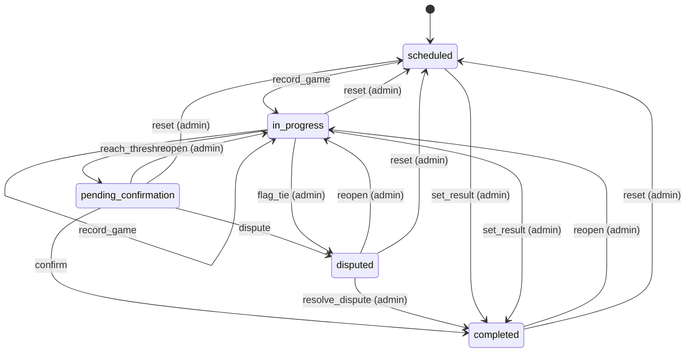
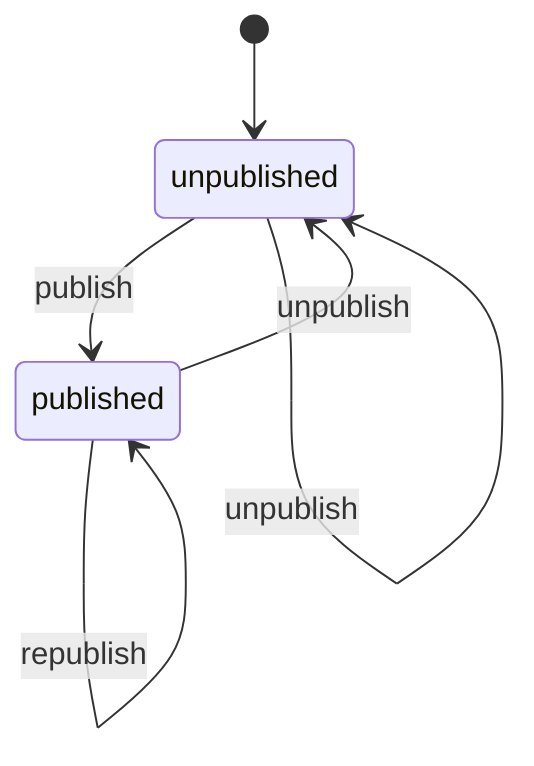
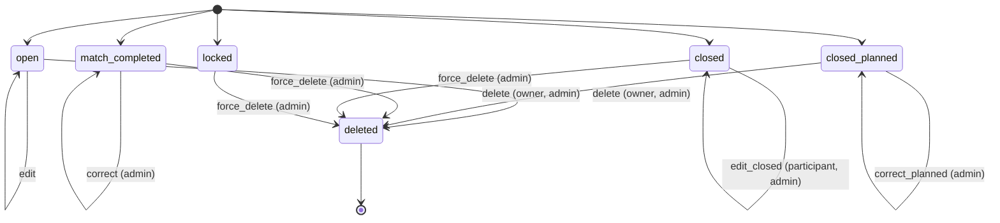
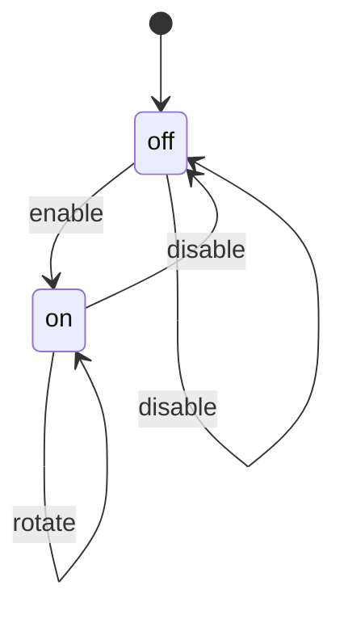

# State machines

<!-- Generated from src/lib/state-machine/registry.ts by `npm run docs:state-machines`. Do not edit by hand: change the machine's definition and regenerate. src/lib/state-machine/__tests__/docs.test.ts fails when this file is stale. -->

Each machine below is a column, timestamp or flag combination that moves through states, defined once, as data, with `defineMachine` (`src/lib/state-machine/machine.ts`). The rules for writers are in AGENTS.md ("Transitions go through the machine"); the decision is ADR 0004 (`docs/adr/0004-explicit-state-machines.md`).

- A writer calls `machine.assertTransition(from, to, actor)` before it writes, and guards the UPDATE with the source states (`.in(column, machine.sourcesOf(to))`, or `.eq(column, from)`), so a row that moved on in between is not overwritten.
- UI derives the available actions from `machine.transitionsFrom(state, actor)` instead of re-listing statuses.
- A refused move is an `IllegalTransitionError` (409, or 403 for the wrong actor) with a catalog code.

## Machines

- [Match](#match) — `matches.status (enum match_status)`
- [Team library publication](#team-library-publication) — `teams.library_published_at (published = set) + library_title, library_description, library_tags`
- [Team roster write locks](#team-roster-write-locks) — `derived: teams.locked, teams.match_id -> matches.status, teams.tournament_id -> tournaments.status/archived -> seasons.status/archived`
- [Team share link](#team-share-link) — `teams.share_token + teams.share_enabled_at (on = both set)`

## Match

- **Id:** `match`
- **State lives in:** matches.status (enum match_status)
- **Module doc:** `docs/match.md`
- **States:** `scheduled`, `in_progress`, `pending_confirmation`, `completed`, `disputed`
- **Actors:** `player`, `admin`

A pairing from scheduling to a confirmed result (spec Section 8). Every status write clears finalized_at; a completion stamps confirmed_at and date_played and clears auto_confirm_at.

| Event | From | To | Actors | Writers | Note |
| --- | --- | --- | --- | --- | --- |
| `record_game` | `scheduled`, `in_progress` | `in_progress` | player, admin | `src/lib/pkmn/game-pipeline.ts` | A game is submitted and the series has no winner yet. |
| `reach_threshold` | `in_progress` | `pending_confirmation` | player, admin | `src/lib/pkmn/game-pipeline.ts` | A game gives one player the wins the best-of needs; auto_confirm_at starts the 24 h clock. |
| `confirm` | `pending_confirmation` | `completed` | player, admin | `src/app/api/confirm-match/[mid]/route.ts` `src/app/api/cron/auto-confirm/route.ts` | The opponent (not the submitter) or an admin confirms, or the auto-confirm cron does after 24 h. |
| `dispute` | `pending_confirmation` | `disputed` | player, admin | `src/app/api/confirm-match/[mid]/route.ts` | A participant flags the result. |
| `resolve_dispute` | `disputed` | `completed` | admin | `src/app/api/confirm-match/[mid]/route.ts` `src/app/api/admin/matches/[id]/result/route.ts` |  |
| `set_result` | `scheduled`, `in_progress` | `completed` | admin | `src/app/api/admin/matches/[id]/result/route.ts` `src/lib/match/bulk-actions.ts` `src/lib/format-engine/runtime/cron.ts` | An admin settles a no-show, a drop or a result agreed outside the app; no confirmation step. |
| `flag_tie` | `in_progress` | `disputed` | admin | `src/lib/pkmn/game-pipeline.ts` | The game pipeline, on the admins' behalf, when a replay is an engine tie. |
| `reopen` | `pending_confirmation`, `completed`, `disputed` | `in_progress` | admin | `src/lib/match/reopen.ts` | Withdraws the result and keeps the games. |
| `reset` | `in_progress`, `pending_confirmation`, `completed`, `disputed` | `scheduled` | admin | `src/lib/pkmn/game-pipeline.ts` | resetMatch / resetRound: deletes the games and rolls their aggregates back. |

## Team library publication

- **Id:** `team.library`
- **State lives in:** teams.library_published_at (published = set) + library_title, library_description, library_tags
- **Module doc:** `docs/teambuilder-reference.md`
- **States:** `unpublished`, `published`
- **Actors:** `owner`, `admin`

A team listed in the public library (/teams/library), forkable by anyone. The owner or a site admin publishes it, and publishing again rewrites the title, description and tags and moves it to the top (library_published_at = now()). The UPDATE is guarded with the library_published_at the route read, so a publish racing another publish or an unpublish answers 409 team_changed. Unpublishing is idempotent and has no UI caller today. Open product question: a team linked to a match that is not played yet (or in a hidden tournament) can be published; kept as is.

| Event | From | To | Actors | Writers | Note |
| --- | --- | --- | --- | --- | --- |
| `publish` | `unpublished` | `published` | owner, admin | `src/app/api/teams/library/route.ts` `src/lib/supabase/queries/teams.ts` |  |
| `republish` | `published` | `published` | owner, admin | `src/app/api/teams/library/route.ts` `src/lib/supabase/queries/teams.ts` | Rewrites the metadata and the timestamp. |
| `unpublish` | `published`, `unpublished` | `unpublished` | owner, admin | `src/app/api/teams/library/route.ts` `src/lib/supabase/queries/teams.ts` | DELETE /api/teams/library clears the timestamp and the metadata. |

## Team roster write locks

- **Id:** `team.roster`
- **State lives in:** derived: teams.locked, teams.match_id -> matches.status, teams.tournament_id -> tournaments.status/archived -> seasons.status/archived
- **Module doc:** `docs/teambuilder-reference.md`
- **States:** `open`, `match_completed`, `closed`, `closed_planned`, `locked`, `deleted`
- **Actors:** `owner`, `participant`, `admin`

Whether a team row may still be edited or deleted, and by whom. The lock is derived on every write from the manual flag teams.locked (no code path sets it today), the closure of its tournament or league (completed or archived) and the status of its linked match, in that order of precedence (teamLockState), so every lock state is an initial state and only the writes themselves are transitions (an edit is a self-loop). Routes ask resolveTeamWriteVerdict, which reads only the facts that can still change the answer. A refusal answers 409 team_locked, 403 with the closure code (team_submission_closed, team_submission_tournament_archived, team_submission_league_closed) or 409 team_match_completed. Creating a team (POST /api/teams) is gated by the closure before any row exists and is not part of this machine. teams.is_draft_team and teams.draft_pool_id are written by no code path and take part in no lock.

| Event | From | To | Actors | Writers | Note |
| --- | --- | --- | --- | --- | --- |
| `edit` | `open` | `open` | owner, participant, admin | `src/app/api/teams/[id]/route.ts` `src/app/api/match-prep/route.ts` `src/lib/supabase/queries/teams.ts` | The UPDATE is guarded with locked = false; a row locked or deleted in between answers 409 team_changed. |
| `correct` | `match_completed` | `match_completed` | admin | `src/app/api/teams/[id]/route.ts` `src/app/api/match-prep/route.ts` `supabase/migrations/20261019120000_teams_completed_match_lock.sql#team_correct_update` | Only an admin correction passes the teams_completed_match_lock trigger; the owner gets 409 team_match_completed, a participant 409 match_prep_match_completed. |
| `edit_closed` | `closed` | `closed` | participant, admin | `src/app/api/match-prep/route.ts` `src/app/api/teams/[id]/route.ts` `supabase/migrations/20261019120000_teams_completed_match_lock.sql#team_correct_update` | The owner gets 403 with the closure code; match prep does not read the closure, so a participant may still save the team of a match that is not completed. |
| `correct_planned` | `closed_planned` | `closed_planned` | admin | `src/app/api/teams/[id]/route.ts` `supabase/migrations/20261019120000_teams_completed_match_lock.sql#team_correct_update` | A planned team (no match) of a closed tournament or league; the owner gets 403 with the closure code. |
| `delete` | `open`, `closed_planned` | `deleted` | owner, admin | `src/app/api/teams/[id]/route.ts` `src/lib/supabase/queries/teams.ts` `supabase/migrations/20261019120000_teams_completed_match_lock.sql#team_correct_delete` | The owner may delete a planned team nobody played with even in a closed tournament; the DELETE is guarded with locked = false. |
| `force_delete` | `match_completed`, `closed`, `locked` | `deleted` | admin | `src/app/api/teams/[id]/route.ts` `src/lib/supabase/queries/teams.ts` `supabase/migrations/20261019120000_teams_completed_match_lock.sql#team_correct_delete` | A site admin deletes any team as a correction. |

## Team share link

- **Id:** `team.share`
- **State lives in:** teams.share_token + teams.share_enabled_at (on = both set)
- **Module doc:** `docs/teambuilder-reference.md`
- **States:** `off`, `on`
- **Actors:** `owner`, `admin`

A secret link that shows the whole roster to anyone holding it (GET /api/teams/shared/[token], /teams/shared/[token]). The owner or a site admin turns it on, and every further POST rotates the token, so the previous link stops working. A link is served only while both columns are set; a row with only one of them reads as off. The token is the compare-and-set guard of the write: a POST whose row changed its token in between answers 409 team_changed. Disabling is idempotent and has no UI caller today.

| Event | From | To | Actors | Writers | Note |
| --- | --- | --- | --- | --- | --- |
| `enable` | `off` | `on` | owner, admin | `src/app/api/teams/share/route.ts` `src/lib/supabase/queries/teams.ts` | POST /api/teams/share: a fresh UUID token and share_enabled_at = now(). |
| `rotate` | `on` | `on` | owner, admin | `src/app/api/teams/share/route.ts` `src/lib/supabase/queries/teams.ts` | The editor's Generate link button POSTs again: a new token replaces the old one. |
| `disable` | `on`, `off` | `off` | owner, admin | `src/app/api/teams/share/route.ts` `src/lib/supabase/queries/teams.ts` | DELETE /api/teams/share clears both columns; on a row without a link it changes nothing and answers 200. |
