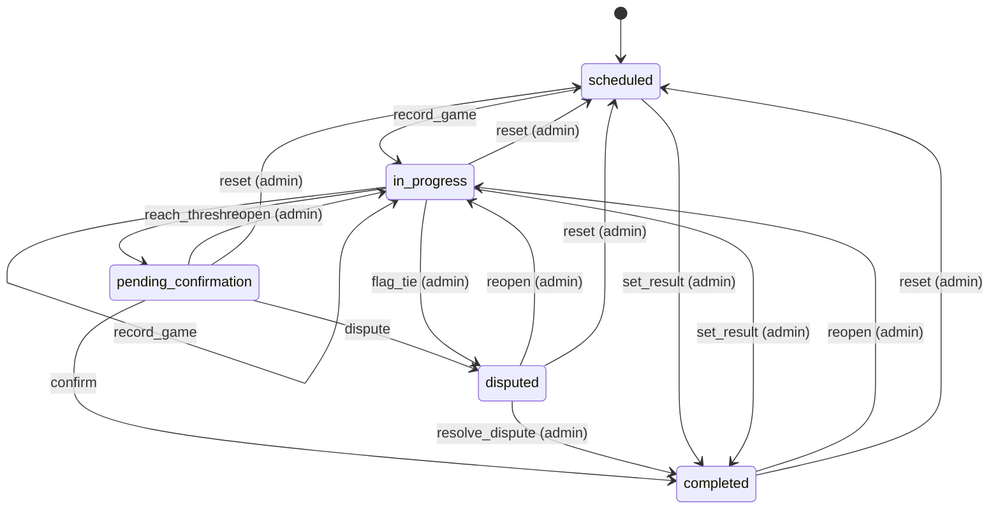
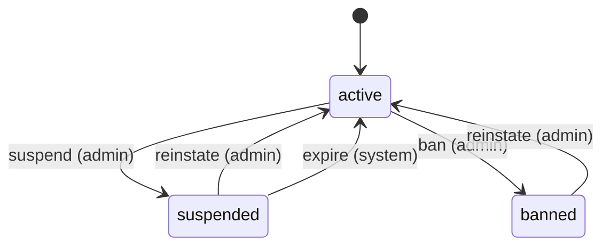

# State machines

<!-- Generated from src/lib/state-machine/registry.ts by `npm run docs:state-machines`. Do not edit by hand: change the machine's definition and regenerate. src/lib/state-machine/__tests__/docs.test.ts fails when this file is stale. -->

Each machine below is a column, timestamp or flag combination that moves through states, defined once, as data, with `defineMachine` (`src/lib/state-machine/machine.ts`). The rules for writers are in AGENTS.md ("Transitions go through the machine"); the decision is ADR 0004 (`docs/adr/0004-explicit-state-machines.md`).

- A writer calls `machine.assertTransition(from, to, actor)` before it writes, and guards the UPDATE with the source states (`.in(column, machine.sourcesOf(to))`, or `.eq(column, from)`), so a row that moved on in between is not overwritten.
- UI derives the available actions from `machine.transitionsFrom(state, actor)` instead of re-listing statuses.
- A refused move is an `IllegalTransitionError` (409, or 403 for the wrong actor) with a catalog code.

## Machines

- [Match](#match) — `matches.status (enum match_status)`
- [Player moderation status](#player-moderation-status) — `players.status (CHECK active | suspended | banned), suspended_until, ban_reason, sessions_valid_after`

## Match

- **Id:** `match`
- **State lives in:** matches.status (enum match_status)
- **Module doc:** `docs/match.md`
- **States:** `scheduled`, `in_progress`, `pending_confirmation`, `completed`, `disputed`
- **Actors:** `player`, `admin`

A pairing from scheduling to a confirmed result (spec Section 8). Every status write clears finalized_at; a completion stamps confirmed_at and date_played and clears auto_confirm_at.

| Event | From | To | Actors | Writers | Note |
| --- | --- | --- | --- | --- | --- |
| `record_game` | `scheduled`, `in_progress` | `in_progress` | player, admin | `src/lib/pkmn/game-pipeline.ts` | A game is submitted and the series has no winner yet. |
| `reach_threshold` | `in_progress` | `pending_confirmation` | player, admin | `src/lib/pkmn/game-pipeline.ts` | A game gives one player the wins the best-of needs; auto_confirm_at starts the 24 h clock. |
| `confirm` | `pending_confirmation` | `completed` | player, admin | `src/app/api/confirm-match/[mid]/route.ts` `src/app/api/cron/auto-confirm/route.ts` | The opponent (not the submitter) or an admin confirms, or the auto-confirm cron does after 24 h. |
| `dispute` | `pending_confirmation` | `disputed` | player, admin | `src/app/api/confirm-match/[mid]/route.ts` | A participant flags the result. |
| `resolve_dispute` | `disputed` | `completed` | admin | `src/app/api/confirm-match/[mid]/route.ts` `src/app/api/admin/matches/[id]/result/route.ts` |  |
| `set_result` | `scheduled`, `in_progress` | `completed` | admin | `src/app/api/admin/matches/[id]/result/route.ts` `src/lib/match/bulk-actions.ts` `src/lib/format-engine/runtime/cron.ts` | An admin settles a no-show, a drop or a result agreed outside the app; no confirmation step. |
| `flag_tie` | `in_progress` | `disputed` | admin | `src/lib/pkmn/game-pipeline.ts` | The game pipeline, on the admins' behalf, when a replay is an engine tie. |
| `reopen` | `pending_confirmation`, `completed`, `disputed` | `in_progress` | admin | `src/lib/match/reopen.ts` | Withdraws the result and keeps the games. |
| `reset` | `in_progress`, `pending_confirmation`, `completed`, `disputed` | `scheduled` | admin | `src/lib/pkmn/game-pipeline.ts` | resetMatch / resetRound: deletes the games and rolls their aggregates back. |

## Player moderation status

- **Id:** `player.status`
- **State lives in:** players.status (CHECK active | suspended | banned), suspended_until, ban_reason, sessions_valid_after
- **Module doc:** `docs/admin.md`
- **States:** `active`, `suspended`, `banned`
- **Actors:** `admin`, `system`

A player is active, suspended until a time, or banned. Only an active player is suspended or banned, and a sanction ends only by reinstating the player (an admin, or the cron once suspended_until has passed). The live require* guards (src/lib/auth/helpers.ts) refuse every status but active; site admins pass the standing check whatever their status (isInGoodStanding), so a sanctioned admin keeps admin access until is_admin is removed. The superadmin row is changed by the superadmin only (superadminPlayerProtectedResponse).

| Event | From | To | Actors | Writers | Note |
| --- | --- | --- | --- | --- | --- |
| `suspend` | `active` | `suspended` | admin | `src/app/api/admin/players/[id]/suspend/route.ts` `src/lib/supabase/queries/players.ts` | Stores suspended_until (a future time), clears ban_reason and ends the sessions the player holds. |
| `ban` | `active` | `banned` | admin | `src/app/api/admin/players/[id]/suspend/route.ts` `src/lib/supabase/queries/players.ts` | Stores ban_reason, clears suspended_until and ends the sessions the player holds. |
| `reinstate` | `suspended`, `banned` | `active` | admin | `src/app/api/admin/players/[id]/unsuspend/route.ts` `src/lib/supabase/queries/players.ts` | Clears suspended_until and ban_reason; the session epoch stays, so tokens from before the sanction stay dead. |
| `expire` | `suspended` | `active` | system | `src/app/api/cron/expire-suspensions/route.ts` `src/lib/supabase/queries/players.ts` | The cron (every 15 min) lifts suspensions whose suspended_until has passed; a banned player has no suspended_until and is never lifted. |
