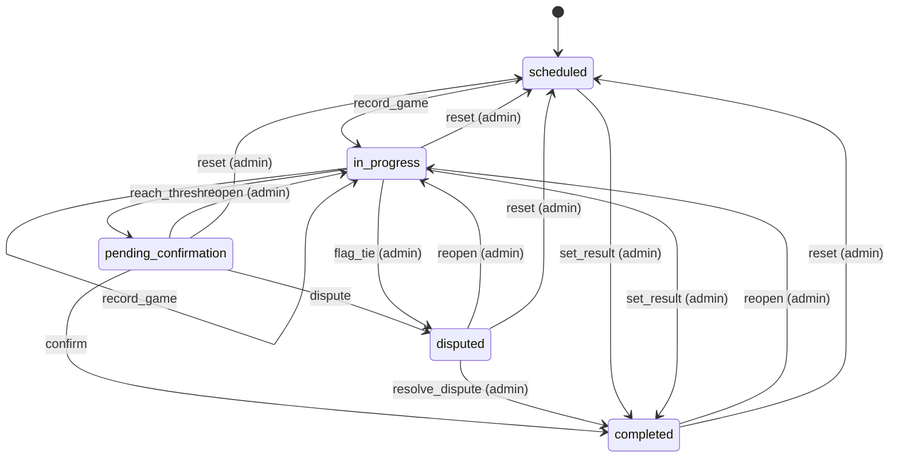
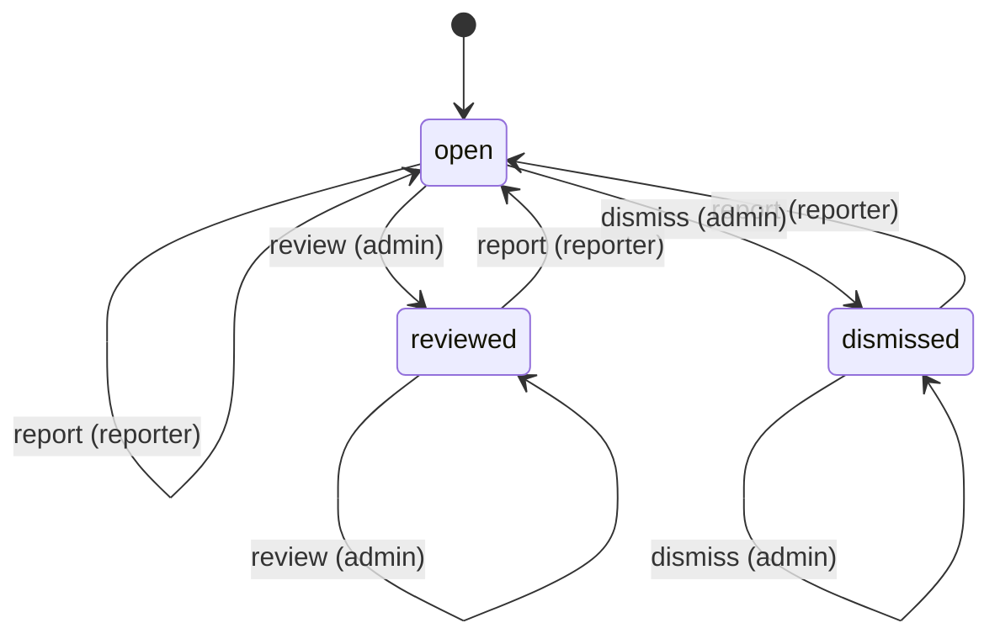
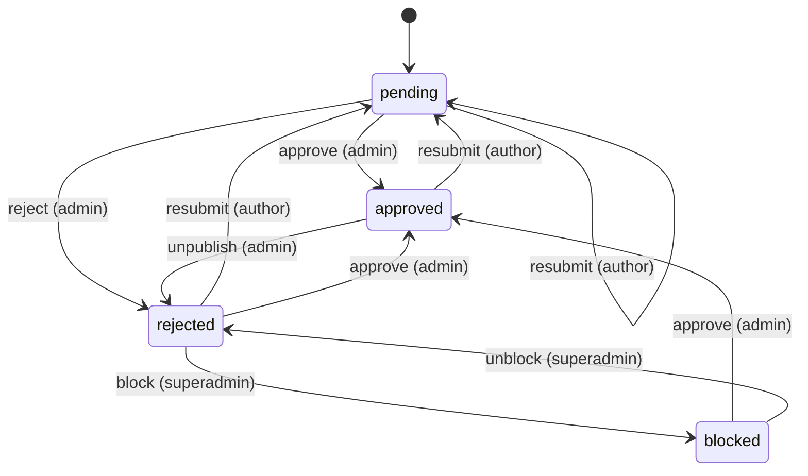

# State machines

<!-- Generated from src/lib/state-machine/registry.ts by `npm run docs:state-machines`. Do not edit by hand: change the machine's definition and regenerate. src/lib/state-machine/__tests__/docs.test.ts fails when this file is stale. -->

Each machine below is a column, timestamp or flag combination that moves through states, defined once, as data, with `defineMachine` (`src/lib/state-machine/machine.ts`). The rules for writers are in AGENTS.md ("Transitions go through the machine"); the decision is ADR 0004 (`docs/adr/0004-explicit-state-machines.md`).

- A writer calls `machine.assertTransition(from, to, actor)` before it writes, and guards the UPDATE with the source states (`.in(column, machine.sourcesOf(to))`, or `.eq(column, from)`), so a row that moved on in between is not overwritten.
- UI derives the available actions from `machine.transitionsFrom(state, actor)` instead of re-listing statuses.
- A refused move is an `IllegalTransitionError` (409, or 403 for the wrong actor) with a catalog code.

## Machines

- [Match](#match) — `matches.status (enum match_status)`
- [Wiki note report](#wiki-note-report) — `wiki_note_reports.status`
- [Wiki note moderation](#wiki-note-moderation) — `wiki_notes.approved + rejected_at + resubmission_blocked_at (derived by noteModerationState)`

## Match

- **Id:** `match`
- **State lives in:** matches.status (enum match_status)
- **Module doc:** `docs/match.md`
- **States:** `scheduled`, `in_progress`, `pending_confirmation`, `completed`, `disputed`
- **Actors:** `player`, `admin`

A pairing from scheduling to a confirmed result (spec Section 8). Every status write clears finalized_at; a completion stamps confirmed_at and date_played and clears auto_confirm_at.

| Event | From | To | Actors | Writers | Note |
| --- | --- | --- | --- | --- | --- |
| `record_game` | `scheduled`, `in_progress` | `in_progress` | player, admin | `src/lib/pkmn/game-pipeline.ts` | A game is submitted and the series has no winner yet. |
| `reach_threshold` | `in_progress` | `pending_confirmation` | player, admin | `src/lib/pkmn/game-pipeline.ts` | A game gives one player the wins the best-of needs; auto_confirm_at starts the 24 h clock. |
| `confirm` | `pending_confirmation` | `completed` | player, admin | `src/app/api/confirm-match/[mid]/route.ts` `src/app/api/cron/auto-confirm/route.ts` | The opponent (not the submitter) or an admin confirms, or the auto-confirm cron does after 24 h. |
| `dispute` | `pending_confirmation` | `disputed` | player, admin | `src/app/api/confirm-match/[mid]/route.ts` | A participant flags the result. |
| `resolve_dispute` | `disputed` | `completed` | admin | `src/app/api/confirm-match/[mid]/route.ts` `src/app/api/admin/matches/[id]/result/route.ts` |  |
| `set_result` | `scheduled`, `in_progress` | `completed` | admin | `src/app/api/admin/matches/[id]/result/route.ts` `src/lib/match/bulk-actions.ts` `src/lib/format-engine/runtime/cron.ts` | An admin settles a no-show, a drop or a result agreed outside the app; no confirmation step. |
| `flag_tie` | `in_progress` | `disputed` | admin | `src/lib/pkmn/game-pipeline.ts` | The game pipeline, on the admins' behalf, when a replay is an engine tie. |
| `reopen` | `pending_confirmation`, `completed`, `disputed` | `in_progress` | admin | `src/lib/match/reopen.ts` | Withdraws the result and keeps the games. |
| `reset` | `in_progress`, `pending_confirmation`, `completed`, `disputed` | `scheduled` | admin | `src/lib/pkmn/game-pipeline.ts` | resetMatch / resetRound: deletes the games and rolls their aggregates back. |

## Wiki note report

- **Id:** `wiki_note_report.status`
- **State lives in:** wiki_note_reports.status
- **Module doc:** `docs/wiki.md`
- **States:** `open`, `reviewed`, `dismissed`
- **Actors:** `reporter`, `admin`

A player report on a live note. A moderator closes an open report as reviewed or dismissed, compare-and-set against the status read, so two moderators cannot close one report two ways; repeating the same close is allowed. Reporting the same note again reopens the reporter's report (UPSERT on note_id, reporter_id).

| Event | From | To | Actors | Writers | Note |
| --- | --- | --- | --- | --- | --- |
| `report` | `open`, `reviewed`, `dismissed` | `open` | reporter | `src/app/api/wiki/notes/[id]/report/route.ts` `src/lib/supabase/queries/wiki-notes.ts` | The reporter reports the note again: the report reopens with the new reason. |
| `review` | `open`, `reviewed` | `reviewed` | admin | `src/app/api/admin/wiki/reports/[id]/route.ts` `src/lib/supabase/queries/wiki-notes.ts` | The moderator acted on the report (for example unpublished the note). |
| `dismiss` | `open`, `dismissed` | `dismissed` | admin | `src/app/api/admin/wiki/reports/[id]/route.ts` `src/lib/supabase/queries/wiki-notes.ts` |  |

## Wiki note moderation

- **Id:** `wiki_note.moderation`
- **State lives in:** wiki_notes.approved + rejected_at + resubmission_blocked_at (derived by noteModerationState)
- **Module doc:** `docs/wiki.md`
- **States:** `pending`, `approved`, `rejected`, `blocked`
- **Actors:** `author`, `admin`, `superadmin`

A community note from submission to a moderator verdict. Only an approved note is public. A moderator approve or reject is compare-and-set against the state and the updated_at the moderator saw, so a verdict on text the author edited meanwhile is refused (wiki_note_changed). A site admin editing the text keeps the state (not a transition); deleting a note removes the row from any state.

| Event | From | To | Actors | Writers | Note |
| --- | --- | --- | --- | --- | --- |
| `resubmit` | `pending`, `approved`, `rejected` | `pending` | author | `src/app/api/wiki/notes/[id]/route.ts` `src/lib/supabase/queries/wiki-notes.ts` | The author edits the text: the note goes back to the queue until a moderator sees it. A blocked note refuses it (wiki_note_resubmission_blocked). |
| `approve` | `pending`, `rejected`, `blocked` | `approved` | admin | `src/app/api/wiki/notes/[id]/route.ts` `src/lib/supabase/queries/wiki-notes.ts` | Publishes the note; approving a blocked note clears the block. |
| `reject` | `pending` | `rejected` | admin | `src/app/api/wiki/notes/[id]/route.ts` `src/lib/supabase/queries/wiki-notes.ts` |  |
| `unpublish` | `approved` | `rejected` | admin | `src/app/api/wiki/notes/[id]/route.ts` `src/lib/supabase/queries/wiki-notes.ts` | Takes a live note out of public view, usually in answer to a report. |
| `block` | `rejected` | `blocked` | superadmin | `src/app/api/wiki/notes/[id]/route.ts` `src/lib/supabase/queries/wiki-notes.ts` | Closes a rejected note for resubmission; it stays rejected. |
| `unblock` | `blocked` | `rejected` | superadmin | `src/app/api/wiki/notes/[id]/route.ts` `src/lib/supabase/queries/wiki-notes.ts` |  |
