# State machines

<!-- Generated from src/lib/state-machine/registry.ts by `npm run docs:state-machines`. Do not edit by hand: change the machine's definition and regenerate. src/lib/state-machine/__tests__/docs.test.ts fails when this file is stale. -->

Each machine below is a column, timestamp or flag combination that moves through states, defined once, as data, with `defineMachine` (`src/lib/state-machine/machine.ts`). The rules for writers are in AGENTS.md ("Transitions go through the machine"); the decision is ADR 0004 (`docs/adr/0004-explicit-state-machines.md`).

- A writer calls `machine.assertTransition(from, to, actor)` before it writes, and guards the UPDATE with the source states (`.in(column, machine.sourcesOf(to))`, or `.eq(column, from)`), so a row that moved on in between is not overwritten.
- UI derives the available actions from `machine.transitionsFrom(state, actor)` instead of re-listing statuses.
- A refused move is an `IllegalTransitionError` (409, or 403 for the wrong actor) with a catalog code.

## Machines

- [Admin Assistant ledger row](#admin-assistant-ledger-row) — `admin_agent_actions.status`
- [Admin Assistant plan](#admin-assistant-plan) — `admin_agent_plans.status`
- [Admin Assistant proposal](#admin-assistant-proposal) — `admin_agent_proposals.status`
- [Cast session](#cast-session) — `cast_sessions.status (CHECK cast_sessions_status_check)`
- [Cast Studio autosave](#cast-studio-autosave) — `CastStudioState.save in src/components/creator/studio/CastStudioContext.tsx (client only)`
- [Draft pool pause](#draft-pool-pause) — `draft_pools.paused_at (+ paused_by, pause_reason) while phase = 'drafting'`
- [Draft pool (queue engine)](#draft-pool-queue-engine) — `draft_pools.phase where engine = 'queue' (+ the status twin)`
- [Draft pool (legacy engine)](#draft-pool-legacy-engine) — `draft_pools.status (enum draft_pool_status) where engine = 'legacy'`
- [Draft slot](#draft-slot) — `draft_slots.status`
- [Draft Kill Token window](#draft-kill-token-window) — `derived: the initial pool's phase, draft_pools.token_purchase_closes_at and the league's completed matches`
- [Match](#match) — `matches.status (enum match_status)`
- [Player moderation status](#player-moderation-status) — `players.status (CHECK active | suspended | banned), suspended_until, ban_reason, sessions_valid_after`
- [Redraft submission window](#redraft-submission-window) — `derived: draft_pools.phase = 'submissions' and submission_deadline_at vs now()`
- [Wiki note report](#wiki-note-report) — `wiki_note_reports.status`
- [Wiki note moderation](#wiki-note-moderation) — `wiki_notes.approved + rejected_at + resubmission_blocked_at (derived by noteModerationState)`

## Admin Assistant ledger row

- **Id:** `admin_agent_action`
- **State lives in:** admin_agent_actions.status
- **Module doc:** `docs/poketools-spec.md`
- **States:** `executing`, `ok`, `failed`, `unknown`, `skipped`, `undone`
- **Actors:** `system`

A dispatched write of the assistant: inserted executing before the dispatch, completed once with its outcome, reconciled from unknown by a Resume, and marked undone after an undo proposal reversed it.

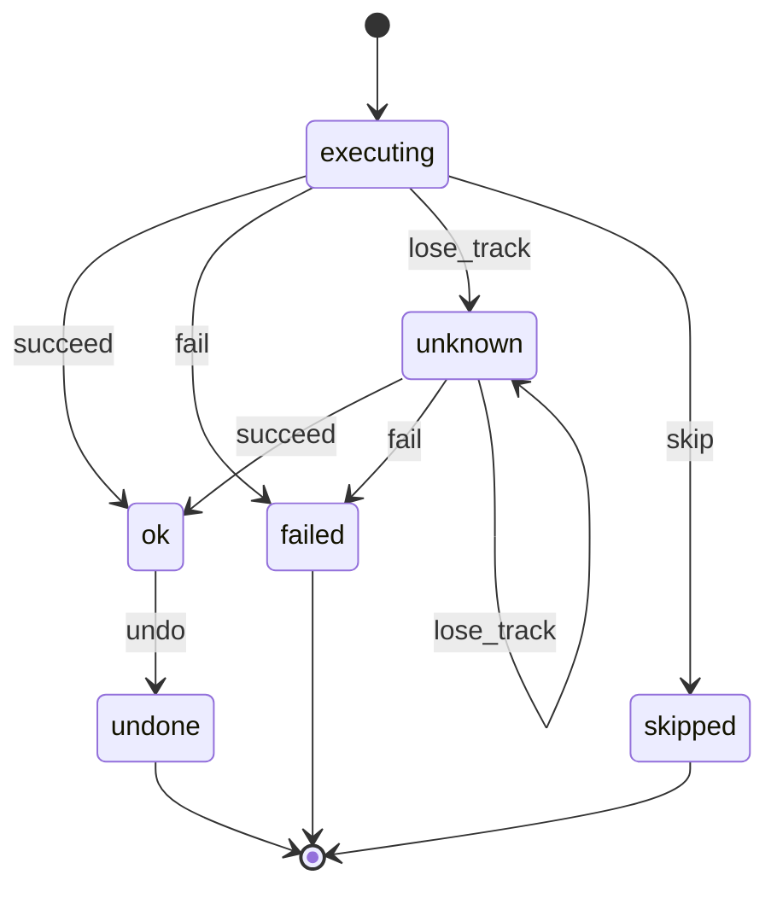

| Event | From | To | Actors | Writers | Note |
| --- | --- | --- | --- | --- | --- |
| `succeed` | `executing`, `unknown` | `ok` | system | `src/lib/ai/admin-agent/proposals/executor.ts` `src/lib/ai/admin-agent/staged/draft-tools.ts` `src/lib/ai/admin-agent/store/actions.ts` | The route answered with the write, or a read-back confirmed it (a Resume reconciling an executing or unknown row). |
| `fail` | `executing`, `unknown` | `failed` | system | `src/lib/ai/admin-agent/proposals/executor.ts` `src/lib/ai/admin-agent/staged/draft-tools.ts` `src/lib/ai/admin-agent/store/actions.ts` | The route refused, or the read-back found the write and still a failure (created_but_unadministrable). |
| `lose_track` | `executing`, `unknown` | `unknown` | system | `src/lib/ai/admin-agent/proposals/executor.ts` `src/lib/ai/admin-agent/staged/draft-tools.ts` `src/lib/ai/admin-agent/store/actions.ts` | The answer did not arrive and the read-back cannot tell (a Resume may write unknown again with the new verify). |
| `skip` | `executing` | `skipped` | system | `src/lib/ai/admin-agent/proposals/executor.ts` `src/lib/ai/admin-agent/staged/draft-tools.ts` `src/lib/ai/admin-agent/store/actions.ts` | Not dispatched: a stale or unreadable precondition, a failed dependency, a call that no longer fits its binding, or a step after the run stopped (inserted and completed at once). |
| `undo` | `ok` | `undone` | system | `src/lib/ai/admin-agent/proposals/executor.ts` `src/lib/ai/admin-agent/store/actions.ts` | markUndone after an undo proposal whose steps for this row all ended ok. |

## Admin Assistant plan

- **Id:** `admin_agent_plan`
- **State lives in:** admin_agent_plans.status
- **Module doc:** `docs/poketools-spec.md`
- **States:** `drafting`, `ready`, `building`, `partial`, `built`, `abandoned`
- **Actors:** `system`

The Plan document of a conversation from drafting to built or abandoned. Not wired yet: no code moves a plan out of drafting (setPlanStatus has no caller), so these transitions describe the intended lifecycle and guard any future writer.

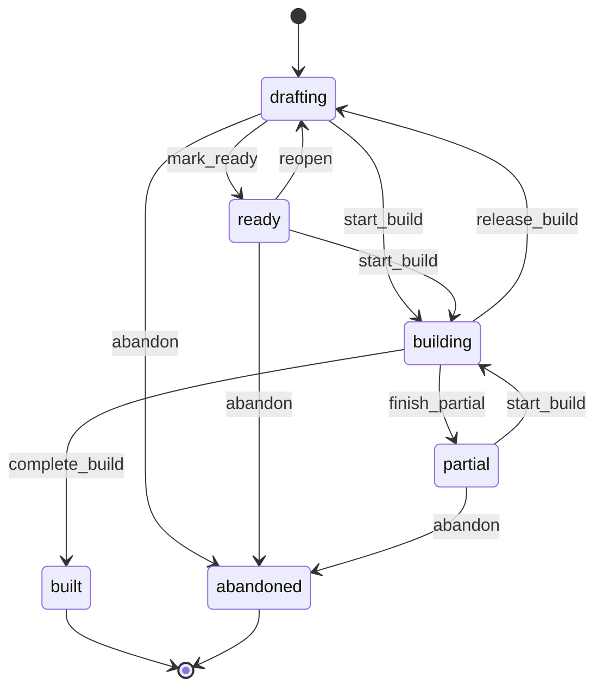

| Event | From | To | Actors | Writers | Note |
| --- | --- | --- | --- | --- | --- |
| `mark_ready` | `drafting` | `ready` | system | `src/lib/ai/admin-agent/store/plans.ts` | Readiness has no blockers (setPlanStatus, or a revision write that names the status). No caller yet. |
| `reopen` | `ready` | `drafting` | system | `src/lib/ai/admin-agent/store/plans.ts` | An edit gives a ready plan blockers again. No caller yet. |
| `start_build` | `drafting`, `ready`, `partial` | `building` | system | `src/lib/ai/admin-agent/store/plans.ts` | A Build proposal of the plan is claimed (stamps build_started_at). No caller yet; propose_build stages only from these states. |
| `complete_build` | `building` | `built` | system | `src/lib/ai/admin-agent/store/plans.ts` | The Build proposal completed (stamps build_finished_at). No caller yet. |
| `finish_partial` | `building` | `partial` | system | `src/lib/ai/admin-agent/store/plans.ts` | The Build ended with some steps written; a fresh Build covers the rest. No caller yet. |
| `release_build` | `building` | `drafting` | system | `src/lib/ai/admin-agent/store/plans.ts` | The Build was refused or wrote nothing (stale, failed before a step). No caller yet. |
| `abandon` | `drafting`, `ready`, `partial` | `abandoned` | system | `src/lib/ai/admin-agent/store/plans.ts` | The admin gives the plan up; a new plan_create is allowed afterwards. No caller yet. |

## Admin Assistant proposal

- **Id:** `admin_agent_proposal`
- **State lives in:** admin_agent_proposals.status
- **Module doc:** `docs/poketools-spec.md`
- **States:** `proposed`, `executing`, `completed`, `partial`, `failed`, `declined`, `expired`, `superseded`, `stale`, `unknown`
- **Actors:** `admin`, `system`

A staged confirmation card: approved (claimed) or declined by its admin, retired by a newer card or plan revision, then ended by the executor or the reaper. Stored expired is never written today: an overdue proposed row is shown as expired by effectiveProposalStatus.

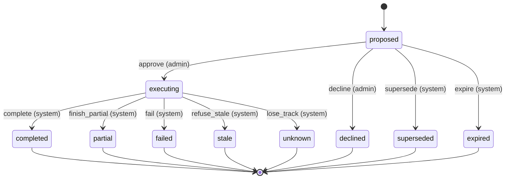

| Event | From | To | Actors | Writers | Note |
| --- | --- | --- | --- | --- | --- |
| `approve` | `proposed` | `executing` | admin | `src/lib/ai/admin-agent/store/proposals.ts` `src/lib/ai/admin-agent/proposals/executor.ts` | claimProposal: one UPDATE bound to the admin, the token hash and an unexpired expires_at; stamps approved_by/at and executing_started_at. |
| `decline` | `proposed` | `declined` | admin | `src/lib/ai/admin-agent/store/proposals.ts` `src/app/api/admin/agent/proposals/[id]/decline/route.ts` | declineProposal stamps finished_at. It does not compare expires_at, so an overdue card can still be declined. |
| `supersede` | `proposed` | `superseded` | system | `src/lib/ai/admin-agent/store/proposals.ts` `src/lib/ai/admin-agent/store/plans.ts` | Staging a card with the same supersede_key, or a plan revision retiring the Build cards of an older revision. |
| `expire` | `proposed` | `expired` | system | `src/lib/ai/admin-agent/store/proposals.ts` | expireProposals (overdue proposed rows of one admin). No caller today; readers derive expired with effectiveProposalStatus. |
| `complete` | `executing` | `completed` | system | `src/lib/ai/admin-agent/proposals/executor.ts` `src/lib/ai/admin-agent/store/proposals.ts` | finishProposal after every step ended ok. |
| `finish_partial` | `executing` | `partial` | system | `src/lib/ai/admin-agent/proposals/executor.ts` `src/lib/ai/admin-agent/store/proposals.ts` | Some steps ok, a later one failed or was skipped. |
| `fail` | `executing` | `failed` | system | `src/lib/ai/admin-agent/proposals/executor.ts` `src/lib/ai/admin-agent/store/proposals.ts` | No step ok and one failed or was skipped, or the blast-radius counter was at its cap after the claim. |
| `refuse_stale` | `executing` | `stale` | system | `src/lib/ai/admin-agent/proposals/executor.ts` `src/lib/ai/admin-agent/store/proposals.ts` | The recheck after the claim (hash, acknowledgements, registry, preconditions) or a stale precondition during the run; the claim is consumed. |
| `lose_track` | `executing` | `unknown` | system | `src/lib/ai/admin-agent/proposals/executor.ts` `src/lib/ai/admin-agent/proposals/reaper.ts` `src/lib/ai/admin-agent/store/proposals.ts` | A Go-live step with an unknown outcome, or the reaper (reapExecutingProposals) ending an execution older than the resume window plus one request. |

## Cast session

- **Id:** `cast_session`
- **State lives in:** cast_sessions.status (CHECK cast_sessions_status_check)
- **Module doc:** `docs/cast-studio.md`
- **States:** `draft`, `live`, `archived`
- **Actors:** `owner`, `admin`

The lifecycle label of a Cast Studio session. A session is created as draft; no screen moves the status today, only a PATCH /api/cast-sessions/[id] that names one, which is guarded with the current status (a status equal to the current one is not a move). The dashboard broadcast page links a match to its first session that is not archived. mode (cast, solo, replaycast) is a type tag picked at creation and edited in the studio, not a lifecycle: it has no machine.

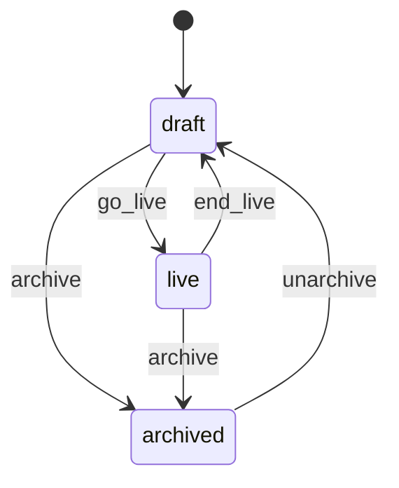

| Event | From | To | Actors | Writers | Note |
| --- | --- | --- | --- | --- | --- |
| `go_live` | `draft` | `live` | owner, admin | `src/app/api/cast-sessions/[id]/route.ts` | The cast starts. |
| `end_live` | `live` | `draft` | owner, admin | `src/app/api/cast-sessions/[id]/route.ts` | The cast ends and the session stays in use. |
| `archive` | `draft`, `live` | `archived` | owner, admin | `src/app/api/cast-sessions/[id]/route.ts` | The session is put away; the dashboard no longer reuses it for its match. |
| `unarchive` | `archived` | `draft` | owner, admin | `src/app/api/cast-sessions/[id]/route.ts` | An archived session comes back as a draft; it goes live from there. |

## Cast Studio autosave

- **Id:** `cast_studio_save`
- **State lives in:** CastStudioState.save in src/components/creator/studio/CastStudioContext.tsx (client only)
- **Module doc:** `docs/cast-studio.md`
- **States:** `idle`, `dirty`, `saving`, `error`
- **Actors:** `caster`, `autosave`

The save badge of the Cast Studio (CastToolbar). Edits from this tab and from another tab over the cast channel both count; one request runs at a time, and its answer is compared with the session as it is when the answer lands (the sent signature). A pagehide sends any unsaved snapshot with keepalive and does not move the state.

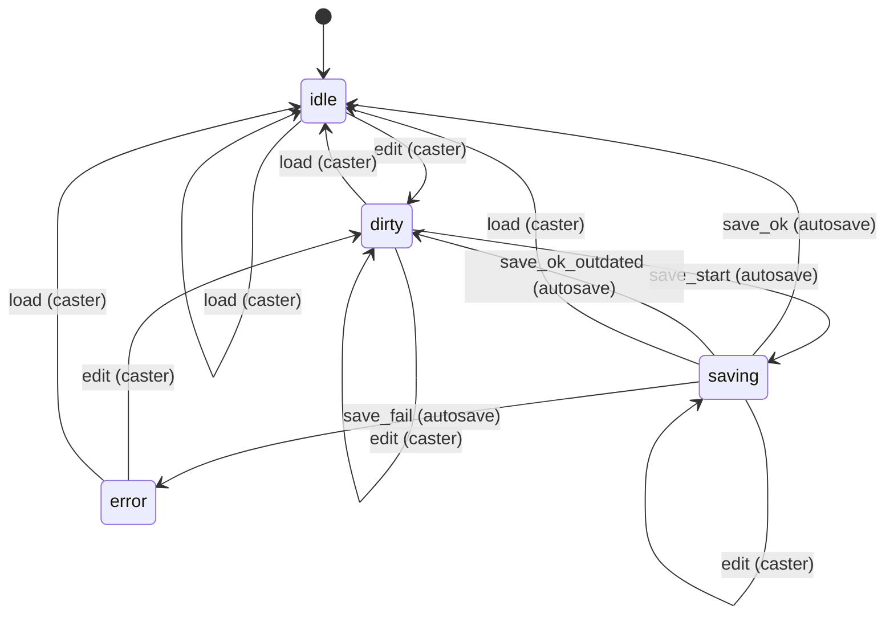

| Event | From | To | Actors | Writers | Note |
| --- | --- | --- | --- | --- | --- |
| `edit` | `idle`, `dirty`, `error` | `dirty` | caster | `src/components/creator/studio/CastStudioContext.tsx` | Any studio action; after a failed save the edit schedules the retry. |
| `edit` | `saving` | `saving` | caster | `src/components/creator/studio/CastStudioContext.tsx` | The running request keeps its snapshot; the sent signature decides when it answers. |
| `save_start` | `dirty` | `saving` | autosave | `src/components/creator/studio/CastStudioContext.tsx` | 5 s after the last edit; never while another save runs. |
| `save_ok` | `saving` | `idle` | autosave | `src/components/creator/studio/CastStudioContext.tsx` | The server stored the snapshot and the session has not changed since it was sent. |
| `save_ok_outdated` | `saving` | `dirty` | autosave | `src/components/creator/studio/CastStudioContext.tsx` | The server stored the snapshot but the session changed while the request ran: the next save follows. |
| `save_fail` | `saving` | `error` | autosave | `src/components/creator/studio/CastStudioContext.tsx` | An HTTP error, success: false, or no answer: the badge shows the failure. |
| `load` | `idle`, `dirty`, `saving`, `error` | `idle` | caster | `src/components/creator/studio/CastStudioContext.tsx` | A stored session replaces the studio state (the load_session action). |

## Draft pool pause

- **Id:** `draft_pool.pause`
- **State lives in:** draft_pools.paused_at (+ paused_by, pause_reason) while phase = 'drafting'
- **Module doc:** `docs/draft-room.md`
- **States:** `running`, `paused`
- **Actors:** `admin`, `system`

A paused pool runs no clock: the active slot's deadline_at is NULL and remaining_ms_at_pause holds its rest, and draft__resolve_timeouts skips the pool. Pick corrections (void, correct, restore a drop) need a paused drafting pool or a complete one (CORRECTION_REQUIRES_PAUSE). pause_reason 'blocked_slot' is retired: nothing writes it any more.

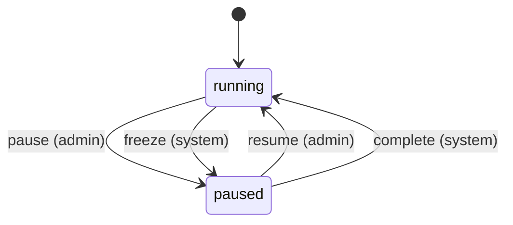

| Event | From | To | Actors | Writers | Note |
| --- | --- | --- | --- | --- | --- |
| `pause` | `running` | `paused` | admin | `supabase/migrations/20261018140100_draft_quiet_hours.sql#draft_set_paused` `src/app/api/drafts/[id]/pause/route.ts` `supabase/migrations/20261018180000_league_groups.sql#draft_admin_void_pick` | A paused pool answers ALREADY_PAUSED; outside drafting DRAFT_NOT_ACTIVE. A complete pool (never paused) reopened by a void also comes back paused. |
| `freeze` | `running` | `paused` | system | `supabase/migrations/20261026091000_league_trash.sql#league_trash_delete` | Moving a league to the recycle bin pauses its running drafts; restoring it keeps them paused. |
| `resume` | `paused` | `running` | admin | `supabase/migrations/20261018140100_draft_quiet_hours.sql#draft_set_paused` `supabase/migrations/20261018140100_draft_quiet_hours.sql#draft__resume` `src/app/api/drafts/[id]/pause/route.ts` | A running pool answers NOT_PAUSED. Restarts the active clock with its remaining time, or activates the next slot. |
| `complete` | `paused` | `running` | system | `supabase/migrations/20261018140200_draft_pool_completability.sql#draft__activate_next` | A restored drop that empties the queue completes the pool, which clears the pause. |

## Draft pool (queue engine)

- **Id:** `draft_pool.phase`
- **State lives in:** draft_pools.phase where engine = 'queue' (+ the status twin)
- **Module doc:** `docs/draft-room.md`
- **States:** `setup`, `submissions`, `drafting`, `complete`, `cancelled`
- **Actors:** `admin`, `system`

An Initial draft starts in setup, a Redraft in submissions (created by draft_create_pool). Every writer sets status next to phase (DRAFT_PHASE_STATUS: setup → pending, submissions and drafting → in_progress, complete and cancelled → complete); no CHECK ties them, so read phase, never status, to tell a cancelled pool from a complete one. Inside drafting the clock can be paused (draft_pool.pause); inside submissions the drops lock when the deadline passes (redraft.submission_window). complete is not terminal: voiding a pick reopens the draft, paused. A pool leaves the machine only by DELETE (setup or cancelled, DELETABLE_QUEUE_PHASES). The system moves run inside reads too: draft_snapshot (GET /api/drafts/[id]/state), draft_my_turn and the draft-ticks cron all call draft__tick.

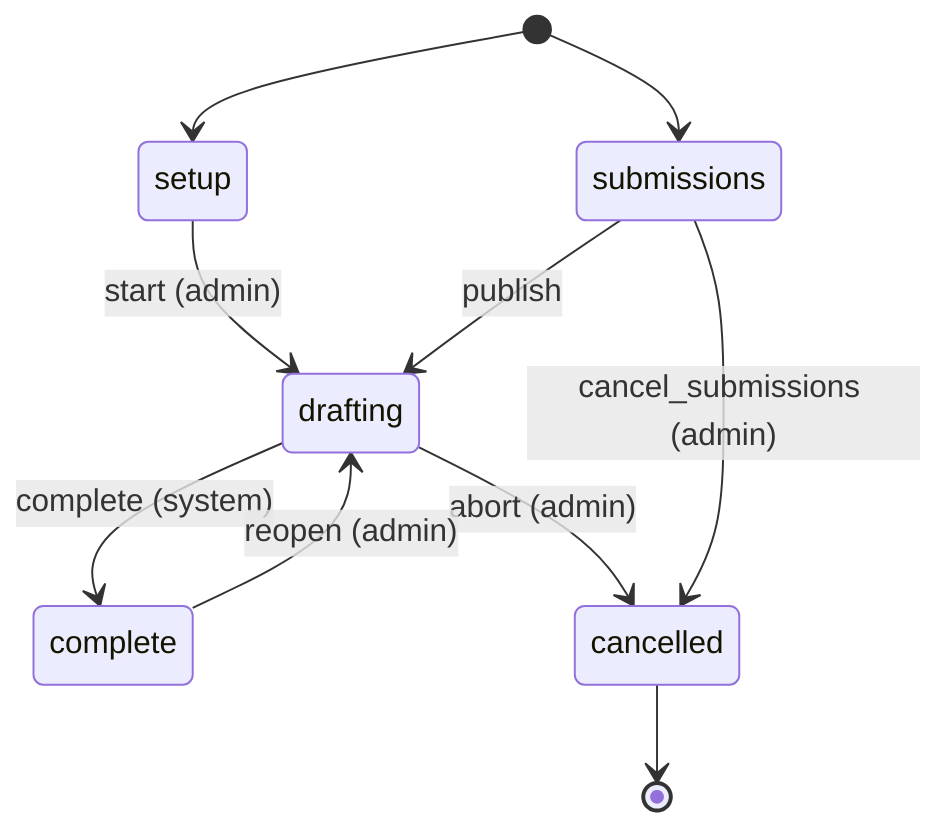

| Event | From | To | Actors | Writers | Note |
| --- | --- | --- | --- | --- | --- |
| `start` | `setup` | `drafting` | admin | `supabase/migrations/20261027190000_draft_start_reroll_every_two_rounds.sql#draft_start` `src/app/api/drafts/[id]/start/route.ts` | Initial drafts only (a Redraft answers SUBMISSION_PHASE); a started pool answers DRAFT_ALREADY_STARTED. Clears any pause. |
| `publish` | `submissions` | `drafting` | admin, system | `supabase/migrations/20261018180000_league_groups.sql#redraft__publish_locked` `supabase/migrations/20261012025023_redraft_rpcs.sql#redraft_publish` `supabase/migrations/20261102150000_draft_list_due_pools.sql#draft__tick` | An admin publishes the drops (before the deadline only with force and a reason), or draft__tick does once the deadline passed; a refused publish stays in submissions with a backoff. |
| `complete` | `drafting` | `complete` | system | `supabase/migrations/20261018140200_draft_pool_completability.sql#draft__activate_next` | The queue runs empty after a pick, a timeout, a resume or a restored drop; clears the pause and stamps ended_at. |
| `abort` | `drafting` | `cancelled` | admin | `supabase/migrations/20261018180000_league_groups.sql#draft_end` `src/app/api/drafts/[id]/end/route.ts` | Initial drafts only (a running Redraft answers DRAFT_ABORT_NOT_ALLOWED): voids every live pick and discards the open slots. |
| `cancel_submissions` | `submissions` | `cancelled` | admin | `supabase/migrations/20261018180000_league_groups.sql#draft_end` `src/app/api/drafts/[id]/end/route.ts` | A Redraft still collecting drops (API only, no button). |
| `reopen` | `complete` | `drafting` | admin | `supabase/migrations/20261018180000_league_groups.sql#draft_admin_void_pick` `src/app/api/drafts/[id]/picks/[pickId]/void/route.ts` `src/app/api/drafts/[id]/picks/[pickId]/correct/route.ts` | Voiding (or correcting) a pick of a complete draft requeues its slot and reopens the draft paused (pause_reason admin, ended_at cleared). The Draft Kill Token window falls back to before. |

## Draft pool (legacy engine)

- **Id:** `draft_pool.status`
- **State lives in:** draft_pools.status (enum draft_pool_status) where engine = 'legacy'
- **Module doc:** `docs/draft-room.md`
- **States:** `pending`, `in_progress`, `complete`
- **Actors:** `admin`, `system`

A pre-queue draft board: an admin opens it to picks, the last pick (or the first state read after it) completes it. The trigger trg_draft_pools_sync_legacy_phase mirrors every status write into phase. An admin may still reopen a complete pool or move a pool back to pending (docs/draft-room.md: retiring a legacy pool of a point-buy season), so no state is terminal; pending → complete is refused (an admin ends a running draft instead).

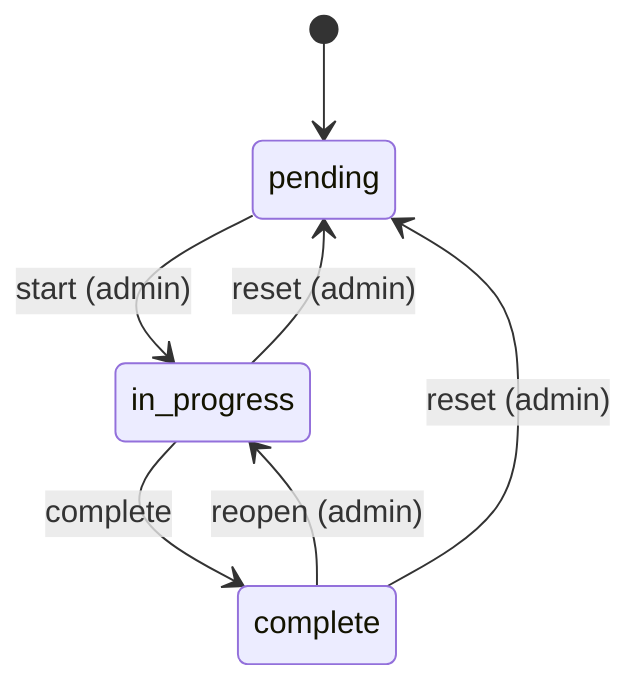

| Event | From | To | Actors | Writers | Note |
| --- | --- | --- | --- | --- | --- |
| `start` | `pending` | `in_progress` | admin | `src/app/api/drafts/[id]/route.ts` `src/lib/supabase/queries/drafts.ts` | DraftBoard Start (and the admin agent's staged propose_draft_activate_legacy_pool). A pool of a point-buy season answers POOL_ENGINE_LEGACY_EPB. |
| `complete` | `in_progress` | `complete` | admin, system | `src/app/api/drafts/[id]/route.ts` `src/app/api/drafts/[id]/picks/route.ts` `src/app/api/drafts/[id]/state/route.ts` `src/lib/supabase/queries/drafts.ts` | An admin ends the draft (DraftBoard End draft), or the system after the last pick: the pick route, else the first GET /api/drafts/[id]/state. |
| `reopen` | `complete` | `in_progress` | admin | `src/app/api/drafts/[id]/route.ts` `src/lib/supabase/queries/drafts.ts` | API only (no button): reopens a finished draft, e.g. to undo its last pick. The next state read completes it again while every pick is made. |
| `reset` | `in_progress`, `complete` | `pending` | admin | `src/app/api/drafts/[id]/route.ts` `src/lib/supabase/queries/drafts.ts` | API only (no button): docs/draft-room.md moves a legacy pool of a point-buy season back to pending so it can be deleted. |

## Draft slot

- **Id:** `draft_slot.status`
- **State lives in:** draft_slots.status
- **Module doc:** `docs/draft-room.md`
- **States:** `pending`, `active`, `done`, `timed_out`
- **Actors:** `player`, `admin`, `system`

A slot is inserted pending (draft_start, the Redraft publish, a timeout's make-up slot, a voided pick's requeued slot). At most one slot of a pool is current (uq_draft_slots_one_current). draft_end and redraft_admin_restore_drop delete pending and active slots instead of moving them. Retired: blocked and forfeited (RETIRED_SLOT_STATUSES) are still allowed by the CHECK and the SlotStatus type, but nothing writes them any more, so they are not states of this machine.

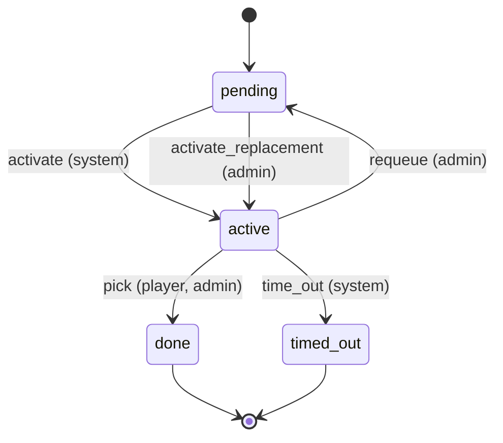

| Event | From | To | Actors | Writers | Note |
| --- | --- | --- | --- | --- | --- |
| `activate` | `pending` | `active` | system | `supabase/migrations/20261018140200_draft_pool_completability.sql#draft__activate_next` | The first pending slot by sort_key gets the clock (none while another slot is current: ACTIVE_SLOT_EXISTS). |
| `activate_replacement` | `pending` | `active` | admin | `supabase/migrations/20261018180000_league_groups.sql#draft_admin_void_pick` | A correction activates the requeued slot and commits the replacement pick in the same statement. |
| `pick` | `active` | `done` | player, admin | `supabase/migrations/20261018180000_league_groups.sql#draft__commit_pick` `supabase/migrations/20261018140200_draft_pool_completability.sql#draft_confirm_pick` | The player on the clock, or an admin override, picks; a wrong slot answers STALE_SLOT. |
| `time_out` | `active` | `timed_out` | system | `supabase/migrations/20261012024916_draft_rpcs.sql#draft__resolve_timeouts` | The deadline passed in an unpaused drafting pool; a make-up slot is queued behind the next player. |
| `requeue` | `active` | `pending` | admin | `supabase/migrations/20261018180000_league_groups.sql#draft_admin_void_pick` | A void puts the current slot back in the queue behind the requeued one. |

## Draft Kill Token window

- **Id:** `draft.kill_token_window`
- **State lives in:** derived: the initial pool's phase, draft_pools.token_purchase_closes_at and the league's completed matches
- **Module doc:** `docs/draft-room.md`
- **States:** `before`, `open`, `closed`
- **Actors:** `admin`, `system`

before until the player's Initial draft is complete; then open until token_purchase_closes_at (or, without one, until the first league match is completed); then closed. Writers are the inputs' writers: the window moves when they change, and is recomputed wherever it is read (tokens overview, TokenCenter, the purchase RPC).

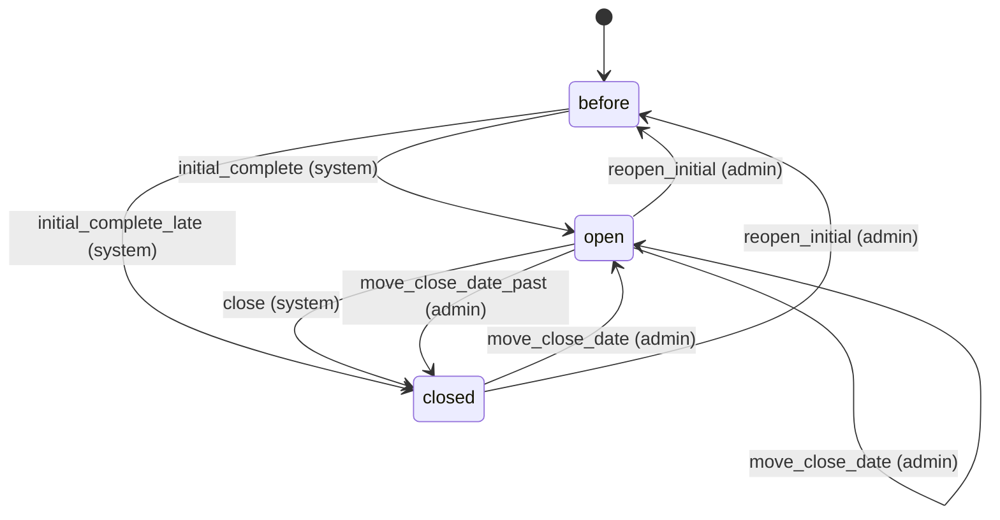

| Event | From | To | Actors | Writers | Note |
| --- | --- | --- | --- | --- | --- |
| `initial_complete` | `before` | `open` | system | `supabase/migrations/20261018140200_draft_pool_completability.sql#draft__activate_next` `src/lib/draft/tokens.ts` `supabase/migrations/20261027193000_draft_token_participation_rate.sql#epb_purchase_draft_token` | The Initial draft completes while the close date is ahead (or none is set and no match is completed). |
| `initial_complete_late` | `before` | `closed` | system | `supabase/migrations/20261018140200_draft_pool_completability.sql#draft__activate_next` `src/lib/draft/tokens.ts` `supabase/migrations/20261027193000_draft_token_participation_rate.sql#epb_purchase_draft_token` | The Initial draft completes after the close date (or after the first completed match). |
| `close` | `open` | `closed` | system | `src/lib/draft/tokens.ts` `supabase/migrations/20261027193000_draft_token_participation_rate.sql#epb_purchase_draft_token` | The close date passes, or without one the first league match is completed. |
| `move_close_date` | `open`, `closed` | `open` | admin | `supabase/migrations/20261018180000_league_groups.sql#draft_configure` `src/app/api/drafts/[id]/config/route.ts` | token_purchase_closes_at is editable in every phase: a later date reopens a closed window (also after matches were played). |
| `move_close_date_past` | `open` | `closed` | admin | `supabase/migrations/20261018180000_league_groups.sql#draft_configure` `src/app/api/drafts/[id]/config/route.ts` | An earlier close date closes the window at once. |
| `reopen_initial` | `open`, `closed` | `before` | admin | `supabase/migrations/20261018180000_league_groups.sql#draft_admin_void_pick` | Voiding a pick of the complete Initial draft reopens it (draft_pool.phase reopen). |

## Match

- **Id:** `match`
- **State lives in:** matches.status (enum match_status)
- **Module doc:** `docs/match.md`
- **States:** `scheduled`, `in_progress`, `pending_confirmation`, `completed`, `disputed`
- **Actors:** `player`, `admin`

A pairing from scheduling to a confirmed result (spec Section 8). Every status write clears finalized_at; a completion stamps confirmed_at and date_played and clears auto_confirm_at.

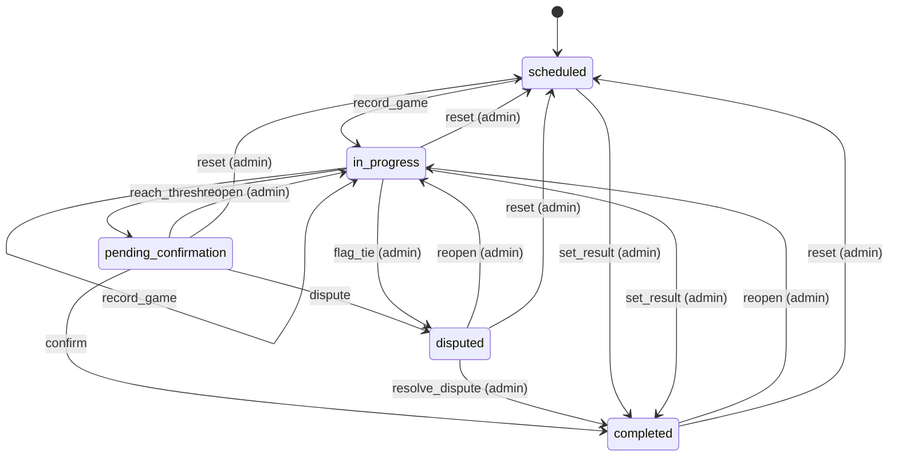

| Event | From | To | Actors | Writers | Note |
| --- | --- | --- | --- | --- | --- |
| `record_game` | `scheduled`, `in_progress` | `in_progress` | player, admin | `src/lib/pkmn/game-pipeline.ts` | A game is submitted and the series has no winner yet. |
| `reach_threshold` | `in_progress` | `pending_confirmation` | player, admin | `src/lib/pkmn/game-pipeline.ts` | A game gives one player the wins the best-of needs; auto_confirm_at starts the 24 h clock. |
| `confirm` | `pending_confirmation` | `completed` | player, admin | `src/app/api/confirm-match/[mid]/route.ts` `src/app/api/cron/auto-confirm/route.ts` | The opponent (not the submitter) or an admin confirms, or the auto-confirm cron does after 24 h. |
| `dispute` | `pending_confirmation` | `disputed` | player, admin | `src/app/api/confirm-match/[mid]/route.ts` | A participant flags the result. |
| `resolve_dispute` | `disputed` | `completed` | admin | `src/app/api/confirm-match/[mid]/route.ts` `src/app/api/admin/matches/[id]/result/route.ts` |  |
| `set_result` | `scheduled`, `in_progress` | `completed` | admin | `src/app/api/admin/matches/[id]/result/route.ts` `src/lib/match/bulk-actions.ts` `src/lib/format-engine/runtime/cron.ts` | An admin settles a no-show, a drop or a result agreed outside the app; no confirmation step. |
| `flag_tie` | `in_progress` | `disputed` | admin | `src/lib/pkmn/game-pipeline.ts` | The game pipeline, on the admins' behalf, when a replay is an engine tie. |
| `reopen` | `pending_confirmation`, `completed`, `disputed` | `in_progress` | admin | `src/lib/match/reopen.ts` | Withdraws the result and keeps the games. |
| `reset` | `in_progress`, `pending_confirmation`, `completed`, `disputed` | `scheduled` | admin | `src/lib/pkmn/game-pipeline.ts` | resetMatch / resetRound: deletes the games and rolls their aggregates back. |

## Player moderation status

- **Id:** `player.status`
- **State lives in:** players.status (CHECK active | suspended | banned), suspended_until, ban_reason, sessions_valid_after
- **Module doc:** `docs/admin.md`
- **States:** `active`, `suspended`, `banned`
- **Actors:** `admin`, `system`

A player is active, suspended until a time, or banned. Only an active player is suspended or banned, and a sanction ends only by reinstating the player (an admin, or the cron once suspended_until has passed). The live require* guards (src/lib/auth/helpers.ts) refuse every status but active; site admins pass the standing check whatever their status (isInGoodStanding), so a sanctioned admin keeps admin access until is_admin is removed. The superadmin row is changed by the superadmin only (superadminPlayerProtectedResponse).

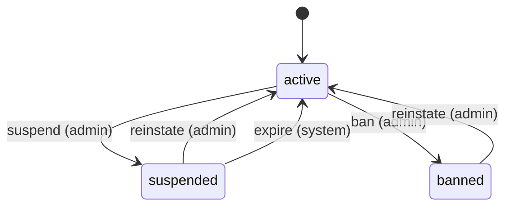

| Event | From | To | Actors | Writers | Note |
| --- | --- | --- | --- | --- | --- |
| `suspend` | `active` | `suspended` | admin | `src/app/api/admin/players/[id]/suspend/route.ts` `src/lib/supabase/queries/players.ts` | Stores suspended_until (a future time), clears ban_reason and ends the sessions the player holds. |
| `ban` | `active` | `banned` | admin | `src/app/api/admin/players/[id]/suspend/route.ts` `src/lib/supabase/queries/players.ts` | Stores ban_reason, clears suspended_until and ends the sessions the player holds. |
| `reinstate` | `suspended`, `banned` | `active` | admin | `src/app/api/admin/players/[id]/unsuspend/route.ts` `src/lib/supabase/queries/players.ts` | Clears suspended_until and ban_reason; the session epoch stays, so tokens from before the sanction stay dead. |
| `expire` | `suspended` | `active` | system | `src/app/api/cron/expire-suspensions/route.ts` `src/lib/supabase/queries/players.ts` | The cron (every 15 min) lifts suspensions whose suspended_until has passed; a banned player has no suspended_until and is never lifted. |

## Redraft submission window

- **Id:** `redraft.submission_window`
- **State lives in:** derived: draft_pools.phase = 'submissions' and submission_deadline_at vs now()
- **Module doc:** `docs/draft-room.md`
- **States:** `open`, `locked`
- **Actors:** `admin`, `system`

Players change their secret drops while the window is open. The lock is time, not a write, so the client (server-offset clock) and SQL (now()) can disagree for a moment; SQL decides. Moving the deadline into the future reopens a locked window.

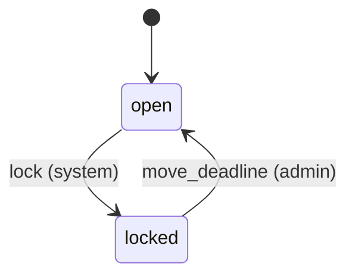

| Event | From | To | Actors | Writers | Note |
| --- | --- | --- | --- | --- | --- |
| `lock` | `open` | `locked` | system | `supabase/migrations/20261018180000_league_groups.sql#draft__build_snapshot` `supabase/migrations/20261018180000_league_groups.sql#redraft_set_submission` `src/lib/supabase/queries/drafts-redraft.ts` | The deadline passes (derived where it is read). |
| `move_deadline` | `locked` | `open` | admin | `supabase/migrations/20261018180000_league_groups.sql#draft_configure` `src/app/api/drafts/[id]/redraft/route.ts` | PATCH /api/drafts/[id]/redraft with a future deadline_at (submissions phase only). |

## Wiki note report

- **Id:** `wiki_note_report.status`
- **State lives in:** wiki_note_reports.status
- **Module doc:** `docs/wiki.md`
- **States:** `open`, `reviewed`, `dismissed`
- **Actors:** `reporter`, `admin`

A player report on a live note. A moderator closes an open report as reviewed or dismissed, compare-and-set against the status read, so two moderators cannot close one report two ways; repeating the same close is allowed. Reporting the same note again reopens the reporter's report (UPSERT on note_id, reporter_id).

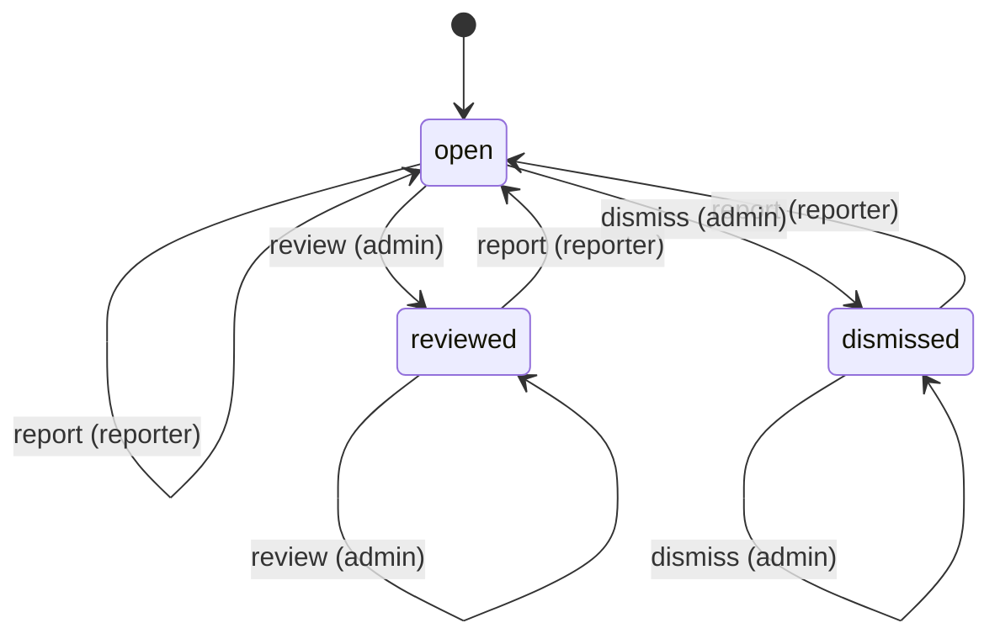

| Event | From | To | Actors | Writers | Note |
| --- | --- | --- | --- | --- | --- |
| `report` | `open`, `reviewed`, `dismissed` | `open` | reporter | `src/app/api/wiki/notes/[id]/report/route.ts` `src/lib/supabase/queries/wiki-notes.ts` | The reporter reports the note again: the report reopens with the new reason. |
| `review` | `open`, `reviewed` | `reviewed` | admin | `src/app/api/admin/wiki/reports/[id]/route.ts` `src/lib/supabase/queries/wiki-notes.ts` | The moderator acted on the report (for example unpublished the note). |
| `dismiss` | `open`, `dismissed` | `dismissed` | admin | `src/app/api/admin/wiki/reports/[id]/route.ts` `src/lib/supabase/queries/wiki-notes.ts` |  |

## Wiki note moderation

- **Id:** `wiki_note.moderation`
- **State lives in:** wiki_notes.approved + rejected_at + resubmission_blocked_at (derived by noteModerationState)
- **Module doc:** `docs/wiki.md`
- **States:** `pending`, `approved`, `rejected`, `blocked`
- **Actors:** `author`, `admin`, `superadmin`

A community note from submission to a moderator verdict. Only an approved note is public. A moderator approve or reject is compare-and-set against the state and the updated_at the moderator saw, so a verdict on text the author edited meanwhile is refused (wiki_note_changed). A site admin editing the text keeps the state (not a transition); deleting a note removes the row from any state.

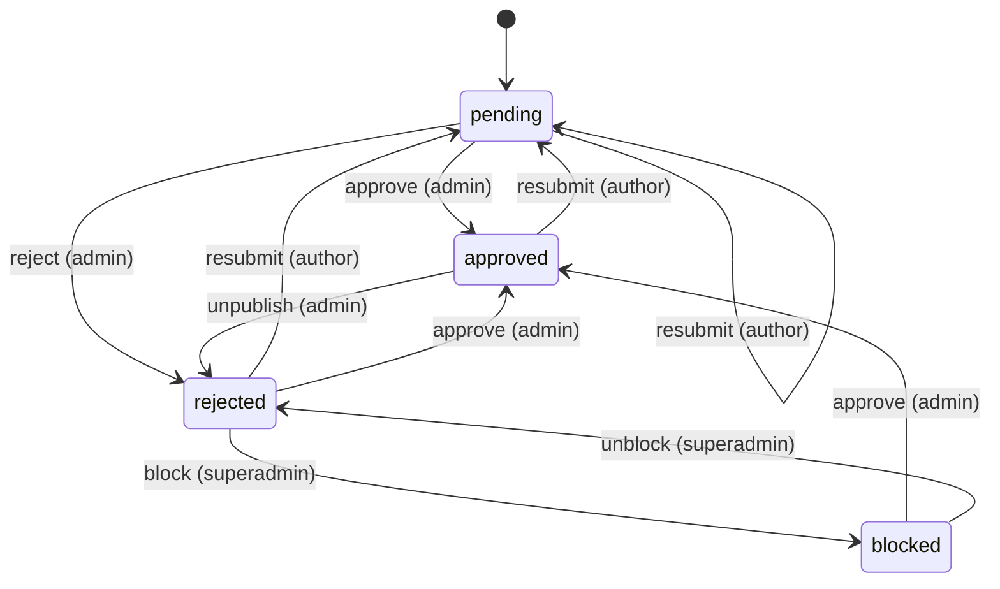

| Event | From | To | Actors | Writers | Note |
| --- | --- | --- | --- | --- | --- |
| `resubmit` | `pending`, `approved`, `rejected` | `pending` | author | `src/app/api/wiki/notes/[id]/route.ts` `src/lib/supabase/queries/wiki-notes.ts` | The author edits the text: the note goes back to the queue until a moderator sees it. A blocked note refuses it (wiki_note_resubmission_blocked). |
| `approve` | `pending`, `rejected`, `blocked` | `approved` | admin | `src/app/api/wiki/notes/[id]/route.ts` `src/lib/supabase/queries/wiki-notes.ts` | Publishes the note; approving a blocked note clears the block. |
| `reject` | `pending` | `rejected` | admin | `src/app/api/wiki/notes/[id]/route.ts` `src/lib/supabase/queries/wiki-notes.ts` |  |
| `unpublish` | `approved` | `rejected` | admin | `src/app/api/wiki/notes/[id]/route.ts` `src/lib/supabase/queries/wiki-notes.ts` | Takes a live note out of public view, usually in answer to a report. |
| `block` | `rejected` | `blocked` | superadmin | `src/app/api/wiki/notes/[id]/route.ts` `src/lib/supabase/queries/wiki-notes.ts` | Closes a rejected note for resubmission; it stays rejected. |
| `unblock` | `blocked` | `rejected` | superadmin | `src/app/api/wiki/notes/[id]/route.ts` `src/lib/supabase/queries/wiki-notes.ts` |  |
