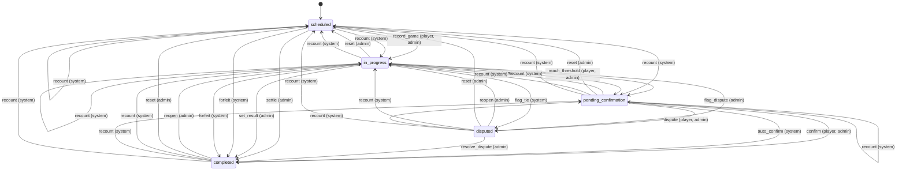
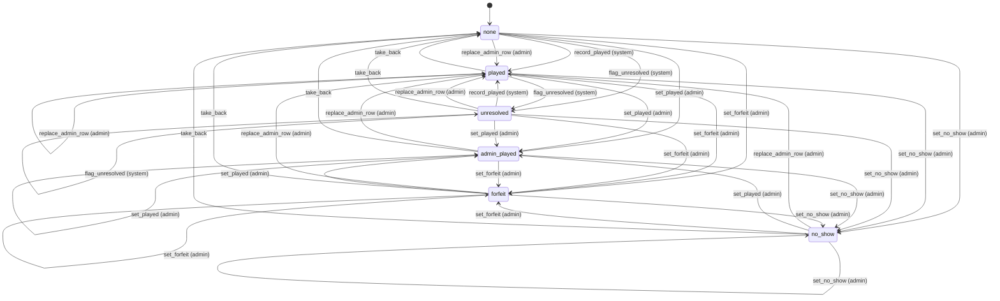

# State machines

<!-- Generated from src/lib/state-machine/registry.ts by `npm run docs:state-machines`. Do not edit by hand: change the machine's definition and regenerate. src/lib/state-machine/__tests__/docs.test.ts fails when this file is stale. -->

Each machine below is a column, timestamp or flag combination that moves through states, defined once, as data, with `defineMachine` (`src/lib/state-machine/machine.ts`). The rules for writers are in AGENTS.md ("Transitions go through the machine"); the decision is ADR 0004 (`docs/adr/0004-explicit-state-machines.md`).

- A writer calls `machine.assertTransition(from, to, actor)` before it writes, and guards the UPDATE with the source states (`.in(column, machine.sourcesOf(to))`, or `.eq(column, from)`), so a row that moved on in between is not overwritten.
- UI derives the available actions from `machine.transitionsFrom(state, actor)` instead of re-listing statuses.
- A refused move is an `IllegalTransitionError` (409, or 403 for the wrong actor) with a catalog code.

## Machines

- [Match](#match) — `matches.status (enum match_status) with confirmed_at, auto_confirm_at, date_played and finalized_at`
- [Match outcome](#match-outcome) — `match_outcomes.kind with source = 'admin' (row absent = none)`

## Match

- **Id:** `match`
- **State lives in:** matches.status (enum match_status) with confirmed_at, auto_confirm_at, date_played and finalized_at
- **Module doc:** `docs/match.md`
- **States:** `scheduled`, `in_progress`, `pending_confirmation`, `completed`, `disputed`
- **Actors:** `player`, `admin`, `system`

A pairing from scheduling to a confirmed result (spec Section 8). Every status write takes its timestamps from matchTimestampsFor: it clears finalized_at, a completion stamps confirmed_at and date_played and clears auto_confirm_at, a move into pending_confirmation starts the auto-confirm deadline of the result source, and a move back clears the result timestamps.

| Event | From | To | Actors | Writers | Note |
| --- | --- | --- | --- | --- | --- |
| `record_game` | `scheduled`, `in_progress` | `in_progress` | player, admin | `src/lib/pkmn/game-pipeline.ts` | A game is submitted and the series has no winner yet. |
| `reach_threshold` | `in_progress` | `pending_confirmation` | player, admin | `src/lib/pkmn/game-pipeline.ts` | A game gives one player the wins the best-of needs; auto_confirm_at starts the deadline of the result source (24 h for a replay, 48 h for a screenshot, none for a manual result without one). |
| `confirm` | `pending_confirmation` | `completed` | player, admin | `src/app/api/confirm-match/[mid]/route.ts` `src/lib/match/bulk-actions.ts` | The opponent (not the submitter) or an admin confirms the reported result. |
| `auto_confirm` | `pending_confirmation` | `completed` | system | `src/app/api/cron/auto-confirm/route.ts` | The auto-confirm cron, once auto_confirm_at has passed; a result without a deadline waits for a person. |
| `dispute` | `pending_confirmation` | `disputed` | player, admin | `src/app/api/confirm-match/[mid]/route.ts` | A participant (or an admin) flags the reported result. |
| `resolve_dispute` | `disputed` | `completed` | admin | `src/app/api/confirm-match/[mid]/route.ts` |  |
| `settle` | `scheduled` | `completed` | admin | `src/app/api/admin/matches/[id]/result/route.ts` | An admin records a result for a match that was never played (a no-show, a drop, a result agreed outside the app), with a reason; no confirmation step. |
| `set_result` | `in_progress` | `completed` | admin | `src/app/api/confirm-match/[mid]/route.ts` `src/app/api/admin/matches/[id]/result/route.ts` | An admin completes a running series directly; no confirmation step. |
| `forfeit` | `scheduled`, `in_progress` | `completed` | system | `src/lib/format-engine/runtime/cron.ts` `supabase/migrations/20261105090000_format_runtime.sql#format_forfeit_complete` | The format cron completes a match as a deadline forfeit when one side registered no team. |
| `flag_dispute` | `in_progress` | `disputed` | admin | `src/app/api/confirm-match/[mid]/route.ts` | An admin marks a running series disputed. |
| `flag_tie` | `in_progress` | `disputed` | system | `src/lib/pkmn/game-pipeline.ts` | The game pipeline, on the admins' behalf, when a replay is an engine tie (no draws are scored). |
| `reopen` | `pending_confirmation`, `completed`, `disputed` | `in_progress` | admin | `src/lib/match/reopen.ts` | Withdraws the result and keeps the games. |
| `reset` | `in_progress`, `pending_confirmation`, `completed`, `disputed` | `scheduled` | admin | `src/lib/pkmn/game-pipeline.ts` | resetMatch / resetRound: deletes the games and rolls their aggregates back. |
| `recount` | `scheduled`, `in_progress`, `pending_confirmation`, `completed`, `disputed` | `in_progress` | system | `src/lib/pkmn/game-pipeline.ts` | After an admin edits or deletes a game, the status follows the remaining games (reevaluateMatchStatus): games left, best-of not reached. |
| `recount` | `scheduled`, `in_progress`, `pending_confirmation`, `completed`, `disputed` | `pending_confirmation` | system | `src/lib/pkmn/game-pipeline.ts` | As above, best-of still reached: the result waits for a confirmation again, without an auto-confirm deadline (one already running is kept). |
| `recount` | `scheduled`, `in_progress`, `pending_confirmation`, `completed`, `disputed` | `scheduled` | system | `src/lib/pkmn/game-pipeline.ts` | As above, no game left. |

## Match outcome

- **Id:** `match_outcome`
- **State lives in:** match_outcomes.kind with source = 'admin' (row absent = none)
- **Module doc:** `docs/match.md`
- **States:** `none`, `played`, `unresolved`, `admin_played`, `forfeit`, `no_show`
- **Actors:** `system`, `admin`

How a decided or unresolvable match ended, next to matches.winner_id. A system write never replaces an admin row (it is kept, the RPC answers kept); an admin result is staged before its status write and only while the match is not completed (p_open_only), and is taken back when that write loses. Standings score the outcome of a completed match only.

| Event | From | To | Actors | Writers | Note |
| --- | --- | --- | --- | --- | --- |
| `record_played` | `none`, `played`, `unresolved` | `played` | system | `src/lib/match/finalize.ts` `supabase/migrations/20261104090000_match_outcomes.sql#match_outcome_record` | Finalize of a completed match: the faint tally of its games (source replay or manual). |
| `replace_admin_row` | `none`, `played`, `unresolved`, `admin_played`, `forfeit`, `no_show` | `played` | admin | `src/lib/match/finalize.ts` `supabase/migrations/20261104090000_match_outcomes.sql#match_outcome_record` | Finalize asked to replace an admin row (replaceAdminRow): a forced write of the played tally. |
| `flag_unresolved` | `none`, `played`, `unresolved` | `unresolved` | system | `src/lib/pkmn/game-pipeline.ts` `src/lib/match/finalize.ts` `supabase/migrations/20261104090000_match_outcomes.sql#match_outcome_record` | A replay engine tie disputes the match; the row is never scored. |
| `set_played` | `none`, `played`, `unresolved`, `admin_played`, `forfeit`, `no_show` | `admin_played` | admin | `src/app/api/admin/matches/[id]/result/route.ts` `src/lib/match/finalize.ts` `supabase/migrations/20261104090000_match_outcomes.sql#match_outcome_record` | An admin records the result as played, with a reason. |
| `set_forfeit` | `none`, `played`, `unresolved`, `admin_played`, `forfeit`, `no_show` | `forfeit` | admin | `src/app/api/admin/matches/[id]/result/route.ts` `src/lib/format-engine/runtime/cron.ts` `src/lib/match/finalize.ts` `supabase/migrations/20261104090000_match_outcomes.sql#match_outcome_record` | An admin records a forfeit, or the format cron a deadline forfeit. |
| `set_no_show` | `none`, `played`, `unresolved`, `admin_played`, `forfeit`, `no_show` | `no_show` | admin | `src/app/api/admin/matches/[id]/result/route.ts` `src/lib/match/finalize.ts` `supabase/migrations/20261104090000_match_outcomes.sql#match_outcome_record` |  |
| `take_back` | `played`, `unresolved`, `admin_played`, `forfeit`, `no_show` | `none` | system, admin | `src/lib/match/outcome-takeback.ts` `src/lib/match/finalize.ts` `src/app/api/admin/matches/[id]/result/route.ts` `src/lib/supabase/queries/match-outcomes.ts` | The match leaves completed or disputed (reset, reopen, a game change), or a staged admin row whose status write lost; deleted by its set_at. |
