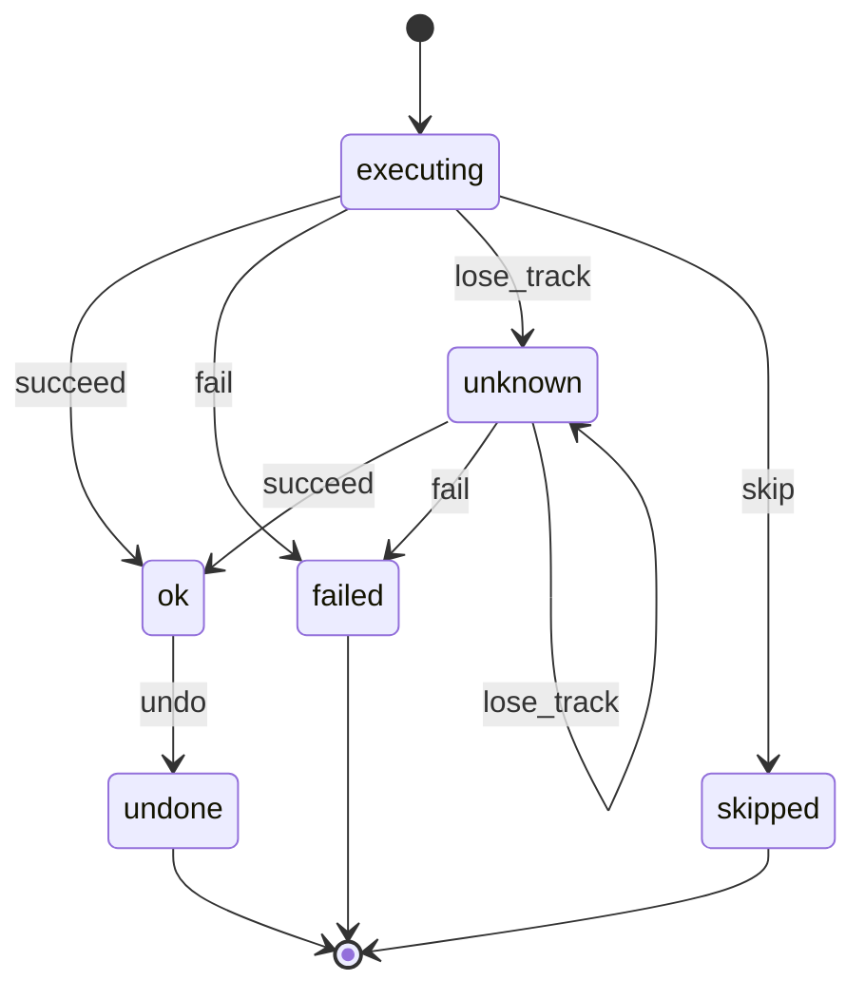
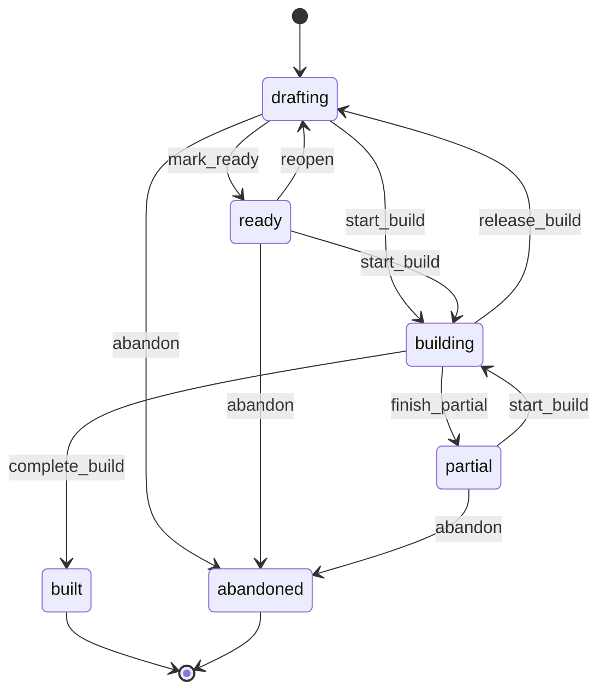
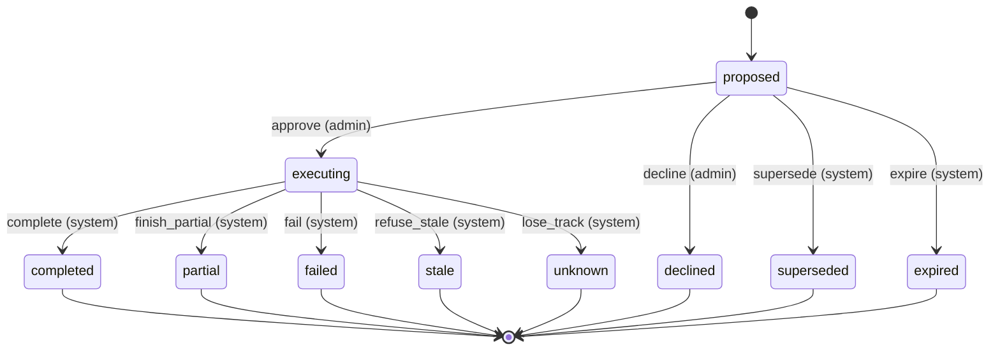
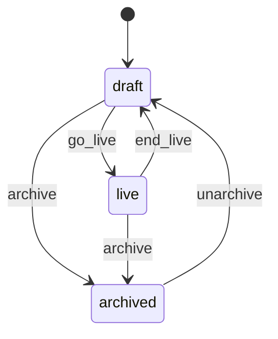
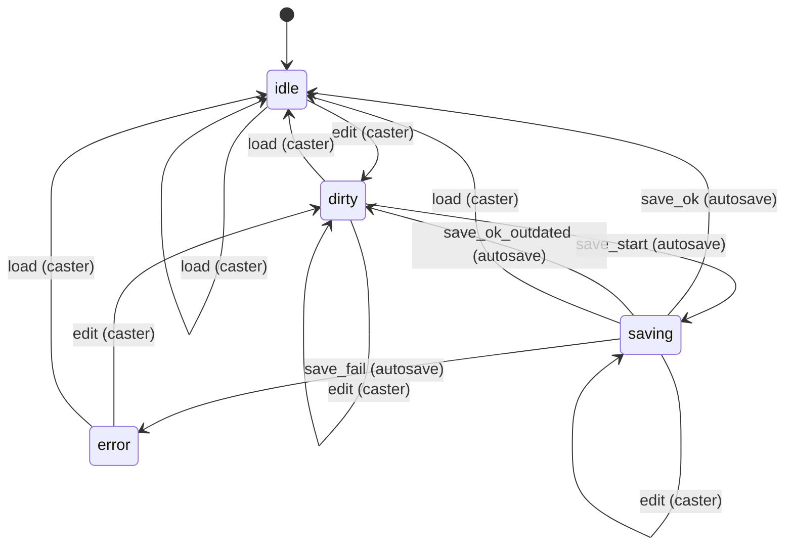
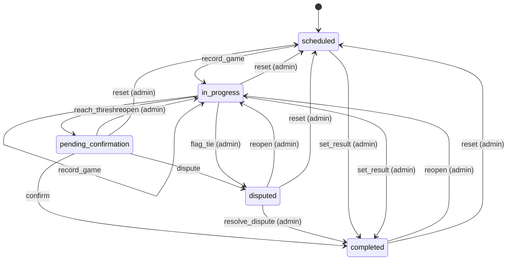
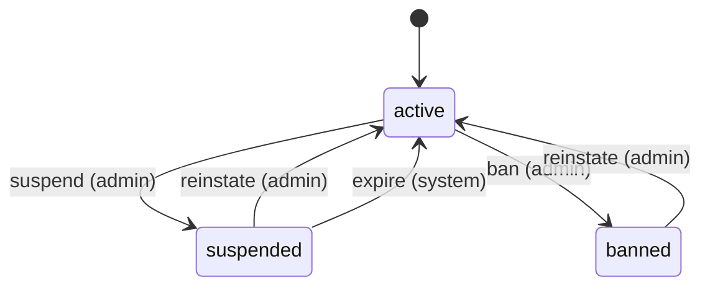

# State machines

<!-- Generated from src/lib/state-machine/registry.ts by `npm run docs:state-machines`. Do not edit by hand: change the machine's definition and regenerate. src/lib/state-machine/__tests__/docs.test.ts fails when this file is stale. -->

Each machine below is a column, timestamp or flag combination that moves through states, defined once, as data, with `defineMachine` (`src/lib/state-machine/machine.ts`). The rules for writers are in AGENTS.md ("Transitions go through the machine"); the decision is ADR 0004 (`docs/adr/0004-explicit-state-machines.md`).

- A writer calls `machine.assertTransition(from, to, actor)` before it writes, and guards the UPDATE with the source states (`.in(column, machine.sourcesOf(to))`, or `.eq(column, from)`), so a row that moved on in between is not overwritten.
- UI derives the available actions from `machine.transitionsFrom(state, actor)` instead of re-listing statuses.
- A refused move is an `IllegalTransitionError` (409, or 403 for the wrong actor) with a catalog code.

## Machines

- [Admin Assistant ledger row](#admin-assistant-ledger-row) — `admin_agent_actions.status`
- [Admin Assistant plan](#admin-assistant-plan) — `admin_agent_plans.status`
- [Admin Assistant proposal](#admin-assistant-proposal) — `admin_agent_proposals.status`
- [Cast session](#cast-session) — `cast_sessions.status (CHECK cast_sessions_status_check)`
- [Cast Studio autosave](#cast-studio-autosave) — `CastStudioState.save in src/components/creator/studio/CastStudioContext.tsx (client only)`
- [Match](#match) — `matches.status (enum match_status)`
- [Player moderation status](#player-moderation-status) — `players.status (CHECK active | suspended | banned), suspended_until, ban_reason, sessions_valid_after`

## Admin Assistant ledger row

- **Id:** `admin_agent_action`
- **State lives in:** admin_agent_actions.status
- **Module doc:** `docs/poketools-spec.md`
- **States:** `executing`, `ok`, `failed`, `unknown`, `skipped`, `undone`
- **Actors:** `system`

A dispatched write of the assistant: inserted executing before the dispatch, completed once with its outcome, reconciled from unknown by a Resume, and marked undone after an undo proposal reversed it.

| Event | From | To | Actors | Writers | Note |
| --- | --- | --- | --- | --- | --- |
| `succeed` | `executing`, `unknown` | `ok` | system | `src/lib/ai/admin-agent/proposals/executor.ts` `src/lib/ai/admin-agent/staged/draft-tools.ts` `src/lib/ai/admin-agent/store/actions.ts` | The route answered with the write, or a read-back confirmed it (a Resume reconciling an executing or unknown row). |
| `fail` | `executing`, `unknown` | `failed` | system | `src/lib/ai/admin-agent/proposals/executor.ts` `src/lib/ai/admin-agent/staged/draft-tools.ts` `src/lib/ai/admin-agent/store/actions.ts` | The route refused, or the read-back found the write and still a failure (created_but_unadministrable). |
| `lose_track` | `executing`, `unknown` | `unknown` | system | `src/lib/ai/admin-agent/proposals/executor.ts` `src/lib/ai/admin-agent/staged/draft-tools.ts` `src/lib/ai/admin-agent/store/actions.ts` | The answer did not arrive and the read-back cannot tell (a Resume may write unknown again with the new verify). |
| `skip` | `executing` | `skipped` | system | `src/lib/ai/admin-agent/proposals/executor.ts` `src/lib/ai/admin-agent/staged/draft-tools.ts` `src/lib/ai/admin-agent/store/actions.ts` | Not dispatched: a stale or unreadable precondition, a failed dependency, a call that no longer fits its binding, or a step after the run stopped (inserted and completed at once). |
| `undo` | `ok` | `undone` | system | `src/lib/ai/admin-agent/proposals/executor.ts` `src/lib/ai/admin-agent/store/actions.ts` | markUndone after an undo proposal whose steps for this row all ended ok. |

## Admin Assistant plan

- **Id:** `admin_agent_plan`
- **State lives in:** admin_agent_plans.status
- **Module doc:** `docs/poketools-spec.md`
- **States:** `drafting`, `ready`, `building`, `partial`, `built`, `abandoned`
- **Actors:** `system`

The Plan document of a conversation from drafting to built or abandoned. Not wired yet: no code moves a plan out of drafting (setPlanStatus has no caller), so these transitions describe the intended lifecycle and guard any future writer.

| Event | From | To | Actors | Writers | Note |
| --- | --- | --- | --- | --- | --- |
| `mark_ready` | `drafting` | `ready` | system | `src/lib/ai/admin-agent/store/plans.ts` | Readiness has no blockers (setPlanStatus, or a revision write that names the status). No caller yet. |
| `reopen` | `ready` | `drafting` | system | `src/lib/ai/admin-agent/store/plans.ts` | An edit gives a ready plan blockers again. No caller yet. |
| `start_build` | `drafting`, `ready`, `partial` | `building` | system | `src/lib/ai/admin-agent/store/plans.ts` | A Build proposal of the plan is claimed (stamps build_started_at). No caller yet; propose_build stages only from these states. |
| `complete_build` | `building` | `built` | system | `src/lib/ai/admin-agent/store/plans.ts` | The Build proposal completed (stamps build_finished_at). No caller yet. |
| `finish_partial` | `building` | `partial` | system | `src/lib/ai/admin-agent/store/plans.ts` | The Build ended with some steps written; a fresh Build covers the rest. No caller yet. |
| `release_build` | `building` | `drafting` | system | `src/lib/ai/admin-agent/store/plans.ts` | The Build was refused or wrote nothing (stale, failed before a step). No caller yet. |
| `abandon` | `drafting`, `ready`, `partial` | `abandoned` | system | `src/lib/ai/admin-agent/store/plans.ts` | The admin gives the plan up; a new plan_create is allowed afterwards. No caller yet. |

## Admin Assistant proposal

- **Id:** `admin_agent_proposal`
- **State lives in:** admin_agent_proposals.status
- **Module doc:** `docs/poketools-spec.md`
- **States:** `proposed`, `executing`, `completed`, `partial`, `failed`, `declined`, `expired`, `superseded`, `stale`, `unknown`
- **Actors:** `admin`, `system`

A staged confirmation card: approved (claimed) or declined by its admin, retired by a newer card or plan revision, then ended by the executor or the reaper. Stored expired is never written today: an overdue proposed row is shown as expired by effectiveProposalStatus.

| Event | From | To | Actors | Writers | Note |
| --- | --- | --- | --- | --- | --- |
| `approve` | `proposed` | `executing` | admin | `src/lib/ai/admin-agent/store/proposals.ts` `src/lib/ai/admin-agent/proposals/executor.ts` | claimProposal: one UPDATE bound to the admin, the token hash and an unexpired expires_at; stamps approved_by/at and executing_started_at. |
| `decline` | `proposed` | `declined` | admin | `src/lib/ai/admin-agent/store/proposals.ts` `src/app/api/admin/agent/proposals/[id]/decline/route.ts` | declineProposal stamps finished_at. It does not compare expires_at, so an overdue card can still be declined. |
| `supersede` | `proposed` | `superseded` | system | `src/lib/ai/admin-agent/store/proposals.ts` `src/lib/ai/admin-agent/store/plans.ts` | Staging a card with the same supersede_key, or a plan revision retiring the Build cards of an older revision. |
| `expire` | `proposed` | `expired` | system | `src/lib/ai/admin-agent/store/proposals.ts` | expireProposals (overdue proposed rows of one admin). No caller today; readers derive expired with effectiveProposalStatus. |
| `complete` | `executing` | `completed` | system | `src/lib/ai/admin-agent/proposals/executor.ts` `src/lib/ai/admin-agent/store/proposals.ts` | finishProposal after every step ended ok. |
| `finish_partial` | `executing` | `partial` | system | `src/lib/ai/admin-agent/proposals/executor.ts` `src/lib/ai/admin-agent/store/proposals.ts` | Some steps ok, a later one failed or was skipped. |
| `fail` | `executing` | `failed` | system | `src/lib/ai/admin-agent/proposals/executor.ts` `src/lib/ai/admin-agent/store/proposals.ts` | No step ok and one failed or was skipped, or the blast-radius counter was at its cap after the claim. |
| `refuse_stale` | `executing` | `stale` | system | `src/lib/ai/admin-agent/proposals/executor.ts` `src/lib/ai/admin-agent/store/proposals.ts` | The recheck after the claim (hash, acknowledgements, registry, preconditions) or a stale precondition during the run; the claim is consumed. |
| `lose_track` | `executing` | `unknown` | system | `src/lib/ai/admin-agent/proposals/executor.ts` `src/lib/ai/admin-agent/proposals/reaper.ts` `src/lib/ai/admin-agent/store/proposals.ts` | A Go-live step with an unknown outcome, or the reaper (reapExecutingProposals) ending an execution older than the resume window plus one request. |

## Cast session

- **Id:** `cast_session`
- **State lives in:** cast_sessions.status (CHECK cast_sessions_status_check)
- **Module doc:** `docs/cast-studio.md`
- **States:** `draft`, `live`, `archived`
- **Actors:** `owner`, `admin`

The lifecycle label of a Cast Studio session. A session is created as draft; no screen moves the status today, only a PATCH /api/cast-sessions/[id] that names one, which is guarded with the current status (a status equal to the current one is not a move). The dashboard broadcast page links a match to its first session that is not archived. mode (cast, solo, replaycast) is a type tag picked at creation and edited in the studio, not a lifecycle: it has no machine.

| Event | From | To | Actors | Writers | Note |
| --- | --- | --- | --- | --- | --- |
| `go_live` | `draft` | `live` | owner, admin | `src/app/api/cast-sessions/[id]/route.ts` | The cast starts. |
| `end_live` | `live` | `draft` | owner, admin | `src/app/api/cast-sessions/[id]/route.ts` | The cast ends and the session stays in use. |
| `archive` | `draft`, `live` | `archived` | owner, admin | `src/app/api/cast-sessions/[id]/route.ts` | The session is put away; the dashboard no longer reuses it for its match. |
| `unarchive` | `archived` | `draft` | owner, admin | `src/app/api/cast-sessions/[id]/route.ts` | An archived session comes back as a draft; it goes live from there. |

## Cast Studio autosave

- **Id:** `cast_studio_save`
- **State lives in:** CastStudioState.save in src/components/creator/studio/CastStudioContext.tsx (client only)
- **Module doc:** `docs/cast-studio.md`
- **States:** `idle`, `dirty`, `saving`, `error`
- **Actors:** `caster`, `autosave`

The save badge of the Cast Studio (CastToolbar). Edits from this tab and from another tab over the cast channel both count; one request runs at a time, and its answer is compared with the session as it is when the answer lands (the sent signature). A pagehide sends any unsaved snapshot with keepalive and does not move the state.

| Event | From | To | Actors | Writers | Note |
| --- | --- | --- | --- | --- | --- |
| `edit` | `idle`, `dirty`, `error` | `dirty` | caster | `src/components/creator/studio/CastStudioContext.tsx` | Any studio action; after a failed save the edit schedules the retry. |
| `edit` | `saving` | `saving` | caster | `src/components/creator/studio/CastStudioContext.tsx` | The running request keeps its snapshot; the sent signature decides when it answers. |
| `save_start` | `dirty` | `saving` | autosave | `src/components/creator/studio/CastStudioContext.tsx` | 5 s after the last edit; never while another save runs. |
| `save_ok` | `saving` | `idle` | autosave | `src/components/creator/studio/CastStudioContext.tsx` | The server stored the snapshot and the session has not changed since it was sent. |
| `save_ok_outdated` | `saving` | `dirty` | autosave | `src/components/creator/studio/CastStudioContext.tsx` | The server stored the snapshot but the session changed while the request ran: the next save follows. |
| `save_fail` | `saving` | `error` | autosave | `src/components/creator/studio/CastStudioContext.tsx` | An HTTP error, success: false, or no answer: the badge shows the failure. |
| `load` | `idle`, `dirty`, `saving`, `error` | `idle` | caster | `src/components/creator/studio/CastStudioContext.tsx` | A stored session replaces the studio state (the load_session action). |

## Match

- **Id:** `match`
- **State lives in:** matches.status (enum match_status)
- **Module doc:** `docs/match.md`
- **States:** `scheduled`, `in_progress`, `pending_confirmation`, `completed`, `disputed`
- **Actors:** `player`, `admin`

A pairing from scheduling to a confirmed result (spec Section 8). Every status write clears finalized_at; a completion stamps confirmed_at and date_played and clears auto_confirm_at.

| Event | From | To | Actors | Writers | Note |
| --- | --- | --- | --- | --- | --- |
| `record_game` | `scheduled`, `in_progress` | `in_progress` | player, admin | `src/lib/pkmn/game-pipeline.ts` | A game is submitted and the series has no winner yet. |
| `reach_threshold` | `in_progress` | `pending_confirmation` | player, admin | `src/lib/pkmn/game-pipeline.ts` | A game gives one player the wins the best-of needs; auto_confirm_at starts the 24 h clock. |
| `confirm` | `pending_confirmation` | `completed` | player, admin | `src/app/api/confirm-match/[mid]/route.ts` `src/app/api/cron/auto-confirm/route.ts` | The opponent (not the submitter) or an admin confirms, or the auto-confirm cron does after 24 h. |
| `dispute` | `pending_confirmation` | `disputed` | player, admin | `src/app/api/confirm-match/[mid]/route.ts` | A participant flags the result. |
| `resolve_dispute` | `disputed` | `completed` | admin | `src/app/api/confirm-match/[mid]/route.ts` `src/app/api/admin/matches/[id]/result/route.ts` |  |
| `set_result` | `scheduled`, `in_progress` | `completed` | admin | `src/app/api/admin/matches/[id]/result/route.ts` `src/lib/match/bulk-actions.ts` `src/lib/format-engine/runtime/cron.ts` | An admin settles a no-show, a drop or a result agreed outside the app; no confirmation step. |
| `flag_tie` | `in_progress` | `disputed` | admin | `src/lib/pkmn/game-pipeline.ts` | The game pipeline, on the admins' behalf, when a replay is an engine tie. |
| `reopen` | `pending_confirmation`, `completed`, `disputed` | `in_progress` | admin | `src/lib/match/reopen.ts` | Withdraws the result and keeps the games. |
| `reset` | `in_progress`, `pending_confirmation`, `completed`, `disputed` | `scheduled` | admin | `src/lib/pkmn/game-pipeline.ts` | resetMatch / resetRound: deletes the games and rolls their aggregates back. |

## Player moderation status

- **Id:** `player.status`
- **State lives in:** players.status (CHECK active | suspended | banned), suspended_until, ban_reason, sessions_valid_after
- **Module doc:** `docs/admin.md`
- **States:** `active`, `suspended`, `banned`
- **Actors:** `admin`, `system`

A player is active, suspended until a time, or banned. Only an active player is suspended or banned, and a sanction ends only by reinstating the player (an admin, or the cron once suspended_until has passed). The live require* guards (src/lib/auth/helpers.ts) refuse every status but active; site admins pass the standing check whatever their status (isInGoodStanding), so a sanctioned admin keeps admin access until is_admin is removed. The superadmin row is changed by the superadmin only (superadminPlayerProtectedResponse).

| Event | From | To | Actors | Writers | Note |
| --- | --- | --- | --- | --- | --- |
| `suspend` | `active` | `suspended` | admin | `src/app/api/admin/players/[id]/suspend/route.ts` `src/lib/supabase/queries/players.ts` | Stores suspended_until (a future time), clears ban_reason and ends the sessions the player holds. |
| `ban` | `active` | `banned` | admin | `src/app/api/admin/players/[id]/suspend/route.ts` `src/lib/supabase/queries/players.ts` | Stores ban_reason, clears suspended_until and ends the sessions the player holds. |
| `reinstate` | `suspended`, `banned` | `active` | admin | `src/app/api/admin/players/[id]/unsuspend/route.ts` `src/lib/supabase/queries/players.ts` | Clears suspended_until and ban_reason; the session epoch stays, so tokens from before the sanction stay dead. |
| `expire` | `suspended` | `active` | system | `src/app/api/cron/expire-suspensions/route.ts` `src/lib/supabase/queries/players.ts` | The cron (every 15 min) lifts suspensions whose suspended_until has passed; a banned player has no suspended_until and is never lifted. |
