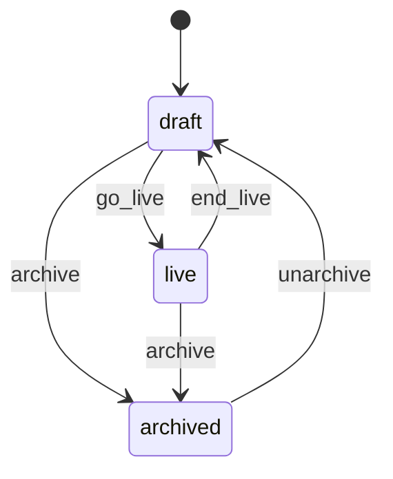
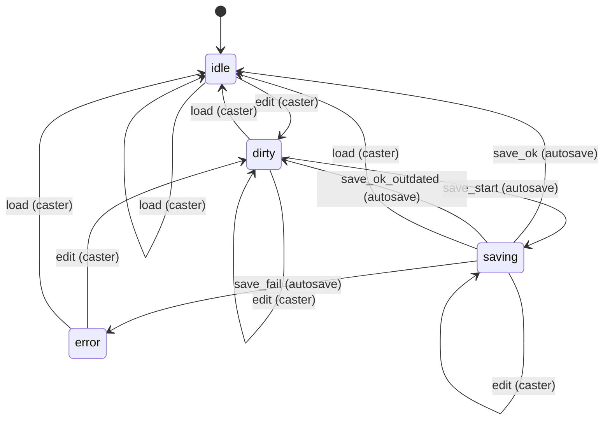
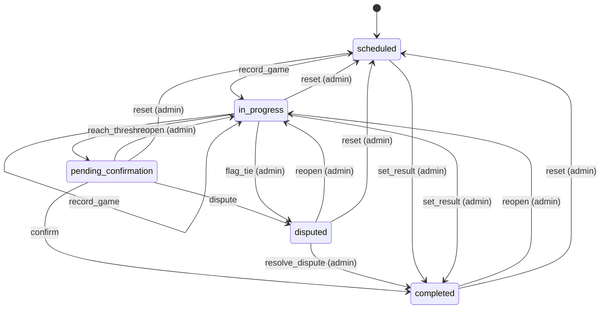

# State machines

<!-- Generated from src/lib/state-machine/registry.ts by `npm run docs:state-machines`. Do not edit by hand: change the machine's definition and regenerate. src/lib/state-machine/__tests__/docs.test.ts fails when this file is stale. -->

Each machine below is a column, timestamp or flag combination that moves through states, defined once, as data, with `defineMachine` (`src/lib/state-machine/machine.ts`). The rules for writers are in AGENTS.md ("Transitions go through the machine"); the decision is ADR 0004 (`docs/adr/0004-explicit-state-machines.md`).

- A writer calls `machine.assertTransition(from, to, actor)` before it writes, and guards the UPDATE with the source states (`.in(column, machine.sourcesOf(to))`, or `.eq(column, from)`), so a row that moved on in between is not overwritten.
- UI derives the available actions from `machine.transitionsFrom(state, actor)` instead of re-listing statuses.
- A refused move is an `IllegalTransitionError` (409, or 403 for the wrong actor) with a catalog code.

## Machines

- [Cast session](#cast-session) — `cast_sessions.status (CHECK cast_sessions_status_check)`
- [Cast Studio autosave](#cast-studio-autosave) — `CastStudioState.save in src/components/creator/studio/CastStudioContext.tsx (client only)`
- [Match](#match) — `matches.status (enum match_status)`

## Cast session

- **Id:** `cast_session`
- **State lives in:** cast_sessions.status (CHECK cast_sessions_status_check)
- **Module doc:** `docs/cast-studio.md`
- **States:** `draft`, `live`, `archived`
- **Actors:** `owner`, `admin`

The lifecycle label of a Cast Studio session. A session is created as draft; no screen moves the status today, only a PATCH /api/cast-sessions/[id] that names one, which is guarded with the current status (a status equal to the current one is not a move). The dashboard broadcast page links a match to its first session that is not archived. mode (cast, solo, replaycast) is a type tag picked at creation and edited in the studio, not a lifecycle: it has no machine.

| Event | From | To | Actors | Writers | Note |
| --- | --- | --- | --- | --- | --- |
| `go_live` | `draft` | `live` | owner, admin | `src/app/api/cast-sessions/[id]/route.ts` | The cast starts. |
| `end_live` | `live` | `draft` | owner, admin | `src/app/api/cast-sessions/[id]/route.ts` | The cast ends and the session stays in use. |
| `archive` | `draft`, `live` | `archived` | owner, admin | `src/app/api/cast-sessions/[id]/route.ts` | The session is put away; the dashboard no longer reuses it for its match. |
| `unarchive` | `archived` | `draft` | owner, admin | `src/app/api/cast-sessions/[id]/route.ts` | An archived session comes back as a draft; it goes live from there. |

## Cast Studio autosave

- **Id:** `cast_studio_save`
- **State lives in:** CastStudioState.save in src/components/creator/studio/CastStudioContext.tsx (client only)
- **Module doc:** `docs/cast-studio.md`
- **States:** `idle`, `dirty`, `saving`, `error`
- **Actors:** `caster`, `autosave`

The save badge of the Cast Studio (CastToolbar). Edits from this tab and from another tab over the cast channel both count; one request runs at a time, and its answer is compared with the session as it is when the answer lands (the sent signature). A pagehide sends any unsaved snapshot with keepalive and does not move the state.

| Event | From | To | Actors | Writers | Note |
| --- | --- | --- | --- | --- | --- |
| `edit` | `idle`, `dirty`, `error` | `dirty` | caster | `src/components/creator/studio/CastStudioContext.tsx` | Any studio action; after a failed save the edit schedules the retry. |
| `edit` | `saving` | `saving` | caster | `src/components/creator/studio/CastStudioContext.tsx` | The running request keeps its snapshot; the sent signature decides when it answers. |
| `save_start` | `dirty` | `saving` | autosave | `src/components/creator/studio/CastStudioContext.tsx` | 5 s after the last edit; never while another save runs. |
| `save_ok` | `saving` | `idle` | autosave | `src/components/creator/studio/CastStudioContext.tsx` | The server stored the snapshot and the session has not changed since it was sent. |
| `save_ok_outdated` | `saving` | `dirty` | autosave | `src/components/creator/studio/CastStudioContext.tsx` | The server stored the snapshot but the session changed while the request ran: the next save follows. |
| `save_fail` | `saving` | `error` | autosave | `src/components/creator/studio/CastStudioContext.tsx` | An HTTP error, success: false, or no answer: the badge shows the failure. |
| `load` | `idle`, `dirty`, `saving`, `error` | `idle` | caster | `src/components/creator/studio/CastStudioContext.tsx` | A stored session replaces the studio state (the load_session action). |

## Match

- **Id:** `match`
- **State lives in:** matches.status (enum match_status)
- **Module doc:** `docs/match.md`
- **States:** `scheduled`, `in_progress`, `pending_confirmation`, `completed`, `disputed`
- **Actors:** `player`, `admin`

A pairing from scheduling to a confirmed result (spec Section 8). Every status write clears finalized_at; a completion stamps confirmed_at and date_played and clears auto_confirm_at.

| Event | From | To | Actors | Writers | Note |
| --- | --- | --- | --- | --- | --- |
| `record_game` | `scheduled`, `in_progress` | `in_progress` | player, admin | `src/lib/pkmn/game-pipeline.ts` | A game is submitted and the series has no winner yet. |
| `reach_threshold` | `in_progress` | `pending_confirmation` | player, admin | `src/lib/pkmn/game-pipeline.ts` | A game gives one player the wins the best-of needs; auto_confirm_at starts the 24 h clock. |
| `confirm` | `pending_confirmation` | `completed` | player, admin | `src/app/api/confirm-match/[mid]/route.ts` `src/app/api/cron/auto-confirm/route.ts` | The opponent (not the submitter) or an admin confirms, or the auto-confirm cron does after 24 h. |
| `dispute` | `pending_confirmation` | `disputed` | player, admin | `src/app/api/confirm-match/[mid]/route.ts` | A participant flags the result. |
| `resolve_dispute` | `disputed` | `completed` | admin | `src/app/api/confirm-match/[mid]/route.ts` `src/app/api/admin/matches/[id]/result/route.ts` |  |
| `set_result` | `scheduled`, `in_progress` | `completed` | admin | `src/app/api/admin/matches/[id]/result/route.ts` `src/lib/match/bulk-actions.ts` `src/lib/format-engine/runtime/cron.ts` | An admin settles a no-show, a drop or a result agreed outside the app; no confirmation step. |
| `flag_tie` | `in_progress` | `disputed` | admin | `src/lib/pkmn/game-pipeline.ts` | The game pipeline, on the admins' behalf, when a replay is an engine tie. |
| `reopen` | `pending_confirmation`, `completed`, `disputed` | `in_progress` | admin | `src/lib/match/reopen.ts` | Withdraws the result and keeps the games. |
| `reset` | `in_progress`, `pending_confirmation`, `completed`, `disputed` | `scheduled` | admin | `src/lib/pkmn/game-pipeline.ts` | resetMatch / resetRound: deletes the games and rolls their aggregates back. |
