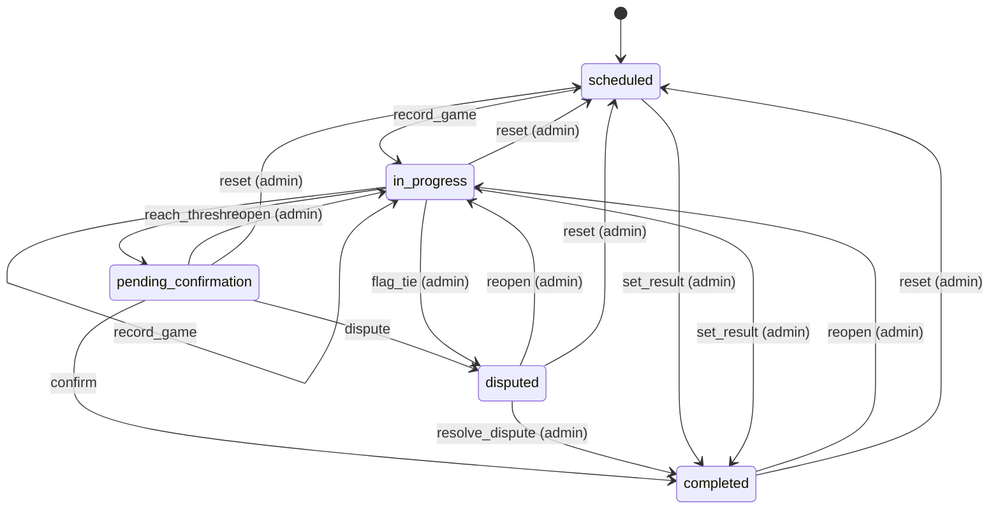
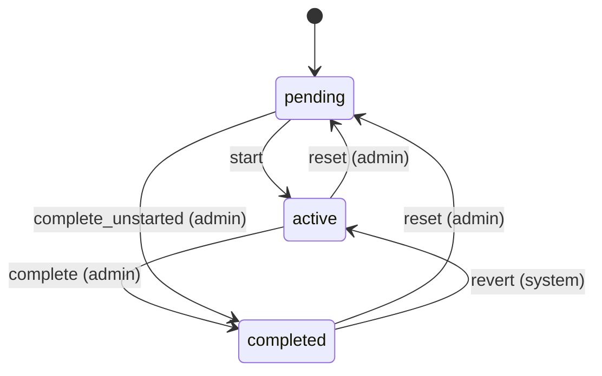
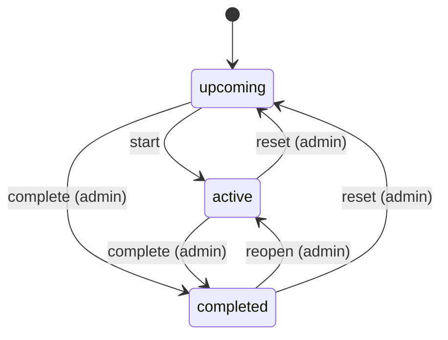
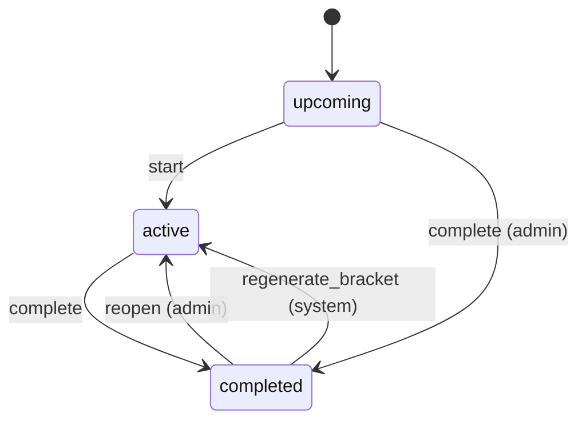

# State machines

<!-- Generated from src/lib/state-machine/registry.ts by `npm run docs:state-machines`. Do not edit by hand: change the machine's definition and regenerate. src/lib/state-machine/__tests__/docs.test.ts fails when this file is stale. -->

Each machine below is a column, timestamp or flag combination that moves through states, defined once, as data, with `defineMachine` (`src/lib/state-machine/machine.ts`). The rules for writers are in AGENTS.md ("Transitions go through the machine"); the decision is ADR 0004 (`docs/adr/0004-explicit-state-machines.md`).

- A writer calls `machine.assertTransition(from, to, actor)` before it writes, and guards the UPDATE with the source states (`.in(column, machine.sourcesOf(to))`, or `.eq(column, from)`), so a row that moved on in between is not overwritten.
- UI derives the available actions from `machine.transitionsFrom(state, actor)` instead of re-listing statuses.
- A refused move is an `IllegalTransitionError` (409, or 403 for the wrong actor) with a catalog code.

## Machines

- [Match](#match) — `matches.status (enum match_status)`
- [Round](#round) — `rounds.status (enum round_status)`
- [League](#league) — `seasons.status (enum season_status)`
- [Tournament and league phase](#tournament-and-league-phase) — `tournaments.status (enum tournament_status)`

## Match

- **Id:** `match`
- **State lives in:** matches.status (enum match_status)
- **Module doc:** `docs/match.md`
- **States:** `scheduled`, `in_progress`, `pending_confirmation`, `completed`, `disputed`
- **Actors:** `player`, `admin`

A pairing from scheduling to a confirmed result (spec Section 8). Every status write clears finalized_at; a completion stamps confirmed_at and date_played and clears auto_confirm_at.

| Event | From | To | Actors | Writers | Note |
| --- | --- | --- | --- | --- | --- |
| `record_game` | `scheduled`, `in_progress` | `in_progress` | player, admin | `src/lib/pkmn/game-pipeline.ts` | A game is submitted and the series has no winner yet. |
| `reach_threshold` | `in_progress` | `pending_confirmation` | player, admin | `src/lib/pkmn/game-pipeline.ts` | A game gives one player the wins the best-of needs; auto_confirm_at starts the 24 h clock. |
| `confirm` | `pending_confirmation` | `completed` | player, admin | `src/app/api/confirm-match/[mid]/route.ts` `src/app/api/cron/auto-confirm/route.ts` | The opponent (not the submitter) or an admin confirms, or the auto-confirm cron does after 24 h. |
| `dispute` | `pending_confirmation` | `disputed` | player, admin | `src/app/api/confirm-match/[mid]/route.ts` | A participant flags the result. |
| `resolve_dispute` | `disputed` | `completed` | admin | `src/app/api/confirm-match/[mid]/route.ts` `src/app/api/admin/matches/[id]/result/route.ts` |  |
| `set_result` | `scheduled`, `in_progress` | `completed` | admin | `src/app/api/admin/matches/[id]/result/route.ts` `src/lib/match/bulk-actions.ts` `src/lib/format-engine/runtime/cron.ts` | An admin settles a no-show, a drop or a result agreed outside the app; no confirmation step. |
| `flag_tie` | `in_progress` | `disputed` | admin | `src/lib/pkmn/game-pipeline.ts` | The game pipeline, on the admins' behalf, when a replay is an engine tie. |
| `reopen` | `pending_confirmation`, `completed`, `disputed` | `in_progress` | admin | `src/lib/match/reopen.ts` | Withdraws the result and keeps the games. |
| `reset` | `in_progress`, `pending_confirmation`, `completed`, `disputed` | `scheduled` | admin | `src/lib/pkmn/game-pipeline.ts` | resetMatch / resetRound: deletes the games and rolls their aggregates back. |

## Round

- **Id:** `round`
- **State lives in:** rounds.status (enum round_status)
- **Module doc:** `docs/tournament.md`
- **States:** `pending`, `active`, `completed`
- **Actors:** `admin`, `system`

A round of a tournament or phase: written pending, started to open it to play, completed by an admin. A match reopened in a completed round reopens the round to active; an admin reset of its matches puts it back to pending.

| Event | From | To | Actors | Writers | Note |
| --- | --- | --- | --- | --- | --- |
| `start` | `pending` | `active` | admin, system | `src/app/api/tournaments/[id]/rounds/[rid]/route.ts` `src/app/api/generate-round/[tid]/route.ts` `src/app/api/tournaments/[id]/generate-all-rounds/route.ts` `src/lib/tournament/bracket-generate.ts` | Start in the round manager, or a generate that was asked to start its round (best effort). |
| `complete` | `active` | `completed` | admin | `supabase/migrations/20261106090000_format_challenges.sql#round_complete` | Refused while a match is unfinished unless forced with a reason (audited round.force_complete). |
| `complete_unstarted` | `pending` | `completed` | admin | `supabase/migrations/20261106090000_format_challenges.sql#round_complete` | The API accepts completing a round that was never started (round_complete only refuses a completed one); the round manager does not offer it. |
| `reset` | `active`, `completed` | `pending` | admin | `src/lib/pkmn/game-pipeline.ts` `src/app/api/tournaments/[id]/rounds/[rid]/route.ts` | Reset in the round manager (resetRound: every played match back to scheduled), or a status PATCH. |
| `revert` | `completed` | `active` | system | `src/lib/pkmn/game-pipeline.ts` | revertRoundIfCompleted: a match of a completed round changed (reopened, a game deleted or edited), so the round is open to play again (players see Submit only in an active round). |

## League

- **Id:** `season`
- **State lives in:** seasons.status (enum season_status)
- **Module doc:** `docs/season.md`
- **States:** `upcoming`, `active`, `completed`
- **Actors:** `admin`, `system`

A league from set-up to its end. The first round or bracket of a phase starts it; an admin sets any status from the status control. Nothing completes a league automatically, and a completed league leaves its phases as they are. Closed (isSeasonClosed) means completed or archived.

| Event | From | To | Actors | Writers | Note |
| --- | --- | --- | --- | --- | --- |
| `start` | `upcoming` | `active` | admin, system | `src/app/api/seasons/[id]/route.ts` `src/lib/season/start-season.ts` `src/lib/dev-seed/seed.ts` | The first round (generate-round) or bracket (generate-bracket) of a phase, as a compare-and-set on upcoming; or the admin status control. A custom league needs an attached format (FORMAT_NOT_ATTACHED). |
| `complete` | `upcoming`, `active` | `completed` | admin | `src/app/api/seasons/[id]/route.ts` | The admin closes the league; its phases keep their status. |
| `reopen` | `completed` | `active` | admin | `src/app/api/seasons/[id]/route.ts` |  |
| `reset` | `active`, `completed` | `upcoming` | admin | `src/app/api/seasons/[id]/route.ts` | Offered by the admin status control. A league with phases past upcoming or with rounds still counts as started (isSeasonStarted). |

## Tournament and league phase

- **Id:** `tournament`
- **State lives in:** tournaments.status (enum tournament_status)
- **Module doc:** `docs/tournament.md`
- **States:** `upcoming`, `active`, `completed`
- **Actors:** `admin`, `system`

A standalone tournament or a league phase from set-up to its result. The first round (or the bracket) starts it; an admin, or the format at a stage end, completes it; an admin may reopen it. Re-sending the current status (active or completed) through the admin route is no move: it replays the format reaction. Nothing moves a phase back to upcoming.

| Event | From | To | Actors | Writers | Note |
| --- | --- | --- | --- | --- | --- |
| `start` | `upcoming` | `active` | admin, system | `supabase/migrations/20261106090000_format_challenges.sql#round_write` `src/lib/tournament/bracket-generate.ts` `src/lib/tournament/tournament-transition.ts` `src/lib/dev-seed/seed.ts` | The first round written (round_write, in the same transaction) or the bracket generated; an admin PATCH may also set it. Fires the format stage_start. bracket-generate still writes active unguarded after the bracket; its guarded, locked writer is a follow-up. |
| `complete` | `active` | `completed` | admin, system | `src/lib/tournament/tournament-transition.ts` `supabase/migrations/20261106090000_format_challenges.sql#phase_complete_at_stage_end` | Mark completed, or the format at a stage end (only while no unseen match is unfinished). Fires stage_end, the auto advance and the tournament_completed announcement. |
| `complete` | `upcoming` | `completed` | admin | `src/lib/tournament/tournament-transition.ts` | Mark completed on a phase or tournament that never started (the admin page offers it). |
| `reopen` | `completed` | `active` | admin | `src/lib/tournament/tournament-transition.ts` | Writes the status only: matches, results and standings are kept; completing again announces again. |
| `regenerate_bracket` | `completed` | `active` | system | `src/lib/tournament/bracket-generate.ts` | Regenerating the bracket of a completed tournament or non-format phase restarts it (the regenerate route refuses a completed format phase). The active write is unguarded until the follow-up locked regenerate writer. |
