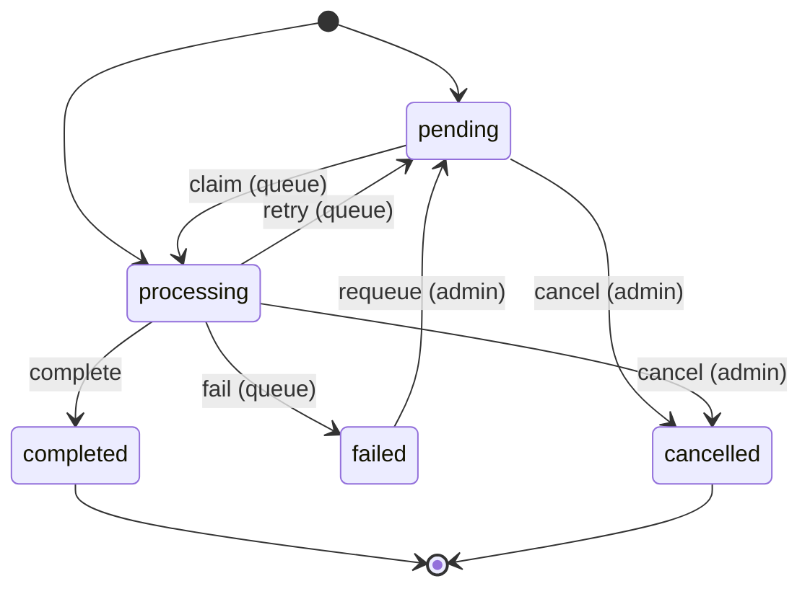
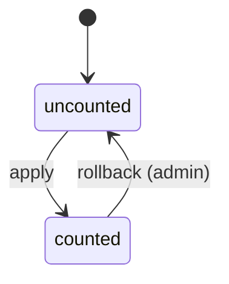
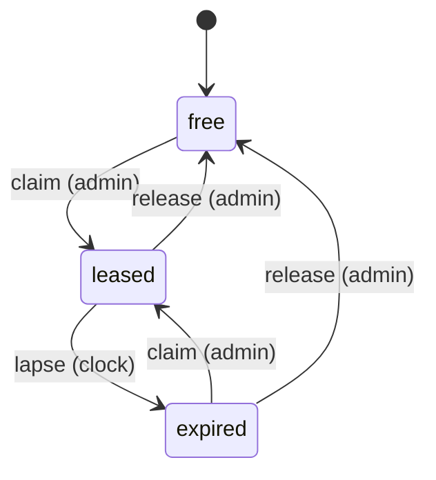
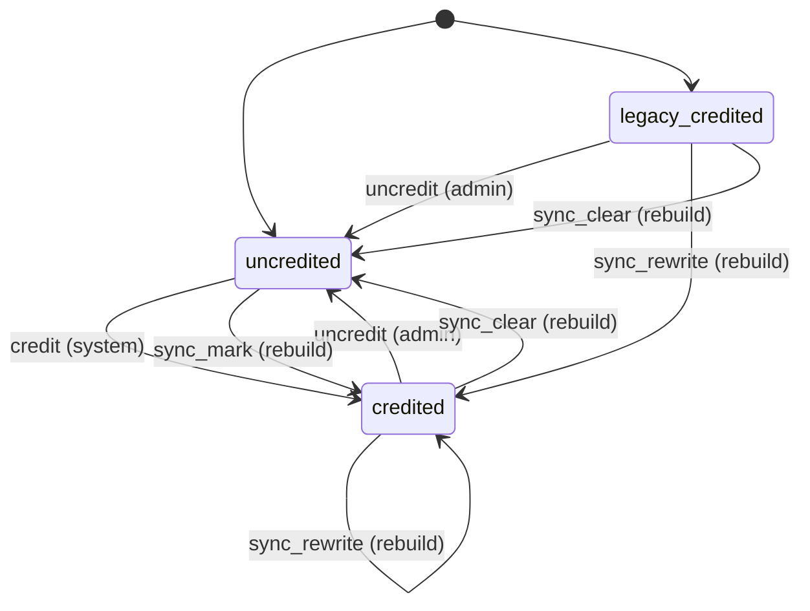
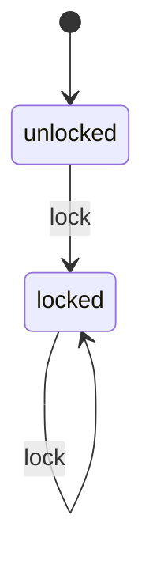
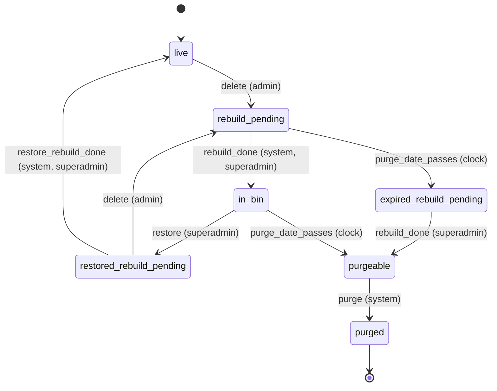
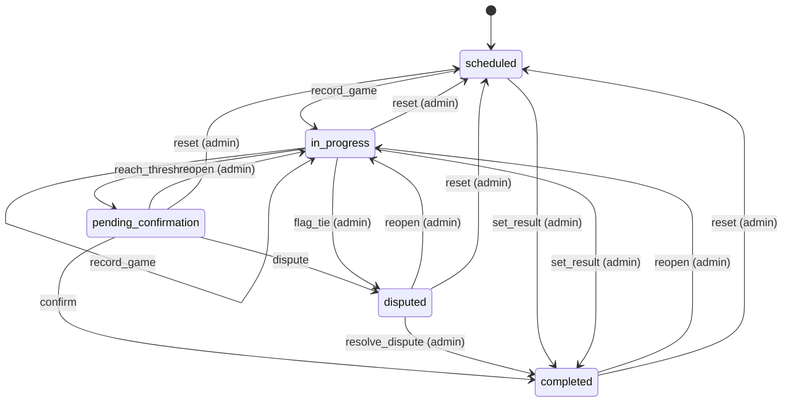

# State machines

<!-- Generated from src/lib/state-machine/registry.ts by `npm run docs:state-machines`. Do not edit by hand: change the machine's definition and regenerate. src/lib/state-machine/__tests__/docs.test.ts fails when this file is stale. -->

Each machine below is a column, timestamp or flag combination that moves through states, defined once, as data, with `defineMachine` (`src/lib/state-machine/machine.ts`). The rules for writers are in AGENTS.md ("Transitions go through the machine"); the decision is ADR 0004 (`docs/adr/0004-explicit-state-machines.md`).

- A writer calls `machine.assertTransition(from, to, actor)` before it writes, and guards the UPDATE with the source states (`.in(column, machine.sourcesOf(to))`, or `.eq(column, from)`), so a row that moved on in between is not overwritten.
- UI derives the available actions from `machine.transitionsFrom(state, actor)` instead of re-listing statuses.
- A refused move is an `IllegalTransitionError` (409, or 403 for the wrong actor) with a catalog code.

## Machines

- [Aggregate job](#aggregate-job) — `aggregate_jobs.status`
- [Game aggregate marker](#game-aggregate-marker) — `games.aggregate_applied_at (NULL = uncounted)`
- [Game edit lease](#game-edit-lease) — `games.edit_lease_token + games.edit_lease_until (both NULL or both set)`
- [Game evolution credit marker](#game-evolution-credit-marker) — `games.evolution_applied_at + games.evolution_credits`
- [Game stats lock](#game-stats-lock) — `games.stats_locked`
- [League recycle bin](#league-recycle-bin) — `derived: seasons row + league_trash (rebuild_pending, purge_after) + league_trash_restore_rebuilds`
- [Match](#match) — `matches.status (enum match_status)`

## Aggregate job

- **Id:** `aggregate_job`
- **State lives in:** aggregate_jobs.status
- **Module doc:** `docs/match.md`
- **States:** `pending`, `processing`, `completed`, `failed`, `cancelled`
- **Actors:** `queue`, `admin`

One queued game count. `enqueueAggregateJob` and `league_trash_restore` insert it `pending`; `applyGameAggregatesNow` (admin game edit) inserts it already `processing` with attempts = 1, so no worker claims it. A claim adds one attempt; a failed run goes back to `pending` while attempts < max_attempts, else to `failed`. Rows go with their game (ON DELETE CASCADE). Whether a game is counted is the game marker, not the job.

| Event | From | To | Actors | Writers | Note |
| --- | --- | --- | --- | --- | --- |
| `claim` | `pending` | `processing` | queue | `supabase/migrations/20260723205115_fix_claim_aggregate_jobs.sql#claim_aggregate_jobs` `src/lib/match/aggregate-queue.ts` | The worker (cron every 10 min, `after()`, the admin drain) claims pending rows with attempts left, FOR UPDATE SKIP LOCKED, and adds one attempt. |
| `complete` | `processing` | `completed` | queue, admin | `supabase/migrations/20261018130100_aggregate_apply_atomic.sql#apply_aggregate_job` `src/lib/match/aggregate-queue.ts` | apply_aggregate_job completes the job in the transaction that adds the counts and sets the game marker; `completeJob` completes a job with nothing to apply (game gone, already counted, no stats). |
| `retry` | `processing` | `pending` | queue | `supabase/migrations/20261018130100_aggregate_apply_atomic.sql#reclaim_stale_aggregate_jobs` `src/lib/match/aggregate-queue.ts` | A failed run (`markJobFailed`) or a run idle for 5 minutes (reclaim) with attempts < max_attempts. |
| `fail` | `processing` | `failed` | queue | `supabase/migrations/20261018130100_aggregate_apply_atomic.sql#reclaim_stale_aggregate_jobs` `src/lib/match/aggregate-queue.ts` | The same two writers once attempts reach max_attempts: the game stays uncounted until a scope rebuild or a requeue. |
| `requeue` | `failed` | `pending` | admin | `src/lib/match/aggregate-queue.ts` `src/lib/reconcile/entity-delete-rebuild.ts` | A league restore rebuild puts the league's failed increment jobs back with attempts = 0 (`requeueFailedIncrementJobsForSeason`). |
| `cancel` | `pending`, `processing` | `cancelled` | admin | `supabase/migrations/20260608100000_baseline_professional_schema.sql#cancel_aggregate_jobs_for_game` `src/lib/match/aggregate-queue.ts` | An admin game edit, game delete or match reset cancels the live jobs of the game before it rolls the game back. |

## Game aggregate marker

- **Id:** `game.aggregate_applied_at`
- **State lives in:** games.aggregate_applied_at (NULL = uncounted)
- **Module doc:** `docs/match.md`
- **States:** `uncounted`, `counted`
- **Actors:** `queue`, `admin`

Whether a game's battle stats are counted in `aggregates` and `player_aggregates`. The counts and the marker change in one transaction under the game row lock. A game is deleted only while uncounted (`deleteUncountedGameRow`); a league restore re-inserts its games uncounted and queues one job each. A scope rebuild re-derives the counts without touching the marker, so it skips games with a live job.

| Event | From | To | Actors | Writers | Note |
| --- | --- | --- | --- | --- | --- |
| `apply` | `uncounted` | `counted` | queue, admin | `supabase/migrations/20261018130100_aggregate_apply_atomic.sql#apply_aggregate_job` `src/lib/supabase/queries/aggregates.ts` `src/lib/match/aggregate-queue.ts` | The queue worker, or an admin game edit re-applying the new stats; a counted game answers already_applied. |
| `rollback` | `counted` | `uncounted` | admin | `supabase/migrations/20261018170000_aggregate_rollback_atomic.sql#rollback_game_aggregates` `src/lib/supabase/queries/aggregates.ts` `src/lib/pkmn/game-pipeline.ts` | Admin game edit, game delete or match reset; fenced on the marker the deltas were built under (marker_changed otherwise). |

## Game edit lease

- **Id:** `game.edit_lease`
- **State lives in:** games.edit_lease_token + games.edit_lease_until (both NULL or both set)
- **Module doc:** `docs/match.md`
- **States:** `free`, `leased`, `expired`
- **Actors:** `admin`, `clock`

One admin edit of a game at a time. Only `editGame` takes the lease; game delete, match reset and winner edits rely on the aggregate marker fence instead. `expired` is a lease whose edit_lease_until has passed: free in effect, cleared lazily by the next claim or the release.

| Event | From | To | Actors | Writers | Note |
| --- | --- | --- | --- | --- | --- |
| `claim` | `free`, `expired` | `leased` | admin | `supabase/migrations/20261019100000_games_edit_lease.sql#claim_game_edit_lease` `src/lib/supabase/queries/games.ts` `src/lib/pkmn/game-pipeline.ts` | Together with the editor's version (updated_at): leased or stale otherwise (409 admin_game_edit_in_progress / admin_game_edit_stale). |
| `release` | `leased`, `expired` | `free` | admin | `supabase/migrations/20261019100000_games_edit_lease.sql#release_game_edit_lease` `src/lib/supabase/queries/games.ts` `src/lib/pkmn/game-pipeline.ts` | The edit releases its own token in finally; another token releases nothing. |
| `lapse` | `leased` | `expired` | clock | `supabase/migrations/20261019100000_games_edit_lease.sql` | edit_lease_until passes (TTL 120 s), for example after a crashed edit. |

## Game evolution credit marker

- **Id:** `game.evolution_applied_at`
- **State lives in:** games.evolution_applied_at + games.evolution_credits
- **Module doc:** `docs/evolution-point-buy.md`
- **States:** `uncredited`, `credited`, `legacy_credited`
- **Actors:** `system`, `admin`, `rebuild`

Whether the real kills of an Evolution Point Buy game are credited to the trackers. `credited` holds the ledger of what was credited (evolution_credits); `legacy_credited` is a marker from before the ledger (evolution_credits NULL), debited from the caller's debits until the season is rebuilt once. Credit, uncredit and the season sync lock the game rows; the sync is fenced on the season epoch.

| Event | From | To | Actors | Writers | Note |
| --- | --- | --- | --- | --- | --- |
| `credit` | `uncredited` | `credited` | system | `supabase/migrations/20261021100100_epb_game_kill_credit_ledger.sql#epb_credit_game_kills` `src/lib/supabase/queries/evolutions.ts` `src/lib/match/evolution-match-evaluator.ts` `src/lib/match/finalize.ts` | The finalize step epb_real_kills, once the match is completed (match_not_completed otherwise). |
| `uncredit` | `credited`, `legacy_credited` | `uncredited` | admin | `supabase/migrations/20261021100100_epb_game_kill_credit_ledger.sql#epb_uncredit_game_kills` `src/lib/supabase/queries/evolutions.ts` `src/lib/match/evolution-match-evaluator.ts` `src/lib/pkmn/game-pipeline.ts` | An admin game edit that moves a completed match out of completed; fenced on the expected marker. |
| `sync_mark` | `uncredited` | `credited` | rebuild | `supabase/migrations/20261021100100_epb_game_kill_credit_ledger.sql#epb_sync_game_kill_credit` `src/lib/reconcile/evolution-rebuild.ts` | The season evolution rebuild marks the games of completed matches it credited. |
| `sync_rewrite` | `credited`, `legacy_credited` | `credited` | rebuild | `supabase/migrations/20261021100100_epb_game_kill_credit_ledger.sql#epb_sync_game_kill_credit` `src/lib/reconcile/evolution-rebuild.ts` | The rebuild rewrites the ledger of a credited game (a legacy marker gets its ledger). |
| `sync_clear` | `credited`, `legacy_credited` | `uncredited` | rebuild | `supabase/migrations/20261021100100_epb_game_kill_credit_ledger.sql#epb_sync_game_kill_credit` `src/lib/reconcile/evolution-rebuild.ts` | The rebuild clears games of matches that are no longer completed. |

## Game stats lock

- **Id:** `game.stats_locked`
- **State lives in:** games.stats_locked
- **Module doc:** `docs/match.md`
- **States:** `unlocked`, `locked`
- **Actors:** `admin`

An admin replaced the battle stats of a game by hand, so re-parse tooling (scripts/reparse-game.ts) leaves it alone unless forced. Advisory: no route checks it. One-way in the app; an unlock is a manual database edit.

| Event | From | To | Actors | Writers | Note |
| --- | --- | --- | --- | --- | --- |
| `lock` | `unlocked`, `locked` | `locked` | admin | `src/lib/supabase/queries/games.ts` `src/lib/pkmn/game-pipeline.ts` | An admin game edit that replaces the battle stats (not a winner-only edit), after the re-apply. |

## League recycle bin

- **Id:** `league_trash`
- **State lives in:** derived: seasons row + league_trash (rebuild_pending, purge_after) + league_trash_restore_rebuilds
- **Module doc:** `docs/season.md`
- **States:** `live`, `rebuild_pending`, `in_bin`, `expired_rebuild_pending`, `purgeable`, `purged`, `restored_rebuild_pending`
- **Actors:** `admin`, `superadmin`, `system`, `clock`

A deleted league waits in the bin for LEAGUE_TRASH_RETENTION_DAYS. It can be restored only while its delete rebuild is confirmed and its purge date has not passed; the expiry cron purges it only once the rebuild is confirmed. `expired_rebuild_pending` is the limbo between the two: past its purge date with the delete rebuild still pending, neither restorable (LEAGUE_TRASH_EXPIRED) nor purgeable until a superadmin runs the rebuild.

| Event | From | To | Actors | Writers | Note |
| --- | --- | --- | --- | --- | --- |
| `delete` | `live`, `restored_rebuild_pending` | `rebuild_pending` | admin | `supabase/migrations/20261026091000_league_trash.sql#league_trash_delete` `src/lib/supabase/queries/league-trash.ts` `src/lib/league-trash/service.ts` `src/app/api/seasons/[id]/route.ts` | DELETE /api/seasons/[id] (site admins). Deleting a restored league again drops its restore tombstone. |
| `rebuild_done` | `rebuild_pending` | `in_bin` | system, superadmin | `supabase/migrations/20261026091000_league_trash.sql#league_trash_rebuild_done` `src/lib/supabase/queries/league-trash.ts` `src/lib/league-trash/service.ts` `src/app/api/admin/league-trash/[id]/rebuild/route.ts` | The delete's derived-data rebuild is confirmed: right after the delete, or later from the trash page's Run rebuild. |
| `rebuild_done` | `expired_rebuild_pending` | `purgeable` | superadmin | `supabase/migrations/20261026091000_league_trash.sql#league_trash_rebuild_done` `src/lib/supabase/queries/league-trash.ts` `src/lib/league-trash/service.ts` `src/app/api/admin/league-trash/[id]/rebuild/route.ts` | The way out of the limbo: the rebuild works whatever the purge date. |
| `purge_date_passes` | `rebuild_pending` | `expired_rebuild_pending` | clock | `src/lib/league-trash/lifecycle-state.ts` | purge_after <= now while the delete rebuild is pending. |
| `purge_date_passes` | `in_bin` | `purgeable` | clock | `src/lib/league-trash/lifecycle-state.ts` | purge_after <= now: the entry can no longer be restored. |
| `restore` | `in_bin` | `restored_rebuild_pending` | superadmin | `supabase/migrations/20261106090000_format_challenges.sql#league_trash_restore` `src/lib/supabase/queries/league-trash.ts` `src/lib/league-trash/service.ts` `src/app/api/admin/league-trash/[id]/restore/route.ts` | Refused past the purge date (LEAGUE_TRASH_EXPIRED) and while the delete rebuild is pending (LEAGUE_TRASH_REBUILD_PENDING). Writes the restore tombstone and queues the aggregate jobs of the counted games. |
| `restore_rebuild_done` | `restored_rebuild_pending` | `live` | system, superadmin | `supabase/migrations/20261026091000_league_trash.sql#league_trash_restore_rebuild_done` `src/lib/supabase/queries/league-trash.ts` `src/lib/league-trash/service.ts` `src/app/api/admin/league-trash/[id]/rebuild/route.ts` | The restore's derived-data rebuild is confirmed and the tombstone deleted. |
| `purge` | `purgeable` | `purged` | system | `supabase/migrations/20261026091000_league_trash.sql#league_trash_expire` `src/lib/supabase/queries/league-trash.ts` `src/app/api/cron/expire-league-trash/route.ts` | The daily expire-league-trash cron; irreversible. |

## Match

- **Id:** `match`
- **State lives in:** matches.status (enum match_status)
- **Module doc:** `docs/match.md`
- **States:** `scheduled`, `in_progress`, `pending_confirmation`, `completed`, `disputed`
- **Actors:** `player`, `admin`

A pairing from scheduling to a confirmed result (spec Section 8). Every status write clears finalized_at; a completion stamps confirmed_at and date_played and clears auto_confirm_at.

| Event | From | To | Actors | Writers | Note |
| --- | --- | --- | --- | --- | --- |
| `record_game` | `scheduled`, `in_progress` | `in_progress` | player, admin | `src/lib/pkmn/game-pipeline.ts` | A game is submitted and the series has no winner yet. |
| `reach_threshold` | `in_progress` | `pending_confirmation` | player, admin | `src/lib/pkmn/game-pipeline.ts` | A game gives one player the wins the best-of needs; auto_confirm_at starts the 24 h clock. |
| `confirm` | `pending_confirmation` | `completed` | player, admin | `src/app/api/confirm-match/[mid]/route.ts` `src/app/api/cron/auto-confirm/route.ts` | The opponent (not the submitter) or an admin confirms, or the auto-confirm cron does after 24 h. |
| `dispute` | `pending_confirmation` | `disputed` | player, admin | `src/app/api/confirm-match/[mid]/route.ts` | A participant flags the result. |
| `resolve_dispute` | `disputed` | `completed` | admin | `src/app/api/confirm-match/[mid]/route.ts` `src/app/api/admin/matches/[id]/result/route.ts` |  |
| `set_result` | `scheduled`, `in_progress` | `completed` | admin | `src/app/api/admin/matches/[id]/result/route.ts` `src/lib/match/bulk-actions.ts` `src/lib/format-engine/runtime/cron.ts` | An admin settles a no-show, a drop or a result agreed outside the app; no confirmation step. |
| `flag_tie` | `in_progress` | `disputed` | admin | `src/lib/pkmn/game-pipeline.ts` | The game pipeline, on the admins' behalf, when a replay is an engine tie. |
| `reopen` | `pending_confirmation`, `completed`, `disputed` | `in_progress` | admin | `src/lib/match/reopen.ts` | Withdraws the result and keeps the games. |
| `reset` | `in_progress`, `pending_confirmation`, `completed`, `disputed` | `scheduled` | admin | `src/lib/pkmn/game-pipeline.ts` | resetMatch / resetRound: deletes the games and rolls their aggregates back. |
