# State machines

<!-- Generated from src/lib/state-machine/registry.ts by `npm run docs:state-machines`. Do not edit by hand: change the machine's definition and regenerate. src/lib/state-machine/__tests__/docs.test.ts fails when this file is stale. -->

Each machine below is a column, timestamp or flag combination that moves through states, defined once, as data, with `defineMachine` (`src/lib/state-machine/machine.ts`). The rules for writers are in AGENTS.md ("Transitions go through the machine"); the decision is ADR 0004 (`docs/adr/0004-explicit-state-machines.md`).

- A writer calls `machine.assertTransition(from, to, actor)` before it writes, and guards the UPDATE with the source states (`.in(column, machine.sourcesOf(to))`, or `.eq(column, from)`), so a row that moved on in between is not overwritten.
- UI derives the available actions from `machine.transitionsFrom(state, actor)` instead of re-listing statuses.
- A refused move is an `IllegalTransitionError` (409, or 403 for the wrong actor) with a catalog code.

## Machines

- [Admin Assistant ledger row](#admin-assistant-ledger-row) — `admin_agent_actions.status`
- [Admin Assistant plan](#admin-assistant-plan) — `admin_agent_plans.status`
- [Admin Assistant proposal](#admin-assistant-proposal) — `admin_agent_proposals.status`
- [Aggregate job](#aggregate-job) — `aggregate_jobs.status`
- [AI artifact](#ai-artifact) — `match_analyses.status, match_prep_analyses.status, tournament_reports.status (absent = no row)`
- [Cast session](#cast-session) — `cast_sessions.status (CHECK cast_sessions_status_check)`
- [Cast Studio autosave](#cast-studio-autosave) — `CastStudioState.save in src/components/creator/studio/CastStudioContext.tsx (client only)`
- [Form submission](#form-submission) — `client: useSubmitPhase (TournamentForm, LeagueForm, EpbImportPanel)`
- [Visible poller](#visible-poller) — `client: createVisiblePoller closure (src/lib/draft/use-visible-poll.ts)`
- [Draft pool pause](#draft-pool-pause) — `draft_pools.paused_at (+ paused_by, pause_reason) while phase = 'drafting'`
- [Draft pool (queue engine)](#draft-pool-queue-engine) — `draft_pools.phase where engine = 'queue' (+ the status twin)`
- [Draft pool (legacy engine)](#draft-pool-legacy-engine) — `draft_pools.status (enum draft_pool_status) where engine = 'legacy'`
- [Draft room armed confirm](#draft-room-armed-confirm) — `client: armedConfirmReducer phase in ArmedConfirmDialog`
- [Draft room pick dialog](#draft-room-pick-dialog) — `client: pickFlowReducer state (open, submitting) in DraftToolClient`
- [Draft slot](#draft-slot) — `draft_slots.status`
- [Draft Kill Token window](#draft-kill-token-window) — `derived: the initial pool's phase, draft_pools.token_purchase_closes_at and the league's completed matches`
- [Format action submission](#format-action-submission) — `format_action_submissions.status`
- [Format action window](#format-action-window) — `format_flags 'action:<id>' + the rule's window.opens_on`
- [Format challenge](#format-challenge) — `format_challenges.status`
- [Format check](#format-check) — `format_checks.status`
- [Format notification read](#format-notification-read) — `format_notifications.read_at`
- [Format relation reveal](#format-relation-reveal) — `format_relation_links.revealed_at`
- [Game aggregate marker](#game-aggregate-marker) — `games.aggregate_applied_at (NULL = uncounted)`
- [Game edit lease](#game-edit-lease) — `games.edit_lease_token + games.edit_lease_until (both NULL or both set)`
- [Game evolution credit marker](#game-evolution-credit-marker) — `games.evolution_applied_at + games.evolution_credits`
- [Game stats lock](#game-stats-lock) — `games.stats_locked`
- [League recycle bin](#league-recycle-bin) — `derived: seasons row + league_trash (rebuild_pending, purge_after) + league_trash_restore_rebuilds`
- [Match](#match) — `matches.status (enum match_status) with confirmed_at, auto_confirm_at, date_played and finalized_at`
- [Match outcome](#match-outcome) — `match_outcomes.kind with source = 'admin' (row absent = none)`
- [Match proposal](#match-proposal) — `match_proposals.status (enum match_proposal_status) with expires_at`
- [Player moderation status](#player-moderation-status) — `players.status (CHECK active | suspended | banned), suspended_until, ban_reason, sessions_valid_after`
- [Push device (this browser)](#push-device-this-browser) — `client: NotifyState in usePushAlerts (browser permission + PushManager subscription)`
- [Redraft submission window](#redraft-submission-window) — `derived: draft_pools.phase = 'submissions' and submission_deadline_at vs now()`
- [League](#league) — `seasons.status (enum season_status)`
- [Season format engine](#season-format-engine) — `season_formats.engine`
- [Team library publication](#team-library-publication) — `teams.library_published_at (published = set) + library_title, library_description, library_tags`
- [Team roster write locks](#team-roster-write-locks) — `derived: teams.locked, teams.match_id -> matches.status, teams.tournament_id -> tournaments.status/archived -> seasons.status/archived`
- [Team share link](#team-share-link) — `teams.share_token + teams.share_enabled_at (on = both set)`
- [Teambuilder save](#teambuilder-save) — `client: EditorState.saveStatus in TeamsEditor`
- [Tournament and league phase](#tournament-and-league-phase) — `tournaments.status (enum tournament_status)`
- [Wiki note report](#wiki-note-report) — `wiki_note_reports.status`
- [Wiki note moderation](#wiki-note-moderation) — `wiki_notes.approved + rejected_at + resubmission_blocked_at (derived by noteModerationState)`

## Admin Assistant ledger row

- **Id:** `admin_agent_action`
- **State lives in:** admin_agent_actions.status
- **Module doc:** `docs/poketools-spec.md`
- **States:** `executing`, `ok`, `failed`, `unknown`, `skipped`, `undone`
- **Actors:** `system`

A dispatched write of the assistant: inserted executing before the dispatch, completed once with its outcome, reconciled from unknown by a Resume, and marked undone after an undo proposal reversed it.

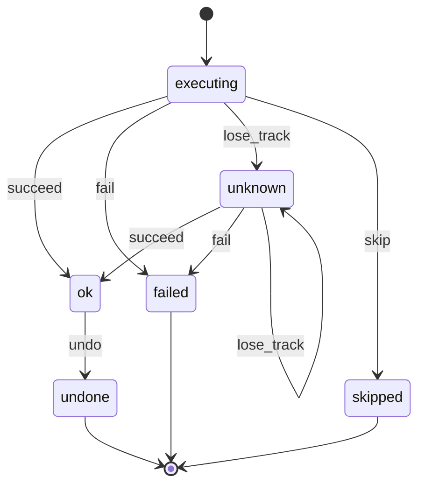

| Event | From | To | Actors | Writers | Note |
| --- | --- | --- | --- | --- | --- |
| `succeed` | `executing`, `unknown` | `ok` | system | `src/lib/ai/admin-agent/proposals/executor.ts`<br>`src/lib/ai/admin-agent/staged/draft-tools.ts`<br>`src/lib/ai/admin-agent/store/actions.ts` | The route answered with the write, or a read-back confirmed it (a Resume reconciling an executing or unknown row). |
| `fail` | `executing`, `unknown` | `failed` | system | `src/lib/ai/admin-agent/proposals/executor.ts`<br>`src/lib/ai/admin-agent/staged/draft-tools.ts`<br>`src/lib/ai/admin-agent/store/actions.ts` | The route refused, or the read-back found the write and still a failure (created_but_unadministrable). |
| `lose_track` | `executing`, `unknown` | `unknown` | system | `src/lib/ai/admin-agent/proposals/executor.ts`<br>`src/lib/ai/admin-agent/staged/draft-tools.ts`<br>`src/lib/ai/admin-agent/store/actions.ts` | The answer did not arrive and the read-back cannot tell (a Resume may write unknown again with the new verify). |
| `skip` | `executing` | `skipped` | system | `src/lib/ai/admin-agent/proposals/executor.ts`<br>`src/lib/ai/admin-agent/staged/draft-tools.ts`<br>`src/lib/ai/admin-agent/store/actions.ts` | Not dispatched: a stale or unreadable precondition, a failed dependency, a call that no longer fits its binding, or a step after the run stopped (inserted and completed at once). |
| `undo` | `ok` | `undone` | system | `src/lib/ai/admin-agent/proposals/executor.ts`<br>`src/lib/ai/admin-agent/store/actions.ts` | markUndone after an undo proposal whose steps for this row all ended ok. |

## Admin Assistant plan

- **Id:** `admin_agent_plan`
- **State lives in:** admin_agent_plans.status
- **Module doc:** `docs/poketools-spec.md`
- **States:** `drafting`, `ready`, `building`, `partial`, `built`, `abandoned`
- **Actors:** `system`

The Plan document of a conversation from drafting to built or abandoned. Not wired yet: no code moves a plan out of drafting (setPlanStatus has no caller), so these transitions describe the intended lifecycle and guard any future writer.

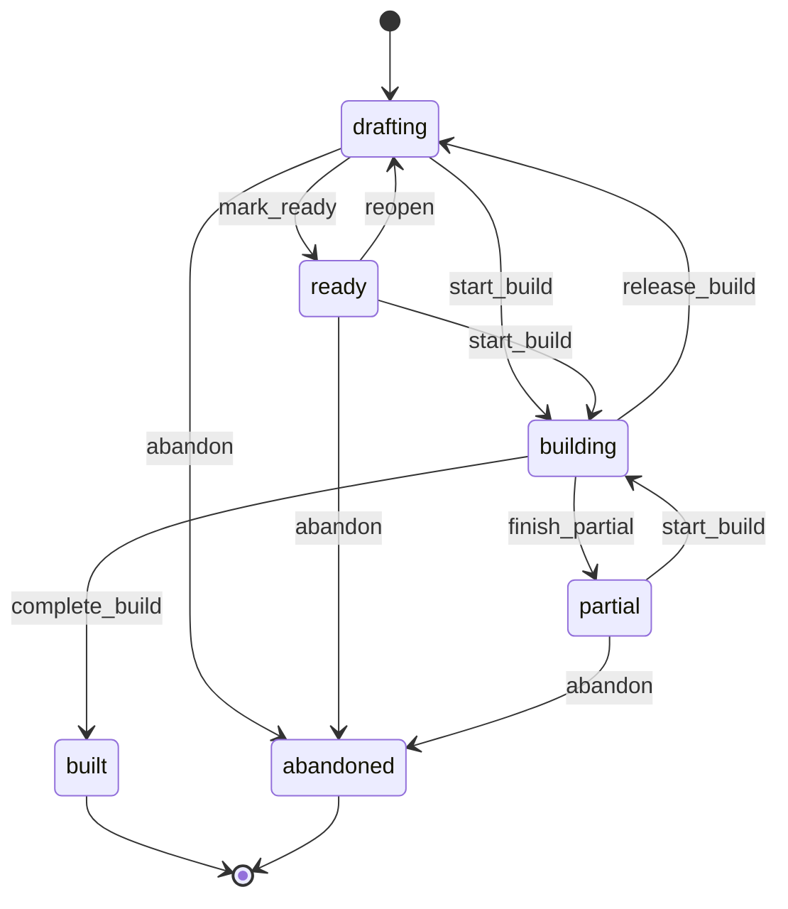

| Event | From | To | Actors | Writers | Note |
| --- | --- | --- | --- | --- | --- |
| `mark_ready` | `drafting` | `ready` | system | `src/lib/ai/admin-agent/store/plans.ts` | Readiness has no blockers (setPlanStatus, or a revision write that names the status). No caller yet. |
| `reopen` | `ready` | `drafting` | system | `src/lib/ai/admin-agent/store/plans.ts` | An edit gives a ready plan blockers again. No caller yet. |
| `start_build` | `drafting`, `ready`, `partial` | `building` | system | `src/lib/ai/admin-agent/store/plans.ts` | A Build proposal of the plan is claimed (stamps build_started_at). No caller yet; propose_build stages only from these states. |
| `complete_build` | `building` | `built` | system | `src/lib/ai/admin-agent/store/plans.ts` | The Build proposal completed (stamps build_finished_at). No caller yet. |
| `finish_partial` | `building` | `partial` | system | `src/lib/ai/admin-agent/store/plans.ts` | The Build ended with some steps written; a fresh Build covers the rest. No caller yet. |
| `release_build` | `building` | `drafting` | system | `src/lib/ai/admin-agent/store/plans.ts` | The Build was refused or wrote nothing (stale, failed before a step). No caller yet. |
| `abandon` | `drafting`, `ready`, `partial` | `abandoned` | system | `src/lib/ai/admin-agent/store/plans.ts` | The admin gives the plan up; a new plan_create is allowed afterwards. No caller yet. |

## Admin Assistant proposal

- **Id:** `admin_agent_proposal`
- **State lives in:** admin_agent_proposals.status
- **Module doc:** `docs/poketools-spec.md`
- **States:** `proposed`, `executing`, `completed`, `partial`, `failed`, `declined`, `expired`, `superseded`, `stale`, `unknown`
- **Actors:** `admin`, `system`

A staged confirmation card: approved (claimed) or declined by its admin, retired by a newer card or plan revision, then ended by the executor or the reaper. Stored expired is never written today: an overdue proposed row is shown as expired by effectiveProposalStatus.

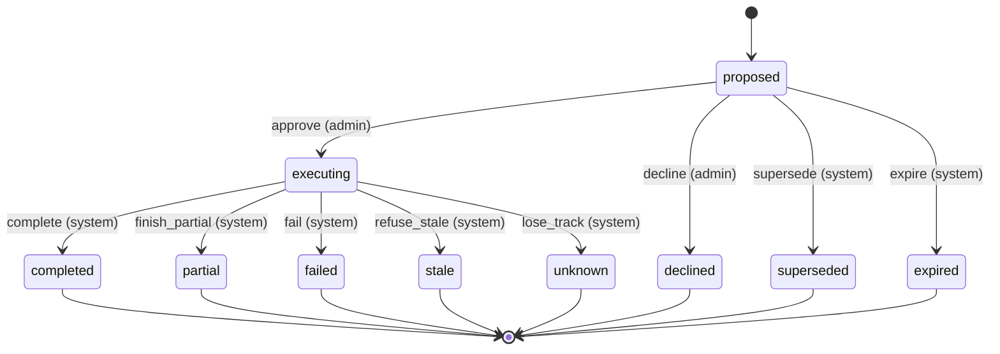

| Event | From | To | Actors | Writers | Note |
| --- | --- | --- | --- | --- | --- |
| `approve` | `proposed` | `executing` | admin | `src/lib/ai/admin-agent/store/proposals.ts`<br>`src/lib/ai/admin-agent/proposals/executor.ts` | claimProposal: one UPDATE bound to the admin, the token hash and an unexpired expires_at; stamps approved_by/at and executing_started_at. |
| `decline` | `proposed` | `declined` | admin | `src/lib/ai/admin-agent/store/proposals.ts`<br>`src/app/api/admin/agent/proposals/[id]/decline/route.ts` | declineProposal stamps finished_at. It does not compare expires_at, so an overdue card can still be declined. |
| `supersede` | `proposed` | `superseded` | system | `src/lib/ai/admin-agent/store/proposals.ts`<br>`src/lib/ai/admin-agent/store/plans.ts` | Staging a card with the same supersede_key, or a plan revision retiring the Build cards of an older revision. |
| `expire` | `proposed` | `expired` | system | `src/lib/ai/admin-agent/store/proposals.ts` | expireProposals (overdue proposed rows of one admin). No caller today; readers derive expired with effectiveProposalStatus. |
| `complete` | `executing` | `completed` | system | `src/lib/ai/admin-agent/proposals/executor.ts`<br>`src/lib/ai/admin-agent/store/proposals.ts` | finishProposal after every step ended ok. |
| `finish_partial` | `executing` | `partial` | system | `src/lib/ai/admin-agent/proposals/executor.ts`<br>`src/lib/ai/admin-agent/store/proposals.ts` | Some steps ok, a later one failed or was skipped. |
| `fail` | `executing` | `failed` | system | `src/lib/ai/admin-agent/proposals/executor.ts`<br>`src/lib/ai/admin-agent/store/proposals.ts` | No step ok and one failed or was skipped, or the blast-radius counter was at its cap after the claim. |
| `refuse_stale` | `executing` | `stale` | system | `src/lib/ai/admin-agent/proposals/executor.ts`<br>`src/lib/ai/admin-agent/store/proposals.ts` | The recheck after the claim (hash, acknowledgements, registry, preconditions) or a stale precondition during the run; the claim is consumed. |
| `lose_track` | `executing` | `unknown` | system | `src/lib/ai/admin-agent/proposals/executor.ts`<br>`src/lib/ai/admin-agent/proposals/reaper.ts`<br>`src/lib/ai/admin-agent/store/proposals.ts` | A Go-live step with an unknown outcome, or the reaper (reapExecutingProposals) ending an execution older than the resume window plus one request. |

## Aggregate job

- **Id:** `aggregate_job`
- **State lives in:** aggregate_jobs.status
- **Module doc:** `docs/match.md`
- **States:** `pending`, `processing`, `completed`, `failed`, `cancelled`
- **Actors:** `queue`, `admin`

One queued game count. `enqueueAggregateJob` and `league_trash_restore` insert it `pending`; `applyGameAggregatesNow` (admin game edit) inserts it already `processing` with attempts = 1, so no worker claims it. A claim adds one attempt; a failed run goes back to `pending` while attempts < max_attempts, else to `failed`. Rows go with their game (ON DELETE CASCADE). Whether a game is counted is the game marker, not the job.

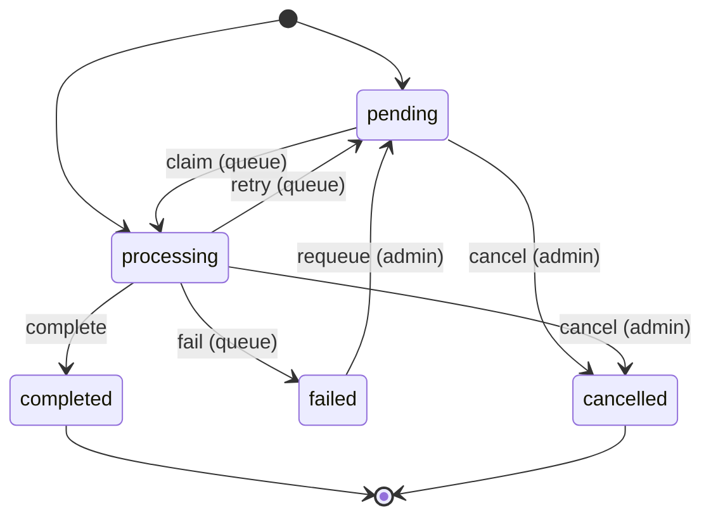

| Event | From | To | Actors | Writers | Note |
| --- | --- | --- | --- | --- | --- |
| `claim` | `pending` | `processing` | queue | `supabase/migrations/20260723205115_fix_claim_aggregate_jobs.sql#claim_aggregate_jobs`<br>`src/lib/match/aggregate-queue.ts` | The worker (cron every 10 min, `after()`, the admin drain) claims pending rows with attempts left, FOR UPDATE SKIP LOCKED, and adds one attempt. |
| `complete` | `processing` | `completed` | queue, admin | `supabase/migrations/20261018130100_aggregate_apply_atomic.sql#apply_aggregate_job`<br>`src/lib/match/aggregate-queue.ts` | apply_aggregate_job completes the job in the transaction that adds the counts and sets the game marker; `completeJob` completes a job with nothing to apply (game gone, already counted, no stats). |
| `retry` | `processing` | `pending` | queue | `supabase/migrations/20261018130100_aggregate_apply_atomic.sql#reclaim_stale_aggregate_jobs`<br>`src/lib/match/aggregate-queue.ts` | A failed run (`markJobFailed`) or a run idle for 5 minutes (reclaim) with attempts < max_attempts. |
| `fail` | `processing` | `failed` | queue | `supabase/migrations/20261018130100_aggregate_apply_atomic.sql#reclaim_stale_aggregate_jobs`<br>`src/lib/match/aggregate-queue.ts` | The same two writers once attempts reach max_attempts: the game stays uncounted until a scope rebuild or a requeue. |
| `requeue` | `failed` | `pending` | admin | `src/lib/match/aggregate-queue.ts`<br>`src/lib/reconcile/entity-delete-rebuild.ts` | A league restore rebuild puts the league's failed increment jobs back with attempts = 0 (`requeueFailedIncrementJobsForSeason`). |
| `cancel` | `pending`, `processing` | `cancelled` | admin | `supabase/migrations/20260608100000_baseline_professional_schema.sql#cancel_aggregate_jobs_for_game`<br>`src/lib/match/aggregate-queue.ts` | An admin game edit, game delete or match reset cancels the live jobs of the game before it rolls the game back. |

## AI artifact

- **Id:** `ai_artifact.status`
- **State lives in:** match_analyses.status, match_prep_analyses.status, tournament_reports.status (absent = no row)
- **Module doc:** `docs/ai.md`
- **States:** `absent`, `pending`, `completed`, `failed`
- **Actors:** `player`, `admin`, `system`

A stored AI generation from request to result. A request inserts a pending row (absent → pending), the generation settles it as completed or failed with UPDATE … WHERE id AND status = 'pending' and a row-count check, and a pending row older than AI_ANALYSIS_STALE_MS is failed by the next request. Regenerating (force, retry after a failure) and a result change on the match delete the row first. A settle that matches no row (the row was deleted or replaced meanwhile) writes nothing and is logged.

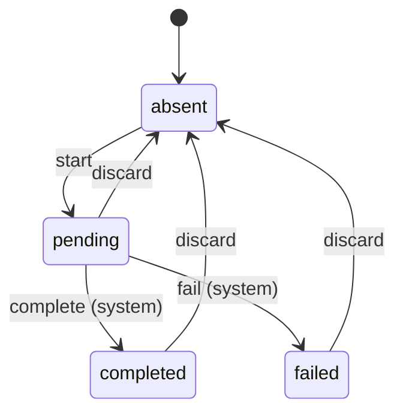

| Event | From | To | Actors | Writers | Note |
| --- | --- | --- | --- | --- | --- |
| `start` | `absent` | `pending` | player, admin, system | `src/app/api/ai/match-analysis/route.ts`<br>`src/app/api/ai/match-prep-analysis/route.ts`<br>`src/app/api/ai/tournament-report/route.ts`<br>`src/app/api/ai/agent/analyze-match/route.ts`<br>`src/lib/ai/tournament-report-generator.ts`<br>`src/lib/supabase/queries/match-analyses.ts`<br>`src/lib/supabase/queries/match-prep-analyses.ts`<br>`src/lib/supabase/queries/tournament-reports.ts` | A request (or the round trigger) inserts a pending row; the unique key allows one per scope. |
| `complete` | `pending` | `completed` | system | `src/lib/supabase/queries/ai-artifacts.ts`<br>`src/app/api/ai/match-analysis/route.ts`<br>`src/app/api/ai/match-prep-analysis/route.ts`<br>`src/app/api/ai/tournament-report/route.ts`<br>`src/app/api/ai/agent/analyze-match/route.ts`<br>`src/lib/ai/tournament-report-generator.ts` |  |
| `fail` | `pending` | `failed` | system | `src/lib/supabase/queries/ai-artifacts.ts`<br>`src/app/api/ai/match-analysis/route.ts`<br>`src/app/api/ai/match-prep-analysis/route.ts`<br>`src/app/api/ai/tournament-report/route.ts`<br>`src/app/api/ai/agent/analyze-match/route.ts`<br>`src/lib/ai/tournament-report-generator.ts` | The generation failed, or a request found the pending row older than AI_ANALYSIS_STALE_MS. |
| `discard` | `pending`, `completed`, `failed` | `absent` | player, admin, system | `src/app/api/ai/match-analysis/route.ts`<br>`src/app/api/ai/match-prep-analysis/route.ts`<br>`src/app/api/ai/tournament-report/route.ts`<br>`src/app/api/ai/agent/analyze-match/route.ts`<br>`src/lib/ai/tournament-report-generator.ts`<br>`src/lib/match/reopen.ts`<br>`src/lib/pkmn/game-pipeline.ts` | Regenerate (force, retry after failure, stale pending) deletes the row before the new insert; a match reset or result change deletes its analyses. |

## Cast session

- **Id:** `cast_session`
- **State lives in:** cast_sessions.status (CHECK cast_sessions_status_check)
- **Module doc:** `docs/cast-studio.md`
- **States:** `draft`, `live`, `archived`
- **Actors:** `owner`, `admin`

The lifecycle label of a Cast Studio session. A session is created as draft; no screen moves the status today, only a PATCH /api/cast-sessions/[id] that names one, which is guarded with the current status (a status equal to the current one is not a move). The dashboard broadcast page links a match to its first session that is not archived. mode (cast, solo, replaycast) is a type tag picked at creation and edited in the studio, not a lifecycle: it has no machine.

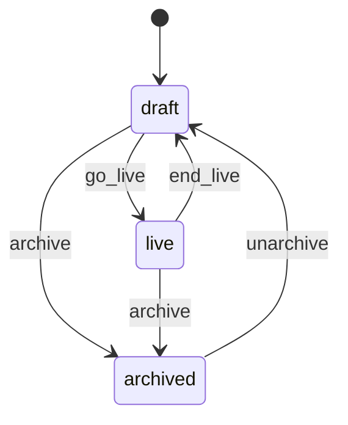

| Event | From | To | Actors | Writers | Note |
| --- | --- | --- | --- | --- | --- |
| `go_live` | `draft` | `live` | owner, admin | `src/app/api/cast-sessions/[id]/route.ts` | The cast starts. |
| `end_live` | `live` | `draft` | owner, admin | `src/app/api/cast-sessions/[id]/route.ts` | The cast ends and the session stays in use. |
| `archive` | `draft`, `live` | `archived` | owner, admin | `src/app/api/cast-sessions/[id]/route.ts` | The session is put away; the dashboard no longer reuses it for its match. |
| `unarchive` | `archived` | `draft` | owner, admin | `src/app/api/cast-sessions/[id]/route.ts` | An archived session comes back as a draft; it goes live from there. |

## Cast Studio autosave

- **Id:** `cast_studio_save`
- **State lives in:** CastStudioState.save in src/components/creator/studio/CastStudioContext.tsx (client only)
- **Module doc:** `docs/cast-studio.md`
- **States:** `idle`, `dirty`, `saving`, `error`
- **Actors:** `caster`, `autosave`

The save badge of the Cast Studio (CastToolbar). Edits from this tab and from another tab over the cast channel both count; one request runs at a time, and its answer is compared with the session as it is when the answer lands (the sent signature). A pagehide sends any unsaved snapshot with keepalive and does not move the state.

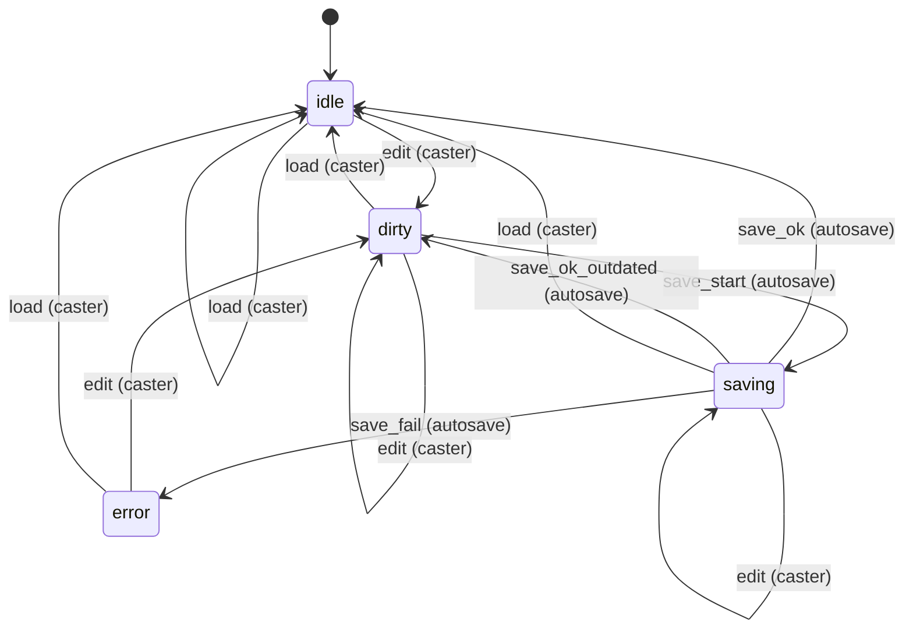

| Event | From | To | Actors | Writers | Note |
| --- | --- | --- | --- | --- | --- |
| `edit` | `idle`, `dirty`, `error` | `dirty` | caster | `src/components/creator/studio/CastStudioContext.tsx` | Any studio action; after a failed save the edit schedules the retry. |
| `edit` | `saving` | `saving` | caster | `src/components/creator/studio/CastStudioContext.tsx` | The running request keeps its snapshot; the sent signature decides when it answers. |
| `save_start` | `dirty` | `saving` | autosave | `src/components/creator/studio/CastStudioContext.tsx` | 5 s after the last edit; never while another save runs. |
| `save_ok` | `saving` | `idle` | autosave | `src/components/creator/studio/CastStudioContext.tsx` | The server stored the snapshot and the session has not changed since it was sent. |
| `save_ok_outdated` | `saving` | `dirty` | autosave | `src/components/creator/studio/CastStudioContext.tsx` | The server stored the snapshot but the session changed while the request ran: the next save follows. |
| `save_fail` | `saving` | `error` | autosave | `src/components/creator/studio/CastStudioContext.tsx` | An HTTP error, success: false, or no answer: the badge shows the failure. |
| `load` | `idle`, `dirty`, `saving`, `error` | `idle` | caster | `src/components/creator/studio/CastStudioContext.tsx` | A stored session replaces the studio state (the load_session action). |

## Form submission

- **Id:** `client.submit_phase`
- **State lives in:** client: useSubmitPhase (TournamentForm, LeagueForm, EpbImportPanel)
- **States:** `idle`, `submitting`, `done`, `failed`
- **Actors:** `viewer`, `request`

One submission at a time. A failure stays retryable; a success that navigates away is final, so a second click while the next page loads cannot create the same tournament or league twice.

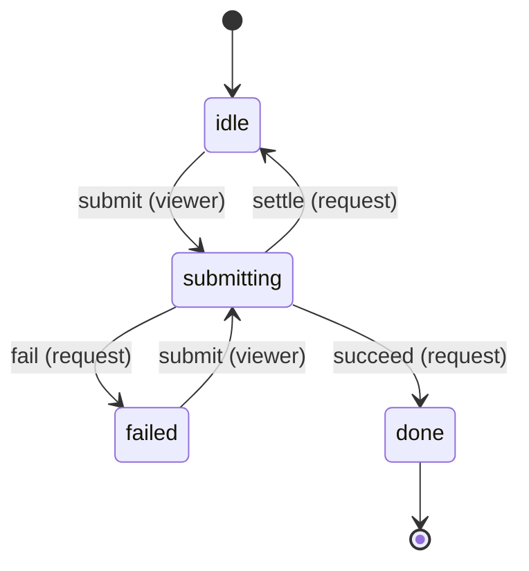

| Event | From | To | Actors | Writers | Note |
| --- | --- | --- | --- | --- | --- |
| `submit` | `idle`, `failed` | `submitting` | viewer | `src/lib/ui/use-submit-phase.ts`<br>`src/components/tournament/TournamentForm.tsx`<br>`src/components/league/LeagueForm.tsx`<br>`src/components/league/EpbImportPanel.tsx` |  |
| `succeed` | `submitting` | `done` | request | `src/lib/ui/use-submit-phase.ts`<br>`src/components/tournament/TournamentForm.tsx`<br>`src/components/league/LeagueForm.tsx`<br>`src/components/league/EpbImportPanel.tsx` | A create that navigates, a live import. |
| `settle` | `submitting` | `idle` | request | `src/lib/ui/use-submit-phase.ts`<br>`src/components/tournament/TournamentForm.tsx`<br>`src/components/league/LeagueForm.tsx`<br>`src/components/league/EpbImportPanel.tsx` | A success that keeps the form open: an edit save, a dry run. |
| `fail` | `submitting` | `failed` | request | `src/lib/ui/use-submit-phase.ts`<br>`src/components/tournament/TournamentForm.tsx`<br>`src/components/league/LeagueForm.tsx`<br>`src/components/league/EpbImportPanel.tsx` | The form shows the error; a retry is a new submit. |

## Visible poller

- **Id:** `client.visible_poller`
- **State lives in:** client: createVisiblePoller closure (src/lib/draft/use-visible-poll.ts)
- **Module doc:** `docs/draft-room.md`
- **States:** `stopped`, `live`, `complete`, `halted`
- **Actors:** `consumer`, `tick`

One poller per live draft screen (and the notification bell, the OBS draft overlay, the hidden-tab turn watch). A tick reports live, complete or stop; the poller schedules the next read from that. Ticks chain with setTimeout and never overlap.

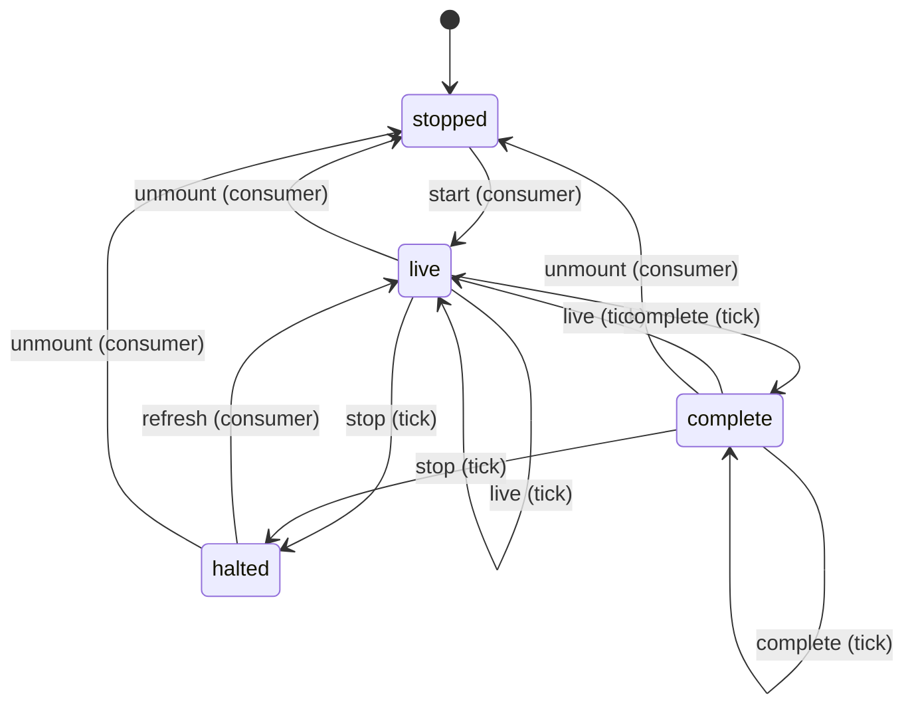

| Event | From | To | Actors | Writers | Note |
| --- | --- | --- | --- | --- | --- |
| `start` | `stopped` | `live` | consumer | `src/lib/draft/use-visible-poll.ts` | Reads at once, also in a hidden tab. |
| `live` | `live`, `complete` | `live` | tick | `src/lib/draft/use-visible-poll.ts`<br>`src/components/draft-tool/hooks/use-draft-snapshot.ts`<br>`src/components/draft/draft-board-sync.ts`<br>`src/components/draft-tool/hooks/use-turn-watch.ts`<br>`src/components/draft-admin/pool-admin.tsx`<br>`src/components/notifications/NotificationBell.tsx`<br>`src/components/broadcast/overlays/DraftViewer.tsx` | Next read after liveIntervalMs. |
| `complete` | `live`, `complete` | `complete` | tick | `src/lib/draft/use-visible-poll.ts`<br>`src/components/draft-tool/hooks/use-draft-snapshot.ts`<br>`src/components/draft/draft-board-sync.ts`<br>`src/components/draft-tool/hooks/use-turn-watch.ts`<br>`src/components/draft-admin/pool-admin.tsx`<br>`src/components/notifications/NotificationBell.tsx`<br>`src/components/broadcast/overlays/DraftViewer.tsx` | Next read after completeIntervalMs (>= 60 s), or none when it is null. |
| `stop` | `live`, `complete` | `halted` | tick | `src/lib/draft/use-visible-poll.ts`<br>`src/components/draft-tool/hooks/use-draft-snapshot.ts`<br>`src/components/draft/draft-board-sync.ts`<br>`src/components/draft-tool/hooks/use-turn-watch.ts`<br>`src/components/draft-admin/pool-admin.tsx`<br>`src/components/notifications/NotificationBell.tsx`<br>`src/components/broadcast/overlays/DraftViewer.tsx` | 401/403 (the turn watch also 404/409): asking again cannot help. |
| `refresh` | `halted` | `live` | consumer | `src/lib/draft/use-visible-poll.ts` | refresh() after a write reads now; the read decides the next state. |
| `unmount` | `live`, `complete`, `halted` | `stopped` | consumer | `src/lib/draft/use-visible-poll.ts` | Aborts the running tick. |

## Draft pool pause

- **Id:** `draft_pool.pause`
- **State lives in:** draft_pools.paused_at (+ paused_by, pause_reason) while phase = 'drafting'
- **Module doc:** `docs/draft-room.md`
- **States:** `running`, `paused`
- **Actors:** `admin`, `system`

A paused pool runs no clock: the active slot's deadline_at is NULL and remaining_ms_at_pause holds its rest, and draft__resolve_timeouts skips the pool. Pick corrections (void, correct, restore a drop) need a paused drafting pool or a complete one (CORRECTION_REQUIRES_PAUSE). pause_reason 'blocked_slot' is retired: nothing writes it any more.

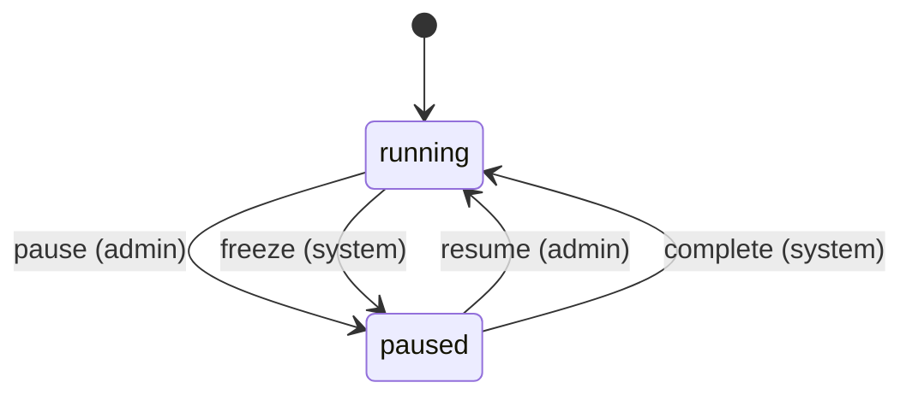

| Event | From | To | Actors | Writers | Note |
| --- | --- | --- | --- | --- | --- |
| `pause` | `running` | `paused` | admin | `supabase/migrations/20261018140100_draft_quiet_hours.sql#draft_set_paused`<br>`src/app/api/drafts/[id]/pause/route.ts`<br>`supabase/migrations/20261018180000_league_groups.sql#draft_admin_void_pick` | A paused pool answers ALREADY_PAUSED; outside drafting DRAFT_NOT_ACTIVE. A complete pool (never paused) reopened by a void also comes back paused. |
| `freeze` | `running` | `paused` | system | `supabase/migrations/20261026091000_league_trash.sql#league_trash_delete` | Moving a league to the recycle bin pauses its running drafts; restoring it keeps them paused. |
| `resume` | `paused` | `running` | admin | `supabase/migrations/20261018140100_draft_quiet_hours.sql#draft_set_paused`<br>`supabase/migrations/20261018140100_draft_quiet_hours.sql#draft__resume`<br>`src/app/api/drafts/[id]/pause/route.ts` | A running pool answers NOT_PAUSED. Restarts the active clock with its remaining time, or activates the next slot. |
| `complete` | `paused` | `running` | system | `supabase/migrations/20261018140200_draft_pool_completability.sql#draft__activate_next` | A restored drop that empties the queue completes the pool, which clears the pause. |

## Draft pool (queue engine)

- **Id:** `draft_pool.phase`
- **State lives in:** draft_pools.phase where engine = 'queue' (+ the status twin)
- **Module doc:** `docs/draft-room.md`
- **States:** `setup`, `submissions`, `drafting`, `complete`, `cancelled`
- **Actors:** `admin`, `system`

An Initial draft starts in setup, a Redraft in submissions (created by draft_create_pool). Every writer sets status next to phase (DRAFT_PHASE_STATUS: setup → pending, submissions and drafting → in_progress, complete and cancelled → complete); no CHECK ties them, so read phase, never status, to tell a cancelled pool from a complete one. Inside drafting the clock can be paused (draft_pool.pause); inside submissions the drops lock when the deadline passes (redraft.submission_window). complete is not terminal: voiding a pick reopens the draft, paused. A pool leaves the machine only by DELETE (setup or cancelled, DELETABLE_QUEUE_PHASES). The system moves run inside reads too: draft_snapshot (GET /api/drafts/[id]/state), draft_my_turn and the draft-ticks cron all call draft__tick.

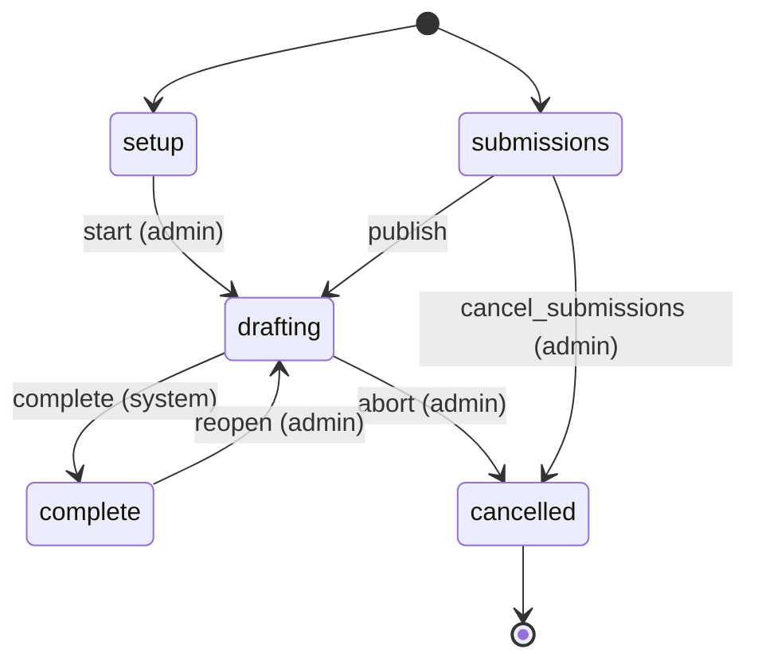

| Event | From | To | Actors | Writers | Note |
| --- | --- | --- | --- | --- | --- |
| `start` | `setup` | `drafting` | admin | `supabase/migrations/20261027190000_draft_start_reroll_every_two_rounds.sql#draft_start`<br>`src/app/api/drafts/[id]/start/route.ts` | Initial drafts only (a Redraft answers SUBMISSION_PHASE); a started pool answers DRAFT_ALREADY_STARTED. Clears any pause. |
| `publish` | `submissions` | `drafting` | admin, system | `supabase/migrations/20261018180000_league_groups.sql#redraft__publish_locked`<br>`supabase/migrations/20261012025023_redraft_rpcs.sql#redraft_publish`<br>`supabase/migrations/20261102150000_draft_list_due_pools.sql#draft__tick` | An admin publishes the drops (before the deadline only with force and a reason), or draft__tick does once the deadline passed; a refused publish stays in submissions with a backoff. |
| `complete` | `drafting` | `complete` | system | `supabase/migrations/20261018140200_draft_pool_completability.sql#draft__activate_next` | The queue runs empty after a pick, a timeout, a resume or a restored drop; clears the pause and stamps ended_at. |
| `abort` | `drafting` | `cancelled` | admin | `supabase/migrations/20261018180000_league_groups.sql#draft_end`<br>`src/app/api/drafts/[id]/end/route.ts` | Initial drafts only (a running Redraft answers DRAFT_ABORT_NOT_ALLOWED): voids every live pick and discards the open slots. |
| `cancel_submissions` | `submissions` | `cancelled` | admin | `supabase/migrations/20261018180000_league_groups.sql#draft_end`<br>`src/app/api/drafts/[id]/end/route.ts` | A Redraft still collecting drops (API only, no button). |
| `reopen` | `complete` | `drafting` | admin | `supabase/migrations/20261018180000_league_groups.sql#draft_admin_void_pick`<br>`src/app/api/drafts/[id]/picks/[pickId]/void/route.ts`<br>`src/app/api/drafts/[id]/picks/[pickId]/correct/route.ts` | Voiding (or correcting) a pick of a complete draft requeues its slot and reopens the draft paused (pause_reason admin, ended_at cleared). The Draft Kill Token window falls back to before. |

## Draft pool (legacy engine)

- **Id:** `draft_pool.status`
- **State lives in:** draft_pools.status (enum draft_pool_status) where engine = 'legacy'
- **Module doc:** `docs/draft-room.md`
- **States:** `pending`, `in_progress`, `complete`
- **Actors:** `admin`, `system`

A pre-queue draft board: an admin opens it to picks, the last pick (or the first state read after it) completes it. The trigger trg_draft_pools_sync_legacy_phase mirrors every status write into phase. An admin may still reopen a complete pool or move a pool back to pending (docs/draft-room.md: retiring a legacy pool of a point-buy season), so no state is terminal; pending → complete is refused (an admin ends a running draft instead).

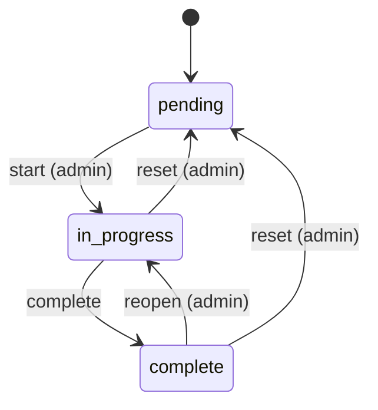

| Event | From | To | Actors | Writers | Note |
| --- | --- | --- | --- | --- | --- |
| `start` | `pending` | `in_progress` | admin | `src/app/api/drafts/[id]/route.ts`<br>`src/lib/supabase/queries/drafts.ts` | DraftBoard Start (and the admin agent's staged propose_draft_activate_legacy_pool). A pool of a point-buy season answers POOL_ENGINE_LEGACY_EPB. |
| `complete` | `in_progress` | `complete` | admin, system | `src/app/api/drafts/[id]/route.ts`<br>`src/app/api/drafts/[id]/picks/route.ts`<br>`src/app/api/drafts/[id]/state/route.ts`<br>`src/lib/supabase/queries/drafts.ts` | An admin ends the draft (DraftBoard End draft), or the system after the last pick: the pick route, else the first GET /api/drafts/[id]/state. |
| `reopen` | `complete` | `in_progress` | admin | `src/app/api/drafts/[id]/route.ts`<br>`src/lib/supabase/queries/drafts.ts` | API only (no button): reopens a finished draft, e.g. to undo its last pick. The next state read completes it again while every pick is made. |
| `reset` | `in_progress`, `complete` | `pending` | admin | `src/app/api/drafts/[id]/route.ts`<br>`src/lib/supabase/queries/drafts.ts` | API only (no button): docs/draft-room.md moves a legacy pool of a point-buy season back to pending so it can be deleted. |

## Draft room armed confirm

- **Id:** `draft_room.armed_confirm`
- **State lives in:** client: armedConfirmReducer phase in ArmedConfirmDialog
- **Module doc:** `docs/draft-room.md`
- **States:** `closed`, `arming`, `armed`, `submitting`
- **Actors:** `viewer`, `timer`, `flow`

The confirm button of a pick or token dialog is enabled only in armed: it stays disabled for CONFIRM_ARM_MS after every open and after every re-arming failure, and while a submission is in flight. A timer for an older arm token is ignored.

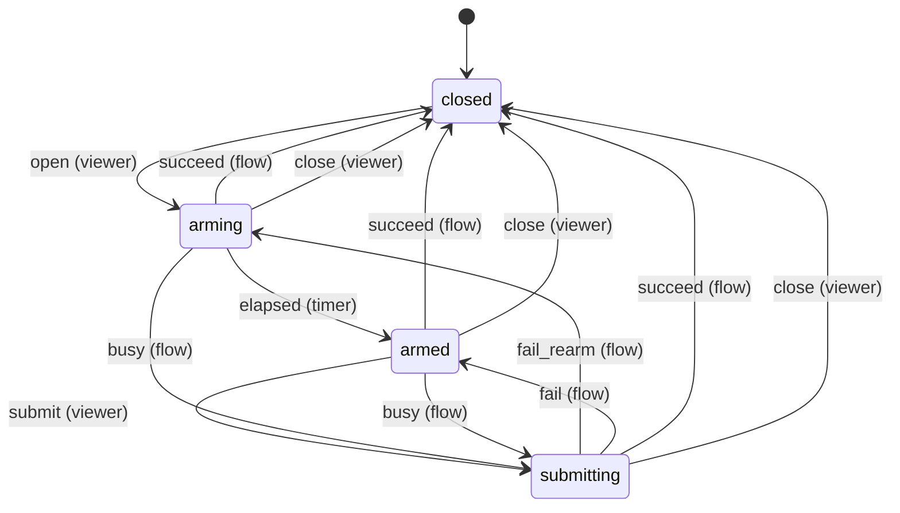

| Event | From | To | Actors | Writers | Note |
| --- | --- | --- | --- | --- | --- |
| `open` | `closed` | `arming` | viewer | `src/lib/draft-ui/armed-confirm.ts`<br>`src/components/draft-tool/shared/ArmedConfirmDialog.tsx` |  |
| `elapsed` | `arming` | `armed` | timer | `src/lib/draft-ui/armed-confirm.ts`<br>`src/components/draft-tool/shared/ArmedConfirmDialog.tsx` | Only the timer of the current arm token. |
| `submit` | `armed` | `submitting` | viewer | `src/lib/draft-ui/armed-confirm.ts`<br>`src/components/draft-tool/shared/ArmedConfirmDialog.tsx` |  |
| `busy` | `arming`, `armed` | `submitting` | flow | `src/lib/draft-ui/armed-confirm.ts`<br>`src/components/draft-tool/shared/ArmedConfirmDialog.tsx` | The caller reports a submission in flight. |
| `fail_rearm` | `submitting` | `arming` | flow | `src/lib/draft-ui/armed-confirm.ts`<br>`src/components/draft-tool/shared/ArmedConfirmDialog.tsx` | Default after a failure: a new arm token. |
| `fail` | `submitting` | `armed` | flow | `src/lib/draft-ui/armed-confirm.ts`<br>`src/components/draft-tool/shared/ArmedConfirmDialog.tsx` | `failed` with `rearm: false`. |
| `succeed` | `arming`, `armed`, `submitting` | `closed` | flow | `src/lib/draft-ui/armed-confirm.ts`<br>`src/components/draft-tool/shared/ArmedConfirmDialog.tsx` |  |
| `close` | `arming`, `armed`, `submitting` | `closed` | viewer | `src/lib/draft-ui/armed-confirm.ts`<br>`src/components/draft-tool/shared/ArmedConfirmDialog.tsx` |  |

## Draft room pick dialog

- **Id:** `draft_room.pick_flow`
- **State lives in:** client: pickFlowReducer state (open, submitting) in DraftToolClient
- **Module doc:** `docs/draft-room.md`
- **States:** `closed`, `open`, `submitting`
- **Actors:** `viewer`, `server`

The confirm dialog of one pick. The request id minted on open is reused for every retry of that dialog (idempotent on the server); a cancel is refused while a pick is in flight. A server answer either closes the dialog (success, or an error that makes it moot: CLOSING_PICK_ERRORS) or reopens it with the error inline (network errors offer Retry).

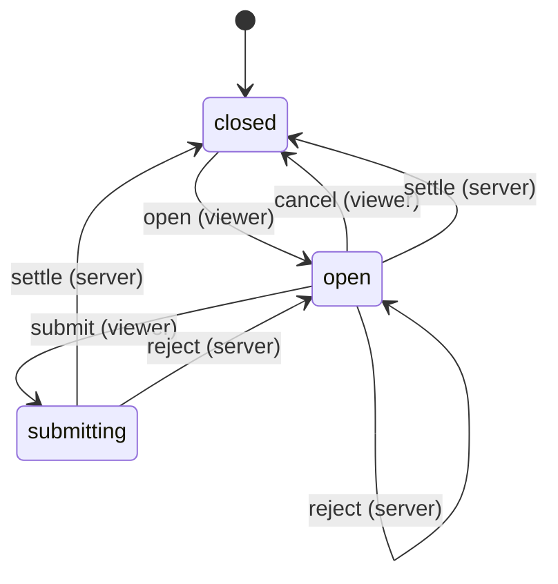

| Event | From | To | Actors | Writers | Note |
| --- | --- | --- | --- | --- | --- |
| `open` | `closed` | `open` | viewer | `src/components/draft-tool/hooks/pick-flow.ts`<br>`src/components/draft-tool/DraftToolClient.tsx` | Mints the request id; an open dialog ignores a second open. |
| `submit` | `open` | `submitting` | viewer | `src/components/draft-tool/hooks/pick-flow.ts`<br>`src/components/draft-tool/DraftToolClient.tsx` | Clears the previous error. |
| `cancel` | `open` | `closed` | viewer | `src/components/draft-tool/hooks/pick-flow.ts`<br>`src/components/draft-tool/DraftToolClient.tsx` | Not while a pick is in flight. |
| `settle` | `open`, `submitting` | `closed` | server | `src/components/draft-tool/hooks/pick-flow.ts`<br>`src/components/draft-tool/DraftToolClient.tsx` | Success, or a closing error (toast + refresh). |
| `reject` | `open`, `submitting` | `open` | server | `src/components/draft-tool/hooks/pick-flow.ts`<br>`src/components/draft-tool/DraftToolClient.tsx` | A validation or network error stays inline; network errors set retryable. |

## Draft slot

- **Id:** `draft_slot.status`
- **State lives in:** draft_slots.status
- **Module doc:** `docs/draft-room.md`
- **States:** `pending`, `active`, `done`, `timed_out`
- **Actors:** `player`, `admin`, `system`

A slot is inserted pending (draft_start, the Redraft publish, a timeout's make-up slot, a voided pick's requeued slot). At most one slot of a pool is current (uq_draft_slots_one_current). draft_end and redraft_admin_restore_drop delete pending and active slots instead of moving them. Retired: blocked and forfeited (RETIRED_SLOT_STATUSES) are still allowed by the CHECK and the SlotStatus type, but nothing writes them any more, so they are not states of this machine.

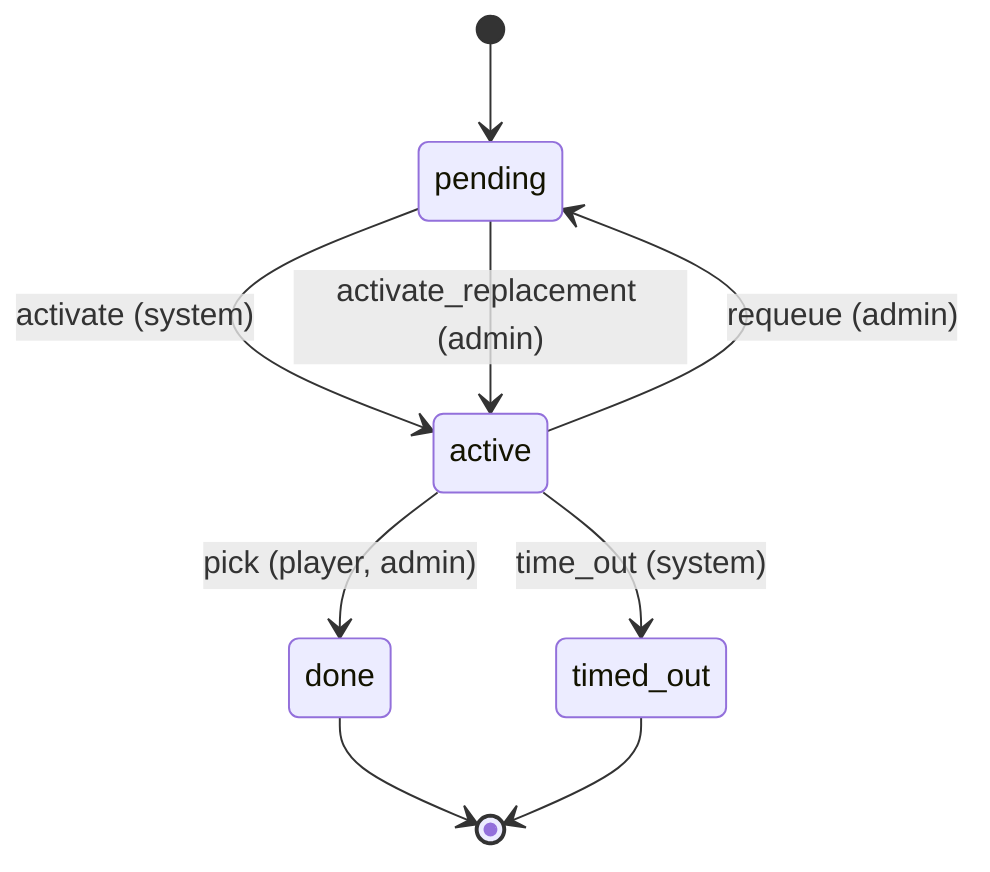

| Event | From | To | Actors | Writers | Note |
| --- | --- | --- | --- | --- | --- |
| `activate` | `pending` | `active` | system | `supabase/migrations/20261018140200_draft_pool_completability.sql#draft__activate_next` | The first pending slot by sort_key gets the clock (none while another slot is current: ACTIVE_SLOT_EXISTS). |
| `activate_replacement` | `pending` | `active` | admin | `supabase/migrations/20261018180000_league_groups.sql#draft_admin_void_pick` | A correction activates the requeued slot and commits the replacement pick in the same statement. |
| `pick` | `active` | `done` | player, admin | `supabase/migrations/20261018180000_league_groups.sql#draft__commit_pick`<br>`supabase/migrations/20261018140200_draft_pool_completability.sql#draft_confirm_pick` | The player on the clock, or an admin override, picks; a wrong slot answers STALE_SLOT. |
| `time_out` | `active` | `timed_out` | system | `supabase/migrations/20261012024916_draft_rpcs.sql#draft__resolve_timeouts` | The deadline passed in an unpaused drafting pool; a make-up slot is queued behind the next player. |
| `requeue` | `active` | `pending` | admin | `supabase/migrations/20261018180000_league_groups.sql#draft_admin_void_pick` | A void puts the current slot back in the queue behind the requeued one. |

## Draft Kill Token window

- **Id:** `draft.kill_token_window`
- **State lives in:** derived: the initial pool's phase, draft_pools.token_purchase_closes_at and the league's completed matches
- **Module doc:** `docs/draft-room.md`
- **States:** `before`, `open`, `closed`
- **Actors:** `admin`, `system`

before until the player's Initial draft is complete; then open until token_purchase_closes_at (or, without one, until the first league match is completed); then closed. Writers are the inputs' writers: the window moves when they change, and is recomputed wherever it is read (tokens overview, TokenCenter, the purchase RPC).

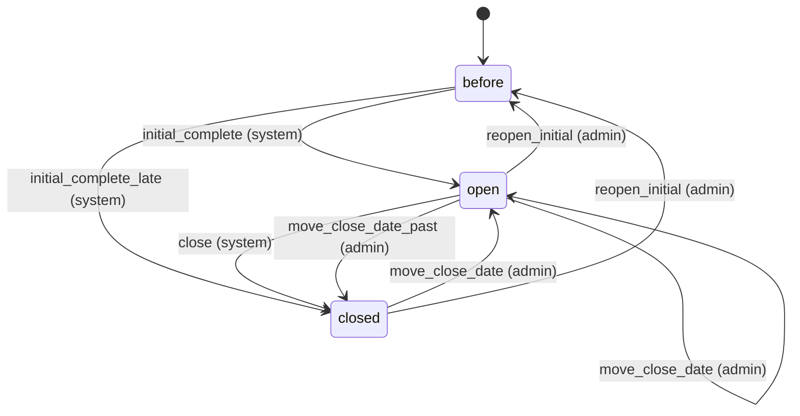

| Event | From | To | Actors | Writers | Note |
| --- | --- | --- | --- | --- | --- |
| `initial_complete` | `before` | `open` | system | `supabase/migrations/20261018140200_draft_pool_completability.sql#draft__activate_next`<br>`src/lib/draft/tokens.ts`<br>`supabase/migrations/20261027193000_draft_token_participation_rate.sql#epb_purchase_draft_token` | The Initial draft completes while the close date is ahead (or none is set and no match is completed). |
| `initial_complete_late` | `before` | `closed` | system | `supabase/migrations/20261018140200_draft_pool_completability.sql#draft__activate_next`<br>`src/lib/draft/tokens.ts`<br>`supabase/migrations/20261027193000_draft_token_participation_rate.sql#epb_purchase_draft_token` | The Initial draft completes after the close date (or after the first completed match). |
| `close` | `open` | `closed` | system | `src/lib/draft/tokens.ts`<br>`supabase/migrations/20261027193000_draft_token_participation_rate.sql#epb_purchase_draft_token` | The close date passes, or without one the first league match is completed. |
| `move_close_date` | `open`, `closed` | `open` | admin | `supabase/migrations/20261018180000_league_groups.sql#draft_configure`<br>`src/app/api/drafts/[id]/config/route.ts` | token_purchase_closes_at is editable in every phase: a later date reopens a closed window (also after matches were played). |
| `move_close_date_past` | `open` | `closed` | admin | `supabase/migrations/20261018180000_league_groups.sql#draft_configure`<br>`src/app/api/drafts/[id]/config/route.ts` | An earlier close date closes the window at once. |
| `reopen_initial` | `open`, `closed` | `before` | admin | `supabase/migrations/20261018180000_league_groups.sql#draft_admin_void_pick` | Voiding a pick of the complete Initial draft reopens it (draft_pool.phase reopen). |

## Format action submission

- **Id:** `format_action_submission`
- **State lives in:** format_action_submissions.status
- **Module doc:** `docs/format-kit.md`
- **States:** `draft`, `submitted`, `locked`
- **Actors:** `player`, `admin`, `system`

A player's pick for one player action. A draft is saved, a submission grants the pick's items, and a lock makes it final. Every writer in SQL refuses a locked row (action_locked); format_action_save writes only a draft and refuses a submitted pick under the action's lock (action_already_submitted, answered as format_action_already_submitted), so a save never demotes a submission.

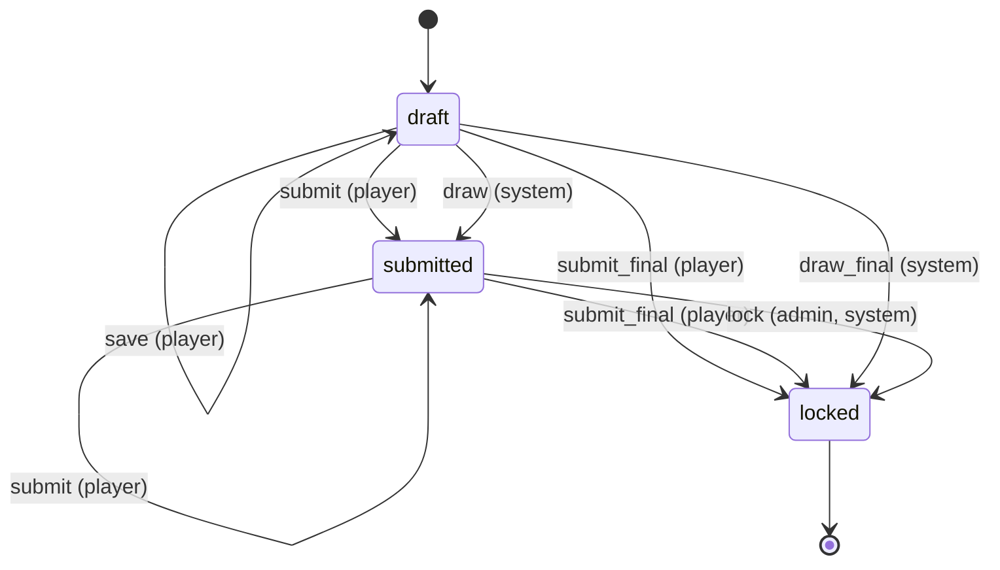

| Event | From | To | Actors | Writers | Note |
| --- | --- | --- | --- | --- | --- |
| `save` | `draft` | `draft` | player | `src/lib/format-engine/runtime/actions-server.ts`<br>`supabase/migrations/20261109090000_format_action_save_draft_only.sql#format_action_save` | Save draft. The first save inserts the row. |
| `submit` | `draft`, `submitted` | `submitted` | player | `src/lib/format-engine/runtime/actions-server.ts`<br>`supabase/migrations/20261105090000_format_runtime.sql#format_action_submit` | Submit, or submit again: the new picks replace the old ones and their items; submitted_at records the last submission. |
| `submit_final` | `draft`, `submitted` | `locked` | player | `src/lib/format-engine/runtime/actions-server.ts`<br>`supabase/migrations/20261105090000_format_runtime.sql#format_action_submit` | Submit on an action whose lock is on_submit: the pick is final at once. |
| `draw` | `draft` | `submitted` | system | `src/lib/format-engine/runtime/cron.ts`<br>`supabase/migrations/20261105090000_format_runtime.sql#format_action_submit` | The cron's deadline pick (seeded_random_pick) for a player who has not submitted: p_only_if_unsubmitted refuses anything but a draft or no row (action_already_submitted). |
| `draw_final` | `draft` | `locked` | system | `src/lib/format-engine/runtime/cron.ts`<br>`supabase/migrations/20261105090000_format_runtime.sql#format_action_submit` | The deadline pick on an action whose lock is on_submit. |
| `lock` | `submitted` | `locked` | admin, system | `src/lib/format-engine/runtime/adjust.ts`<br>`src/lib/format-engine/runtime/effects.ts`<br>`supabase/migrations/20261105090000_format_runtime.sql#format__apply_ops` | The window locks (lock_action op): every submitted pick becomes final. A draft stays a draft: it is not a submission. |

## Format action window

- **Id:** `format_action_window`
- **State lives in:** format_flags 'action:<id>' + the rule's window.opens_on
- **Module doc:** `docs/format-kit.md`
- **States:** `not_open_yet`, `open`, `locked`
- **Actors:** `admin`, `system`

When players may pick for a player action. The format's events and time marks open and lock it (format__apply_ops writes the flag unconditionally, so the system may repeat a move); an admin opens or locks it with an action adjustment, which refuses a move to the state the window is already in (action_state_unchanged). Opening a locked window does not unlock the picks the lock made final.

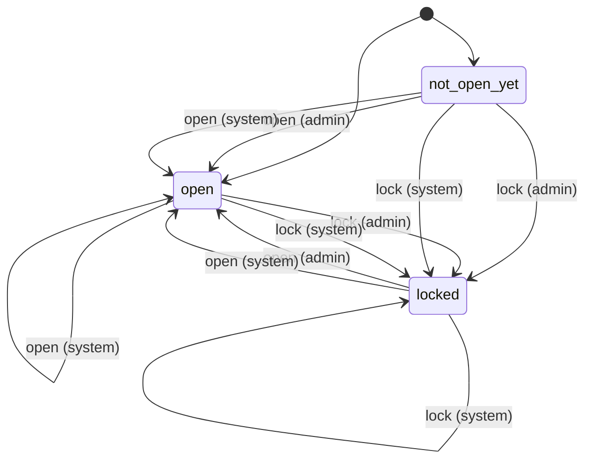

| Event | From | To | Actors | Writers | Note |
| --- | --- | --- | --- | --- | --- |
| `open` | `not_open_yet`, `locked` | `open` | admin | `src/lib/format-engine/runtime/adjust.ts`<br>`supabase/migrations/20261105090000_format_runtime.sql#format__apply_ops` | Action adjustment with state open. Reopening a locked window leaves locked picks locked. |
| `open` | `not_open_yet`, `open`, `locked` | `open` | system | `src/lib/format-engine/runtime/effects.ts`<br>`supabase/migrations/20261105090000_format_runtime.sql#format__apply_ops` | An event or time mark the rule's window.opens_on matches (open_action op). A late open after a lock reopens the window; the cron replays due marks in order (calendar.ts) so a later mark's lock wins. |
| `lock` | `not_open_yet`, `open` | `locked` | admin | `src/lib/format-engine/runtime/adjust.ts`<br>`supabase/migrations/20261105090000_format_runtime.sql#format__apply_ops` | Action adjustment with state locked: locks every submitted pick too and fires action_locked. |
| `lock` | `not_open_yet`, `open`, `locked` | `locked` | system | `src/lib/format-engine/runtime/effects.ts`<br>`src/lib/format-engine/runtime/cron.ts`<br>`supabase/migrations/20261105090000_format_runtime.sql#format__apply_ops` | An event or time mark the rule's window.closes_on matches, or the cron's auto_lock policy (lock_action op): locks every submitted pick too. |

## Format challenge

- **Id:** `format_challenge`
- **State lives in:** format_challenges.status
- **Module doc:** `docs/format-kit.md`
- **States:** `open`, `accepted`, `declined`, `expired`, `cancelled`
- **Actors:** `challenger`, `defender`, `admin`, `system`

A ladder challenge from challenger to defender. Only an open challenge moves, except that deleting a round cancels the accepted challenges whose match it deletes. 'cancelled' covers a withdrawal, a player who left the phase and a deleted match; the cooldown counts every status but cancelled. The notify trigger writes a notification for every status change.

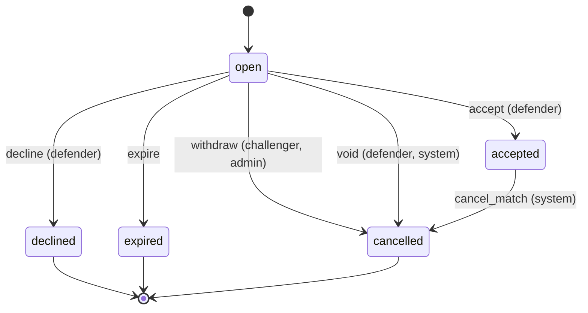

| Event | From | To | Actors | Writers | Note |
| --- | --- | --- | --- | --- | --- |
| `accept` | `open` | `accepted` | defender | `src/lib/supabase/queries/format-challenges.ts`<br>`supabase/migrations/20261106090000_format_challenges.sql#format_challenge_respond` | The defender accepts while the engine is kit and the phase is not completed: a scheduled match is created in the open round. |
| `decline` | `open` | `declined` | defender | `src/lib/supabase/queries/format-challenges.ts`<br>`supabase/migrations/20261106090000_format_challenges.sql#format_challenge_respond` |  |
| `withdraw` | `open` | `cancelled` | challenger, admin | `src/lib/supabase/queries/format-challenges.ts`<br>`supabase/migrations/20261108090000_format_notifications.sql#format_challenge_cancel` | The challenger withdraws, or an admin for them. |
| `void` | `open` | `cancelled` | defender, system | `supabase/migrations/20261106090000_format_challenges.sql#format_challenge_respond`<br>`supabase/migrations/20261106090000_format_challenges.sql#format_challenge_create` | A player left the phase: found by an accept (stored, then challenge_player_not_enrolled) or swept by the next create in the phase. |
| `expire` | `open` | `expired` | challenger, defender, admin, system | `src/lib/format-engine/challenge-server.ts`<br>`supabase/migrations/20261106090000_format_challenges.sql#format_challenges_expire`<br>`supabase/migrations/20261106090000_format_challenges.sql#format_challenge_create`<br>`supabase/migrations/20261106090000_format_challenges.sql#format_challenge_respond`<br>`supabase/migrations/20261108090000_format_notifications.sql#format_challenge_cancel` | The accept window ran out: the cron sweep, a create in the phase, or a late answer or withdrawal (stored, then challenge_expired). |
| `cancel_match` | `accepted` | `cancelled` | system | `supabase/migrations/20261109090000_format_action_save_draft_only.sql#round_delete` | Deleting a round with only scheduled matches cancels the accepted challenges whose match it deletes (the UPDATE is guarded by status = 'accepted'). |

## Format check

- **Id:** `format_check`
- **State lives in:** format_checks.status
- **Module doc:** `docs/format-kit.md`
- **States:** `open`, `confirmed`, `rejected`
- **Actors:** `admin`, `system`

A check the format opens for an admin (standings tie, missed deadline, team audit, pairing rule, unresolved outcome). An admin confirms or rejects it once; a match reset or reopen rejects the match's own open checks. A resolved check never reopens, and its dedupe key stays taken.

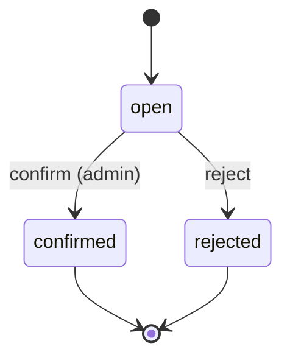

| Event | From | To | Actors | Writers | Note |
| --- | --- | --- | --- | --- | --- |
| `confirm` | `open` | `confirmed` | admin | `src/lib/format-engine/runtime/checks-server.ts`<br>`supabase/migrations/20261105090000_format_runtime.sql#format_check_resolve` |  |
| `reject` | `open` | `rejected` | admin, system | `src/lib/format-engine/runtime/checks-server.ts`<br>`src/lib/format-engine/runtime/hooks.ts`<br>`supabase/migrations/20261105090000_format_runtime.sql#format_check_resolve` | An admin's verdict, or the system closing a match's checks when the match is reset or reopened (note match_reset). |

## Format notification read

- **Id:** `format_notification_read`
- **State lives in:** format_notifications.read_at
- **Module doc:** `docs/format-kit.md`
- **States:** `unread`, `read`
- **Actors:** `player`

A player's format notification, unread until the player marks it read. Nothing marks it unread again.

```mermaid
stateDiagram-v2
  [*] --> unread
  unread --> read: mark_read
  read --> [*]
```

| Event | From | To | Actors | Writers | Note |
| --- | --- | --- | --- | --- | --- |
| `mark_read` | `unread` | `read` | player | `src/app/api/notifications/read/route.ts`<br>`src/lib/supabase/queries/format-notifications.ts` | The player marks some or all of their own notifications read. |

## Format relation reveal

- **Id:** `format_relation_reveal`
- **State lives in:** format_relation_links.revealed_at
- **Module doc:** `docs/format-kit.md`
- **States:** `hidden`, `revealed`
- **Actors:** `admin`, `system`

Whether the links of a relation (a secret-santa draw) are visible to the players. A reveal on a relation without links changes no row, so a draw after the reveal event stays hidden; the planners only reveal links that exist.

```mermaid
stateDiagram-v2
  [*] --> hidden
  hidden --> revealed: reveal
  revealed --> [*]
```

| Event | From | To | Actors | Writers | Note |
| --- | --- | --- | --- | --- | --- |
| `reveal` | `hidden` | `revealed` | admin, system | `src/lib/format-engine/runtime/adjust.ts`<br>`src/lib/format-engine/runtime/effects.ts`<br>`supabase/migrations/20261105090000_format_runtime.sql#format__apply_ops` | A relation adjustment with reveal, or the event the relation's reveal_on matches. |

## Game aggregate marker

- **Id:** `game.aggregate_applied_at`
- **State lives in:** games.aggregate_applied_at (NULL = uncounted)
- **Module doc:** `docs/match.md`
- **States:** `uncounted`, `counted`
- **Actors:** `queue`, `admin`

Whether a game's battle stats are counted in `aggregates` and `player_aggregates`. The counts and the marker change in one transaction under the game row lock. A game is deleted only while uncounted (`deleteUncountedGameRow`); a league restore re-inserts its games uncounted and queues one job each. A scope rebuild re-derives the counts without touching the marker, so it skips games with a live job.

```mermaid
stateDiagram-v2
  [*] --> uncounted
  uncounted --> counted: apply
  counted --> uncounted: rollback (admin)
```

| Event | From | To | Actors | Writers | Note |
| --- | --- | --- | --- | --- | --- |
| `apply` | `uncounted` | `counted` | queue, admin | `supabase/migrations/20261018130100_aggregate_apply_atomic.sql#apply_aggregate_job`<br>`src/lib/supabase/queries/aggregates.ts`<br>`src/lib/match/aggregate-queue.ts` | The queue worker, or an admin game edit re-applying the new stats; a counted game answers already_applied. |
| `rollback` | `counted` | `uncounted` | admin | `supabase/migrations/20261018170000_aggregate_rollback_atomic.sql#rollback_game_aggregates`<br>`src/lib/supabase/queries/aggregates.ts`<br>`src/lib/pkmn/game-pipeline.ts` | Admin game edit, game delete or match reset; fenced on the marker the deltas were built under (marker_changed otherwise). |

## Game edit lease

- **Id:** `game.edit_lease`
- **State lives in:** games.edit_lease_token + games.edit_lease_until (both NULL or both set)
- **Module doc:** `docs/match.md`
- **States:** `free`, `leased`, `expired`
- **Actors:** `admin`, `clock`

One admin edit of a game at a time. Only `editGame` takes the lease; game delete, match reset and winner edits rely on the aggregate marker fence instead. `expired` is a lease whose edit_lease_until has passed: free in effect, cleared lazily by the next claim or the release.

```mermaid
stateDiagram-v2
  [*] --> free
  free --> leased: claim (admin)
  expired --> leased: claim (admin)
  leased --> free: release (admin)
  expired --> free: release (admin)
  leased --> expired: lapse (clock)
```

| Event | From | To | Actors | Writers | Note |
| --- | --- | --- | --- | --- | --- |
| `claim` | `free`, `expired` | `leased` | admin | `supabase/migrations/20261019100000_games_edit_lease.sql#claim_game_edit_lease`<br>`src/lib/supabase/queries/games.ts`<br>`src/lib/pkmn/game-pipeline.ts` | Together with the editor's version (updated_at): leased or stale otherwise (409 admin_game_edit_in_progress / admin_game_edit_stale). |
| `release` | `leased`, `expired` | `free` | admin | `supabase/migrations/20261019100000_games_edit_lease.sql#release_game_edit_lease`<br>`src/lib/supabase/queries/games.ts`<br>`src/lib/pkmn/game-pipeline.ts` | The edit releases its own token in finally; another token releases nothing. |
| `lapse` | `leased` | `expired` | clock | `supabase/migrations/20261019100000_games_edit_lease.sql` | edit_lease_until passes (TTL 120 s), for example after a crashed edit. |

## Game evolution credit marker

- **Id:** `game.evolution_applied_at`
- **State lives in:** games.evolution_applied_at + games.evolution_credits
- **Module doc:** `docs/evolution-point-buy.md`
- **States:** `uncredited`, `credited`, `legacy_credited`
- **Actors:** `system`, `admin`, `rebuild`

Whether the real kills of an Evolution Point Buy game are credited to the trackers. `credited` holds the ledger of what was credited (evolution_credits); `legacy_credited` is a marker from before the ledger (evolution_credits NULL), debited from the caller's debits until the season is rebuilt once. Credit, uncredit and the season sync lock the game rows; the sync is fenced on the season epoch.

```mermaid
stateDiagram-v2
  [*] --> uncredited
  [*] --> legacy_credited
  uncredited --> credited: credit (system)
  credited --> uncredited: uncredit (admin)
  legacy_credited --> uncredited: uncredit (admin)
  uncredited --> credited: sync_mark (rebuild)
  credited --> credited: sync_rewrite (rebuild)
  legacy_credited --> credited: sync_rewrite (rebuild)
  credited --> uncredited: sync_clear (rebuild)
  legacy_credited --> uncredited: sync_clear (rebuild)
```

| Event | From | To | Actors | Writers | Note |
| --- | --- | --- | --- | --- | --- |
| `credit` | `uncredited` | `credited` | system | `supabase/migrations/20261021100100_epb_game_kill_credit_ledger.sql#epb_credit_game_kills`<br>`src/lib/supabase/queries/evolutions.ts`<br>`src/lib/match/evolution-match-evaluator.ts`<br>`src/lib/match/finalize.ts` | The finalize step epb_real_kills, once the match is completed (match_not_completed otherwise). |
| `uncredit` | `credited`, `legacy_credited` | `uncredited` | admin | `supabase/migrations/20261021100100_epb_game_kill_credit_ledger.sql#epb_uncredit_game_kills`<br>`src/lib/supabase/queries/evolutions.ts`<br>`src/lib/match/evolution-match-evaluator.ts`<br>`src/lib/pkmn/game-pipeline.ts` | An admin game edit that moves a completed match out of completed; fenced on the expected marker. |
| `sync_mark` | `uncredited` | `credited` | rebuild | `supabase/migrations/20261021100100_epb_game_kill_credit_ledger.sql#epb_sync_game_kill_credit`<br>`src/lib/reconcile/evolution-rebuild.ts` | The season evolution rebuild marks the games of completed matches it credited. |
| `sync_rewrite` | `credited`, `legacy_credited` | `credited` | rebuild | `supabase/migrations/20261021100100_epb_game_kill_credit_ledger.sql#epb_sync_game_kill_credit`<br>`src/lib/reconcile/evolution-rebuild.ts` | The rebuild rewrites the ledger of a credited game (a legacy marker gets its ledger). |
| `sync_clear` | `credited`, `legacy_credited` | `uncredited` | rebuild | `supabase/migrations/20261021100100_epb_game_kill_credit_ledger.sql#epb_sync_game_kill_credit`<br>`src/lib/reconcile/evolution-rebuild.ts` | The rebuild clears games of matches that are no longer completed. |

## Game stats lock

- **Id:** `game.stats_locked`
- **State lives in:** games.stats_locked
- **Module doc:** `docs/match.md`
- **States:** `unlocked`, `locked`
- **Actors:** `admin`

An admin replaced the battle stats of a game by hand, so re-parse tooling (scripts/reparse-game.ts) leaves it alone unless forced. Advisory: no route checks it. One-way in the app; an unlock is a manual database edit.

```mermaid
stateDiagram-v2
  [*] --> unlocked
  unlocked --> locked: lock
  locked --> locked: lock
```

| Event | From | To | Actors | Writers | Note |
| --- | --- | --- | --- | --- | --- |
| `lock` | `unlocked`, `locked` | `locked` | admin | `src/lib/supabase/queries/games.ts`<br>`src/lib/pkmn/game-pipeline.ts` | An admin game edit that replaces the battle stats (not a winner-only edit), after the re-apply. |

## League recycle bin

- **Id:** `league_trash`
- **State lives in:** derived: seasons row + league_trash (rebuild_pending, purge_after) + league_trash_restore_rebuilds
- **Module doc:** `docs/season.md`
- **States:** `live`, `rebuild_pending`, `in_bin`, `expired_rebuild_pending`, `purgeable`, `purged`, `restored_rebuild_pending`
- **Actors:** `admin`, `superadmin`, `system`, `clock`

A deleted league waits in the bin for LEAGUE_TRASH_RETENTION_DAYS. It can be restored only while its delete rebuild is confirmed and its purge date has not passed; the expiry cron purges it only once the rebuild is confirmed. `expired_rebuild_pending` is the limbo between the two: past its purge date with the delete rebuild still pending, neither restorable (LEAGUE_TRASH_EXPIRED) nor purgeable until a superadmin runs the rebuild.

```mermaid
stateDiagram-v2
  [*] --> live
  live --> rebuild_pending: delete (admin)
  restored_rebuild_pending --> rebuild_pending: delete (admin)
  rebuild_pending --> in_bin: rebuild_done (system, superadmin)
  expired_rebuild_pending --> purgeable: rebuild_done (superadmin)
  rebuild_pending --> expired_rebuild_pending: purge_date_passes (clock)
  in_bin --> purgeable: purge_date_passes (clock)
  in_bin --> restored_rebuild_pending: restore (superadmin)
  restored_rebuild_pending --> live: restore_rebuild_done (system, superadmin)
  purgeable --> purged: purge (system)
  purged --> [*]
```

| Event | From | To | Actors | Writers | Note |
| --- | --- | --- | --- | --- | --- |
| `delete` | `live`, `restored_rebuild_pending` | `rebuild_pending` | admin | `supabase/migrations/20261026091000_league_trash.sql#league_trash_delete`<br>`src/lib/supabase/queries/league-trash.ts`<br>`src/lib/league-trash/service.ts`<br>`src/app/api/seasons/[id]/route.ts` | DELETE /api/seasons/[id] (site admins). Deleting a restored league again drops its restore tombstone. |
| `rebuild_done` | `rebuild_pending` | `in_bin` | system, superadmin | `supabase/migrations/20261026091000_league_trash.sql#league_trash_rebuild_done`<br>`src/lib/supabase/queries/league-trash.ts`<br>`src/lib/league-trash/service.ts`<br>`src/app/api/admin/league-trash/[id]/rebuild/route.ts` | The delete's derived-data rebuild is confirmed: right after the delete, or later from the trash page's Run rebuild. |
| `rebuild_done` | `expired_rebuild_pending` | `purgeable` | superadmin | `supabase/migrations/20261026091000_league_trash.sql#league_trash_rebuild_done`<br>`src/lib/supabase/queries/league-trash.ts`<br>`src/lib/league-trash/service.ts`<br>`src/app/api/admin/league-trash/[id]/rebuild/route.ts` | The way out of the limbo: the rebuild works whatever the purge date. |
| `purge_date_passes` | `rebuild_pending` | `expired_rebuild_pending` | clock | `src/lib/league-trash/lifecycle-state.ts` | purge_after <= now while the delete rebuild is pending. |
| `purge_date_passes` | `in_bin` | `purgeable` | clock | `src/lib/league-trash/lifecycle-state.ts` | purge_after <= now: the entry can no longer be restored. |
| `restore` | `in_bin` | `restored_rebuild_pending` | superadmin | `supabase/migrations/20261106090000_format_challenges.sql#league_trash_restore`<br>`src/lib/supabase/queries/league-trash.ts`<br>`src/lib/league-trash/service.ts`<br>`src/app/api/admin/league-trash/[id]/restore/route.ts` | Refused past the purge date (LEAGUE_TRASH_EXPIRED) and while the delete rebuild is pending (LEAGUE_TRASH_REBUILD_PENDING). Writes the restore tombstone and queues the aggregate jobs of the counted games. |
| `restore_rebuild_done` | `restored_rebuild_pending` | `live` | system, superadmin | `supabase/migrations/20261026091000_league_trash.sql#league_trash_restore_rebuild_done`<br>`src/lib/supabase/queries/league-trash.ts`<br>`src/lib/league-trash/service.ts`<br>`src/app/api/admin/league-trash/[id]/rebuild/route.ts` | The restore's derived-data rebuild is confirmed and the tombstone deleted. |
| `purge` | `purgeable` | `purged` | system | `supabase/migrations/20261026091000_league_trash.sql#league_trash_expire`<br>`src/lib/supabase/queries/league-trash.ts`<br>`src/app/api/cron/expire-league-trash/route.ts` | The daily expire-league-trash cron; irreversible. |

## Match

- **Id:** `match`
- **State lives in:** matches.status (enum match_status) with confirmed_at, auto_confirm_at, date_played and finalized_at
- **Module doc:** `docs/match.md`
- **States:** `scheduled`, `in_progress`, `pending_confirmation`, `completed`, `disputed`
- **Actors:** `player`, `admin`, `system`

A pairing from scheduling to a confirmed result (spec Section 8). Every status write takes its timestamps from matchTimestampsFor: it clears finalized_at, a completion stamps confirmed_at and date_played and clears auto_confirm_at, a move into pending_confirmation starts the auto-confirm deadline of the result source, and a move back clears the result timestamps.

```mermaid
stateDiagram-v2
  [*] --> scheduled
  scheduled --> in_progress: record_game (player, admin)
  in_progress --> in_progress: record_game (player, admin)
  in_progress --> pending_confirmation: reach_threshold (player, admin)
  pending_confirmation --> completed: confirm (player, admin)
  pending_confirmation --> completed: auto_confirm (system)
  pending_confirmation --> disputed: dispute (player, admin)
  disputed --> completed: resolve_dispute (admin)
  scheduled --> completed: settle (admin)
  in_progress --> completed: set_result (admin)
  scheduled --> completed: forfeit (system)
  in_progress --> completed: forfeit (system)
  in_progress --> disputed: flag_dispute (admin)
  in_progress --> disputed: flag_tie (system)
  pending_confirmation --> in_progress: reopen (admin)
  completed --> in_progress: reopen (admin)
  disputed --> in_progress: reopen (admin)
  in_progress --> scheduled: reset (admin)
  pending_confirmation --> scheduled: reset (admin)
  completed --> scheduled: reset (admin)
  disputed --> scheduled: reset (admin)
  scheduled --> in_progress: recount (system)
  in_progress --> in_progress: recount (system)
  pending_confirmation --> in_progress: recount (system)
  completed --> in_progress: recount (system)
  disputed --> in_progress: recount (system)
  scheduled --> pending_confirmation: recount (system)
  in_progress --> pending_confirmation: recount (system)
  pending_confirmation --> pending_confirmation: recount (system)
  completed --> pending_confirmation: recount (system)
  disputed --> pending_confirmation: recount (system)
  scheduled --> scheduled: recount (system)
  in_progress --> scheduled: recount (system)
  pending_confirmation --> scheduled: recount (system)
  completed --> scheduled: recount (system)
  disputed --> scheduled: recount (system)
```

| Event | From | To | Actors | Writers | Note |
| --- | --- | --- | --- | --- | --- |
| `record_game` | `scheduled`, `in_progress` | `in_progress` | player, admin | `src/lib/pkmn/game-pipeline.ts` | A game is submitted and the series has no winner yet. |
| `reach_threshold` | `in_progress` | `pending_confirmation` | player, admin | `src/lib/pkmn/game-pipeline.ts` | A game gives one player the wins the best-of needs; auto_confirm_at starts the deadline of the result source (24 h for a replay, 48 h for a screenshot, none for a manual result without one). |
| `confirm` | `pending_confirmation` | `completed` | player, admin | `src/app/api/confirm-match/[mid]/route.ts`<br>`src/lib/match/bulk-actions.ts` | The opponent (not the submitter) or an admin confirms the reported result. |
| `auto_confirm` | `pending_confirmation` | `completed` | system | `src/app/api/cron/auto-confirm/route.ts` | The auto-confirm cron, once auto_confirm_at has passed; a result without a deadline waits for a person. |
| `dispute` | `pending_confirmation` | `disputed` | player, admin | `src/app/api/confirm-match/[mid]/route.ts` | A participant (or an admin) flags the reported result. |
| `resolve_dispute` | `disputed` | `completed` | admin | `src/app/api/confirm-match/[mid]/route.ts` |  |
| `settle` | `scheduled` | `completed` | admin | `src/app/api/admin/matches/[id]/result/route.ts` | An admin records a result for a match that was never played (a no-show, a drop, a result agreed outside the app), with a reason; no confirmation step. |
| `set_result` | `in_progress` | `completed` | admin | `src/app/api/confirm-match/[mid]/route.ts`<br>`src/app/api/admin/matches/[id]/result/route.ts` | An admin completes a running series directly; no confirmation step. |
| `forfeit` | `scheduled`, `in_progress` | `completed` | system | `src/lib/format-engine/runtime/cron.ts`<br>`supabase/migrations/20261105090000_format_runtime.sql#format_forfeit_complete` | The format cron completes a match as a deadline forfeit when one side registered no team. |
| `flag_dispute` | `in_progress` | `disputed` | admin | `src/app/api/confirm-match/[mid]/route.ts` | An admin marks a running series disputed. |
| `flag_tie` | `in_progress` | `disputed` | system | `src/lib/pkmn/game-pipeline.ts` | The game pipeline, on the admins' behalf, when a replay is an engine tie (no draws are scored). |
| `reopen` | `pending_confirmation`, `completed`, `disputed` | `in_progress` | admin | `src/lib/match/reopen.ts` | Withdraws the result and keeps the games. |
| `reset` | `in_progress`, `pending_confirmation`, `completed`, `disputed` | `scheduled` | admin | `src/lib/pkmn/game-pipeline.ts` | resetMatch / resetRound: deletes the games and rolls their aggregates back. |
| `recount` | `scheduled`, `in_progress`, `pending_confirmation`, `completed`, `disputed` | `in_progress` | system | `src/lib/pkmn/game-pipeline.ts` | After an admin edits or deletes a game, the status follows the remaining games (reevaluateMatchStatus): games left, best-of not reached. |
| `recount` | `scheduled`, `in_progress`, `pending_confirmation`, `completed`, `disputed` | `pending_confirmation` | system | `src/lib/pkmn/game-pipeline.ts` | As above, best-of still reached: the result waits for a confirmation again, without an auto-confirm deadline (one already running is kept). |
| `recount` | `scheduled`, `in_progress`, `pending_confirmation`, `completed`, `disputed` | `scheduled` | system | `src/lib/pkmn/game-pipeline.ts` | As above, no game left. |

## Match outcome

- **Id:** `match_outcome`
- **State lives in:** match_outcomes.kind with source = 'admin' (row absent = none)
- **Module doc:** `docs/match.md`
- **States:** `none`, `played`, `unresolved`, `admin_played`, `forfeit`, `no_show`
- **Actors:** `system`, `admin`

How a decided or unresolvable match ended, next to matches.winner_id. A system write never replaces an admin row (it is kept, the RPC answers kept); an admin result is staged before its status write and only while the match is not completed (p_open_only), and is taken back when that write loses. Standings score the outcome of a completed match only.

```mermaid
stateDiagram-v2
  [*] --> none
  none --> played: record_played (system)
  played --> played: record_played (system)
  unresolved --> played: record_played (system)
  none --> played: replace_admin_row (admin)
  played --> played: replace_admin_row (admin)
  unresolved --> played: replace_admin_row (admin)
  admin_played --> played: replace_admin_row (admin)
  forfeit --> played: replace_admin_row (admin)
  no_show --> played: replace_admin_row (admin)
  none --> unresolved: flag_unresolved (system)
  played --> unresolved: flag_unresolved (system)
  unresolved --> unresolved: flag_unresolved (system)
  none --> admin_played: set_played (admin)
  played --> admin_played: set_played (admin)
  unresolved --> admin_played: set_played (admin)
  admin_played --> admin_played: set_played (admin)
  forfeit --> admin_played: set_played (admin)
  no_show --> admin_played: set_played (admin)
  none --> forfeit: set_forfeit (admin)
  played --> forfeit: set_forfeit (admin)
  unresolved --> forfeit: set_forfeit (admin)
  admin_played --> forfeit: set_forfeit (admin)
  forfeit --> forfeit: set_forfeit (admin)
  no_show --> forfeit: set_forfeit (admin)
  none --> no_show: set_no_show (admin)
  played --> no_show: set_no_show (admin)
  unresolved --> no_show: set_no_show (admin)
  admin_played --> no_show: set_no_show (admin)
  forfeit --> no_show: set_no_show (admin)
  no_show --> no_show: set_no_show (admin)
  played --> none: take_back
  unresolved --> none: take_back
  admin_played --> none: take_back
  forfeit --> none: take_back
  no_show --> none: take_back
```

| Event | From | To | Actors | Writers | Note |
| --- | --- | --- | --- | --- | --- |
| `record_played` | `none`, `played`, `unresolved` | `played` | system | `src/lib/match/finalize.ts`<br>`supabase/migrations/20261104090000_match_outcomes.sql#match_outcome_record` | Finalize of a completed match: the faint tally of its games (source replay or manual). |
| `replace_admin_row` | `none`, `played`, `unresolved`, `admin_played`, `forfeit`, `no_show` | `played` | admin | `src/lib/match/finalize.ts`<br>`supabase/migrations/20261104090000_match_outcomes.sql#match_outcome_record` | Finalize asked to replace an admin row (replaceAdminRow): a forced write of the played tally. |
| `flag_unresolved` | `none`, `played`, `unresolved` | `unresolved` | system | `src/lib/pkmn/game-pipeline.ts`<br>`src/lib/match/finalize.ts`<br>`supabase/migrations/20261104090000_match_outcomes.sql#match_outcome_record` | A replay engine tie disputes the match; the row is never scored. |
| `set_played` | `none`, `played`, `unresolved`, `admin_played`, `forfeit`, `no_show` | `admin_played` | admin | `src/app/api/admin/matches/[id]/result/route.ts`<br>`src/lib/match/finalize.ts`<br>`supabase/migrations/20261104090000_match_outcomes.sql#match_outcome_record` | An admin records the result as played, with a reason. |
| `set_forfeit` | `none`, `played`, `unresolved`, `admin_played`, `forfeit`, `no_show` | `forfeit` | admin | `src/app/api/admin/matches/[id]/result/route.ts`<br>`src/lib/format-engine/runtime/cron.ts`<br>`src/lib/match/finalize.ts`<br>`supabase/migrations/20261104090000_match_outcomes.sql#match_outcome_record` | An admin records a forfeit, or the format cron a deadline forfeit. |
| `set_no_show` | `none`, `played`, `unresolved`, `admin_played`, `forfeit`, `no_show` | `no_show` | admin | `src/app/api/admin/matches/[id]/result/route.ts`<br>`src/lib/match/finalize.ts`<br>`supabase/migrations/20261104090000_match_outcomes.sql#match_outcome_record` |  |
| `take_back` | `played`, `unresolved`, `admin_played`, `forfeit`, `no_show` | `none` | system, admin | `src/lib/match/outcome-takeback.ts`<br>`src/lib/match/finalize.ts`<br>`src/app/api/admin/matches/[id]/result/route.ts`<br>`src/lib/supabase/queries/match-outcomes.ts` | The match leaves completed or disputed (reset, reopen, a game change), or a staged admin row whose status write lost; deleted by its set_at. |

## Match proposal

- **Id:** `match_proposal`
- **State lives in:** match_proposals.status (enum match_proposal_status) with expires_at
- **Module doc:** `docs/match.md`
- **States:** `pending`, `accepted`, `rejected`, `expired`, `cancelled`
- **Actors:** `responder`, `admin`, `system`

A time one player proposes and the other answers within 48 h. A pending proposal past expires_at counts as expired: it can no longer be answered, and the row is moved to expired when its responder answers it or when a new proposal is made for the match. Accepting it schedules the match and cancels the other pending proposals.

```mermaid
stateDiagram-v2
  [*] --> pending
  pending --> accepted: accept (responder)
  pending --> rejected: reject (responder)
  pending --> expired: expire (system)
  pending --> cancelled: cancel (admin, system)
  accepted --> [*]
  rejected --> [*]
  expired --> [*]
  cancelled --> [*]
```

| Event | From | To | Actors | Writers | Note |
| --- | --- | --- | --- | --- | --- |
| `accept` | `pending` | `accepted` | responder | `src/app/api/match-proposals/[id]/accept/route.ts`<br>`src/lib/supabase/queries/match-proposals.ts` | The responder accepts before expires_at; the match is scheduled at the proposed time. |
| `reject` | `pending` | `rejected` | responder | `src/app/api/match-proposals/[id]/reject/route.ts`<br>`src/lib/supabase/queries/match-proposals.ts` |  |
| `expire` | `pending` | `expired` | system | `src/app/api/match-proposals/[id]/accept/route.ts`<br>`src/app/api/match-proposals/[id]/reject/route.ts`<br>`src/app/api/matches/[id]/proposals/route.ts`<br>`src/lib/supabase/queries/match-proposals.ts` | Lazily, once expires_at has passed: when the responder answers it, or before a new proposal for the match. |
| `cancel` | `pending` | `cancelled` | admin, system | `src/app/api/match-proposals/[id]/accept/route.ts`<br>`src/app/api/admin/matches/[id]/schedule/route.ts`<br>`src/app/api/tournaments/[id]/rounds/[rid]/matches/[mid]/repair/route.ts`<br>`src/lib/match/bulk-actions.ts`<br>`src/lib/season/substitute.ts`<br>`src/lib/supabase/queries/match-proposals.ts` | The match was scheduled another way (another proposal accepted, an admin schedule, a repair, a bulk action, a substitution). |

## Player moderation status

- **Id:** `player.status`
- **State lives in:** players.status (CHECK active | suspended | banned), suspended_until, ban_reason, sessions_valid_after
- **Module doc:** `docs/admin.md`
- **States:** `active`, `suspended`, `banned`
- **Actors:** `admin`, `system`

A player is active, suspended until a time, or banned. Only an active player is suspended or banned, and a sanction ends only by reinstating the player (an admin, or the cron once suspended_until has passed). The live require* guards (src/lib/auth/helpers.ts) refuse every status but active; site admins pass the standing check whatever their status (isInGoodStanding), so a sanctioned admin keeps admin access until is_admin is removed. The superadmin row is changed by the superadmin only (superadminPlayerProtectedResponse).

```mermaid
stateDiagram-v2
  [*] --> active
  active --> suspended: suspend (admin)
  active --> banned: ban (admin)
  suspended --> active: reinstate (admin)
  banned --> active: reinstate (admin)
  suspended --> active: expire (system)
```

| Event | From | To | Actors | Writers | Note |
| --- | --- | --- | --- | --- | --- |
| `suspend` | `active` | `suspended` | admin | `src/app/api/admin/players/[id]/suspend/route.ts`<br>`src/lib/supabase/queries/players.ts` | Stores suspended_until (a future time), clears ban_reason and ends the sessions the player holds. |
| `ban` | `active` | `banned` | admin | `src/app/api/admin/players/[id]/suspend/route.ts`<br>`src/lib/supabase/queries/players.ts` | Stores ban_reason, clears suspended_until and ends the sessions the player holds. |
| `reinstate` | `suspended`, `banned` | `active` | admin | `src/app/api/admin/players/[id]/unsuspend/route.ts`<br>`src/lib/supabase/queries/players.ts` | Clears suspended_until and ban_reason; the session epoch stays, so tokens from before the sanction stay dead. |
| `expire` | `suspended` | `active` | system | `src/app/api/cron/expire-suspensions/route.ts`<br>`src/lib/supabase/queries/players.ts` | The cron (every 15 min) lifts suspensions whose suspended_until has passed; a banned player has no suspended_until and is never lifted. |

## Push device (this browser)

- **Id:** `push.device`
- **State lives in:** client: NotifyState in usePushAlerts (browser permission + PushManager subscription)
- **Module doc:** `docs/push.md`
- **States:** `unsupported`, `install-required`, `denied`, `ask`, `off`, `on`, `busy`, `failed`
- **Actors:** `browser`, `viewer`, `switch`

Whether THIS browser gets push alerts. The browser read on mount (and on a language change) sets the state from the permission and the subscription; a click on the bell switches it through busy. A server that answers push_disabled hides the control for good.

```mermaid
stateDiagram-v2
  [*] --> unsupported
  unsupported --> unsupported: read_unsupported (browser)
  install-required --> unsupported: read_unsupported (browser)
  denied --> unsupported: read_unsupported (browser)
  ask --> unsupported: read_unsupported (browser)
  off --> unsupported: read_unsupported (browser)
  on --> unsupported: read_unsupported (browser)
  busy --> unsupported: read_unsupported (browser)
  failed --> unsupported: read_unsupported (browser)
  unsupported --> install-required: read_install-required (browser)
  install-required --> install-required: read_install-required (browser)
  denied --> install-required: read_install-required (browser)
  ask --> install-required: read_install-required (browser)
  off --> install-required: read_install-required (browser)
  on --> install-required: read_install-required (browser)
  busy --> install-required: read_install-required (browser)
  failed --> install-required: read_install-required (browser)
  unsupported --> denied: read_denied (browser)
  install-required --> denied: read_denied (browser)
  denied --> denied: read_denied (browser)
  ask --> denied: read_denied (browser)
  off --> denied: read_denied (browser)
  on --> denied: read_denied (browser)
  busy --> denied: read_denied (browser)
  failed --> denied: read_denied (browser)
  unsupported --> ask: read_ask (browser)
  install-required --> ask: read_ask (browser)
  denied --> ask: read_ask (browser)
  ask --> ask: read_ask (browser)
  off --> ask: read_ask (browser)
  on --> ask: read_ask (browser)
  busy --> ask: read_ask (browser)
  failed --> ask: read_ask (browser)
  unsupported --> off: read_off (browser)
  install-required --> off: read_off (browser)
  denied --> off: read_off (browser)
  ask --> off: read_off (browser)
  off --> off: read_off (browser)
  on --> off: read_off (browser)
  busy --> off: read_off (browser)
  failed --> off: read_off (browser)
  unsupported --> on: read_on (browser)
  install-required --> on: read_on (browser)
  denied --> on: read_on (browser)
  ask --> on: read_on (browser)
  off --> on: read_on (browser)
  on --> on: read_on (browser)
  busy --> on: read_on (browser)
  failed --> on: read_on (browser)
  ask --> busy: toggle (viewer)
  off --> busy: toggle (viewer)
  on --> busy: toggle (viewer)
  failed --> busy: toggle (viewer)
  busy --> on: enabled (switch)
  busy --> off: disabled (switch)
  busy --> ask: dismissed (switch)
  busy --> denied: refused (switch)
  busy --> failed: fail (switch)
  busy --> unsupported: push_disabled (switch)
```

| Event | From | To | Actors | Writers | Note |
| --- | --- | --- | --- | --- | --- |
| `read_unsupported` | `unsupported`, `install-required`, `denied`, `ask`, `off`, `on`, `busy`, `failed` | `unsupported` | browser | `src/components/draft-tool/hooks/use-turn-watch.ts`<br>`src/lib/push/client.ts` | readPushState after mount or a language change. |
| `read_install-required` | `unsupported`, `install-required`, `denied`, `ask`, `off`, `on`, `busy`, `failed` | `install-required` | browser | `src/components/draft-tool/hooks/use-turn-watch.ts`<br>`src/lib/push/client.ts` | readPushState after mount or a language change. |
| `read_denied` | `unsupported`, `install-required`, `denied`, `ask`, `off`, `on`, `busy`, `failed` | `denied` | browser | `src/components/draft-tool/hooks/use-turn-watch.ts`<br>`src/lib/push/client.ts` | readPushState after mount or a language change. |
| `read_ask` | `unsupported`, `install-required`, `denied`, `ask`, `off`, `on`, `busy`, `failed` | `ask` | browser | `src/components/draft-tool/hooks/use-turn-watch.ts`<br>`src/lib/push/client.ts` | readPushState after mount or a language change. |
| `read_off` | `unsupported`, `install-required`, `denied`, `ask`, `off`, `on`, `busy`, `failed` | `off` | browser | `src/components/draft-tool/hooks/use-turn-watch.ts`<br>`src/lib/push/client.ts` | readPushState after mount or a language change. |
| `read_on` | `unsupported`, `install-required`, `denied`, `ask`, `off`, `on`, `busy`, `failed` | `on` | browser | `src/components/draft-tool/hooks/use-turn-watch.ts`<br>`src/lib/push/client.ts` | readPushState after mount or a language change. |
| `toggle` | `ask`, `off`, `on`, `failed` | `busy` | viewer | `src/components/draft-tool/hooks/use-turn-watch.ts`<br>`src/components/draft-tool/feedback/NotifyToggle.tsx` | Only a click; install-required and denied open their hint instead. |
| `enabled` | `busy` | `on` | switch | `src/components/draft-tool/hooks/use-turn-watch.ts`<br>`src/lib/push/client.ts` |  |
| `disabled` | `busy` | `off` | switch | `src/components/draft-tool/hooks/use-turn-watch.ts`<br>`src/lib/push/client.ts` |  |
| `dismissed` | `busy` | `ask` | switch | `src/components/draft-tool/hooks/use-turn-watch.ts` | The permission prompt was closed without an answer. |
| `refused` | `busy` | `denied` | switch | `src/components/draft-tool/hooks/use-turn-watch.ts` |  |
| `fail` | `busy` | `failed` | switch | `src/components/draft-tool/hooks/use-turn-watch.ts` | Keeps the previous on/off; retryable. |
| `push_disabled` | `busy` | `unsupported` | switch | `src/components/draft-tool/hooks/use-turn-watch.ts` | The server has no push configuration, or the browser cannot subscribe. |

## Redraft submission window

- **Id:** `redraft.submission_window`
- **State lives in:** derived: draft_pools.phase = 'submissions' and submission_deadline_at vs now()
- **Module doc:** `docs/draft-room.md`
- **States:** `open`, `locked`
- **Actors:** `admin`, `system`

Players change their secret drops while the window is open. The lock is time, not a write, so the client (server-offset clock) and SQL (now()) can disagree for a moment; SQL decides. Moving the deadline into the future reopens a locked window.

```mermaid
stateDiagram-v2
  [*] --> open
  open --> locked: lock (system)
  locked --> open: move_deadline (admin)
```

| Event | From | To | Actors | Writers | Note |
| --- | --- | --- | --- | --- | --- |
| `lock` | `open` | `locked` | system | `supabase/migrations/20261018180000_league_groups.sql#draft__build_snapshot`<br>`supabase/migrations/20261018180000_league_groups.sql#redraft_set_submission`<br>`src/lib/supabase/queries/drafts-redraft.ts` | The deadline passes (derived where it is read). |
| `move_deadline` | `locked` | `open` | admin | `supabase/migrations/20261018180000_league_groups.sql#draft_configure`<br>`src/app/api/drafts/[id]/redraft/route.ts` | PATCH /api/drafts/[id]/redraft with a future deadline_at (submissions phase only). |

## League

- **Id:** `season`
- **State lives in:** seasons.status (enum season_status)
- **Module doc:** `docs/season.md`
- **States:** `upcoming`, `active`, `completed`
- **Actors:** `admin`, `system`

A league from set-up to its end. The first round or bracket of a phase starts it; an admin sets any status from the status control. Nothing completes a league automatically, and a completed league leaves its phases as they are. Closed (isSeasonClosed) means completed or archived.

```mermaid
stateDiagram-v2
  [*] --> upcoming
  upcoming --> active: start
  upcoming --> completed: complete (admin)
  active --> completed: complete (admin)
  completed --> active: reopen (admin)
  active --> upcoming: reset (admin)
  completed --> upcoming: reset (admin)
```

| Event | From | To | Actors | Writers | Note |
| --- | --- | --- | --- | --- | --- |
| `start` | `upcoming` | `active` | admin, system | `src/app/api/seasons/[id]/route.ts`<br>`src/lib/season/start-season.ts`<br>`src/lib/dev-seed/seed.ts` | The first round (generate-round) or bracket (generate-bracket) of a phase, as a compare-and-set on upcoming; or the admin status control. A custom league needs an attached format (FORMAT_NOT_ATTACHED). |
| `complete` | `upcoming`, `active` | `completed` | admin | `src/app/api/seasons/[id]/route.ts` | The admin closes the league; its phases keep their status. |
| `reopen` | `completed` | `active` | admin | `src/app/api/seasons/[id]/route.ts` |  |
| `reset` | `active`, `completed` | `upcoming` | admin | `src/app/api/seasons/[id]/route.ts` | Offered by the admin status control. A league with phases past upcoming or with rounds still counts as started (isSeasonStarted). |

## Season format engine

- **Id:** `season_format_engine`
- **State lives in:** season_formats.engine
- **Module doc:** `docs/format-kit.md`
- **States:** `legacy`, `shadow`, `kit`
- **Actors:** `admin`

The engine of a league's attached format. A first attach inserts the row with the column default kit; a replace keeps the engine; a detach deletes the row, so a detach and a new attach start again at kit. SQL knows only kit or not kit: shadow and legacy are the same to the database. Switching to kit makes the cron replay the league's finished matches; switching away stops new reactions and leaves open challenges open.

```mermaid
stateDiagram-v2
  [*] --> kit
  shadow --> legacy: use_legacy
  kit --> legacy: use_legacy
  legacy --> shadow: use_shadow
  kit --> shadow: use_shadow
  legacy --> kit: use_kit
  shadow --> kit: use_kit
```

| Event | From | To | Actors | Writers | Note |
| --- | --- | --- | --- | --- | --- |
| `use_legacy` | `shadow`, `kit` | `legacy` | admin | `src/app/api/seasons/[id]/format/engine/route.ts`<br>`src/lib/supabase/queries/season-formats.ts` |  |
| `use_shadow` | `legacy`, `kit` | `shadow` | admin | `src/app/api/seasons/[id]/format/engine/route.ts`<br>`src/lib/supabase/queries/season-formats.ts` | Legacy tables stay in charge; the kit is computed alongside for the admin diff. |
| `use_kit` | `legacy`, `shadow` | `kit` | admin | `src/app/api/seasons/[id]/format/engine/route.ts`<br>`src/lib/supabase/queries/season-formats.ts` | The docs advise going through shadow first; legacy to kit directly stays allowed. |

## Team library publication

- **Id:** `team.library`
- **State lives in:** teams.library_published_at (published = set) + library_title, library_description, library_tags
- **Module doc:** `docs/teambuilder-reference.md`
- **States:** `unpublished`, `published`
- **Actors:** `owner`, `admin`

A team listed in the public library (/teams/library), forkable by anyone. The owner or a site admin publishes it, and publishing again rewrites the title, description and tags and moves it to the top (library_published_at = now()). The UPDATE is guarded with the library_published_at the route read, so a publish racing another publish or an unpublish answers 409 team_changed. Unpublishing is idempotent and has no UI caller today. Open product question: a team linked to a match that is not played yet (or in a hidden tournament) can be published; kept as is.

```mermaid
stateDiagram-v2
  [*] --> unpublished
  unpublished --> published: publish
  published --> published: republish
  published --> unpublished: unpublish
  unpublished --> unpublished: unpublish
```

| Event | From | To | Actors | Writers | Note |
| --- | --- | --- | --- | --- | --- |
| `publish` | `unpublished` | `published` | owner, admin | `src/app/api/teams/library/route.ts`<br>`src/lib/supabase/queries/teams.ts` |  |
| `republish` | `published` | `published` | owner, admin | `src/app/api/teams/library/route.ts`<br>`src/lib/supabase/queries/teams.ts` | Rewrites the metadata and the timestamp. |
| `unpublish` | `published`, `unpublished` | `unpublished` | owner, admin | `src/app/api/teams/library/route.ts`<br>`src/lib/supabase/queries/teams.ts` | DELETE /api/teams/library clears the timestamp and the metadata. |

## Team roster write locks

- **Id:** `team.roster`
- **State lives in:** derived: teams.locked, teams.match_id -> matches.status, teams.tournament_id -> tournaments.status/archived -> seasons.status/archived
- **Module doc:** `docs/teambuilder-reference.md`
- **States:** `open`, `match_completed`, `closed`, `closed_planned`, `locked`, `deleted`
- **Actors:** `owner`, `participant`, `admin`

Whether a team row may still be edited or deleted, and by whom. The lock is derived on every write from the manual flag teams.locked (no code path sets it today), the closure of its tournament or league (completed or archived) and the status of its linked match, in that order of precedence (teamLockState), so every lock state is an initial state and only the writes themselves are transitions (an edit is a self-loop). Routes ask resolveTeamWriteVerdict, which reads only the facts that can still change the answer. A refusal answers 409 team_locked, 403 with the closure code (team_submission_closed, team_submission_tournament_archived, team_submission_league_closed) or 409 team_match_completed. Creating a team (POST /api/teams) is gated by the closure before any row exists and is not part of this machine. teams.is_draft_team and teams.draft_pool_id are written by no code path and take part in no lock.

```mermaid
stateDiagram-v2
  [*] --> open
  [*] --> match_completed
  [*] --> closed
  [*] --> closed_planned
  [*] --> locked
  open --> open: edit
  match_completed --> match_completed: correct (admin)
  closed --> closed: edit_closed (participant, admin)
  closed_planned --> closed_planned: correct_planned (admin)
  open --> deleted: delete (owner, admin)
  closed_planned --> deleted: delete (owner, admin)
  match_completed --> deleted: force_delete (admin)
  closed --> deleted: force_delete (admin)
  locked --> deleted: force_delete (admin)
  deleted --> [*]
```

| Event | From | To | Actors | Writers | Note |
| --- | --- | --- | --- | --- | --- |
| `edit` | `open` | `open` | owner, participant, admin | `src/app/api/teams/[id]/route.ts`<br>`src/app/api/match-prep/route.ts`<br>`src/lib/supabase/queries/teams.ts` | The UPDATE is guarded with locked = false; a row locked or deleted in between answers 409 team_changed. |
| `correct` | `match_completed` | `match_completed` | admin | `src/app/api/teams/[id]/route.ts`<br>`src/app/api/match-prep/route.ts`<br>`supabase/migrations/20261019120000_teams_completed_match_lock.sql#team_correct_update` | Only an admin correction passes the teams_completed_match_lock trigger; the owner gets 409 team_match_completed, a participant 409 match_prep_match_completed. |
| `edit_closed` | `closed` | `closed` | participant, admin | `src/app/api/match-prep/route.ts`<br>`src/app/api/teams/[id]/route.ts`<br>`supabase/migrations/20261019120000_teams_completed_match_lock.sql#team_correct_update` | The owner gets 403 with the closure code; match prep does not read the closure, so a participant may still save the team of a match that is not completed. |
| `correct_planned` | `closed_planned` | `closed_planned` | admin | `src/app/api/teams/[id]/route.ts`<br>`supabase/migrations/20261019120000_teams_completed_match_lock.sql#team_correct_update` | A planned team (no match) of a closed tournament or league; the owner gets 403 with the closure code. |
| `delete` | `open`, `closed_planned` | `deleted` | owner, admin | `src/app/api/teams/[id]/route.ts`<br>`src/lib/supabase/queries/teams.ts`<br>`supabase/migrations/20261019120000_teams_completed_match_lock.sql#team_correct_delete` | The owner may delete a planned team nobody played with even in a closed tournament; the DELETE is guarded with locked = false. |
| `force_delete` | `match_completed`, `closed`, `locked` | `deleted` | admin | `src/app/api/teams/[id]/route.ts`<br>`src/lib/supabase/queries/teams.ts`<br>`supabase/migrations/20261019120000_teams_completed_match_lock.sql#team_correct_delete` | A site admin deletes any team as a correction. |

## Team share link

- **Id:** `team.share`
- **State lives in:** teams.share_token + teams.share_enabled_at (on = both set)
- **Module doc:** `docs/teambuilder-reference.md`
- **States:** `off`, `on`
- **Actors:** `owner`, `admin`

A secret link that shows the whole roster to anyone holding it (GET /api/teams/shared/[token], /teams/shared/[token]). The owner or a site admin turns it on, and every further POST rotates the token, so the previous link stops working. A link is served only while both columns are set; a row with only one of them reads as off. The token is the compare-and-set guard of the write: a POST whose row changed its token in between answers 409 team_changed. Disabling is idempotent and has no UI caller today.

```mermaid
stateDiagram-v2
  [*] --> off
  off --> on: enable
  on --> on: rotate
  on --> off: disable
  off --> off: disable
```

| Event | From | To | Actors | Writers | Note |
| --- | --- | --- | --- | --- | --- |
| `enable` | `off` | `on` | owner, admin | `src/app/api/teams/share/route.ts`<br>`src/lib/supabase/queries/teams.ts` | POST /api/teams/share: a fresh UUID token and share_enabled_at = now(). |
| `rotate` | `on` | `on` | owner, admin | `src/app/api/teams/share/route.ts`<br>`src/lib/supabase/queries/teams.ts` | The editor's Generate link button POSTs again: a new token replaces the old one. |
| `disable` | `on`, `off` | `off` | owner, admin | `src/app/api/teams/share/route.ts`<br>`src/lib/supabase/queries/teams.ts` | DELETE /api/teams/share clears both columns; on a row without a link it changes nothing and answers 200. |

## Teambuilder save

- **Id:** `teambuilder.save`
- **State lives in:** client: EditorState.saveStatus in TeamsEditor
- **Module doc:** `docs/teambuilder-editor.md`
- **States:** `idle`, `saving`, `saved`, `warned`, `unchecked`, `error`
- **Actors:** `player`, `server`

One save of the team (POST /api/teams, PATCH /api/teams/[id], or POST /api/match-prep in plan mode). A save never overlaps another one. An edit made while a save is in flight keeps the team dirty after the save lands.

```mermaid
stateDiagram-v2
  [*] --> idle
  idle --> saving: save (player)
  saved --> saving: save (player)
  warned --> saving: save (player)
  unchecked --> saving: save (player)
  error --> saving: save (player)
  saving --> saved: saved (server)
  saving --> error: fail (server)
  saved --> warned: warn (server)
  saved --> unchecked: uncheck (server)
```

| Event | From | To | Actors | Writers | Note |
| --- | --- | --- | --- | --- | --- |
| `save` | `idle`, `saved`, `warned`, `unchecked`, `error` | `saving` | player | `src/components/teambuilder/v3/hooks/useTeamSave.ts`<br>`src/components/teambuilder/v3/editor/state.ts` | The Save button; disabled while saving. |
| `saved` | `saving` | `saved` | server | `src/components/teambuilder/v3/hooks/useTeamSave.ts`<br>`src/components/teambuilder/v3/editor/state.ts` | MARK_SAVED: clean unless the team was edited during the save. |
| `fail` | `saving` | `error` | server | `src/components/teambuilder/v3/hooks/useTeamSave.ts`<br>`src/components/teambuilder/v3/editor/state.ts` | One generic label; a 409 for a completed match also locks the editor. |
| `warn` | `saved` | `warned` | server | `src/components/teambuilder/v3/hooks/useTeamSave.ts`<br>`src/components/teambuilder/v3/editor/state.ts` | Saved; the league rules are not met (the verdict goes to the validation panel). |
| `uncheck` | `saved` | `unchecked` | server | `src/components/teambuilder/v3/hooks/useTeamSave.ts`<br>`src/components/teambuilder/v3/editor/state.ts` | Saved; the league rules could not be checked. |

## Tournament and league phase

- **Id:** `tournament`
- **State lives in:** tournaments.status (enum tournament_status)
- **Module doc:** `docs/tournament.md`
- **States:** `upcoming`, `active`, `completed`
- **Actors:** `admin`, `system`

A standalone tournament or a league phase from set-up to its result. The first round (or the bracket) starts it; an admin, or the format at a stage end, completes it; an admin may reopen it. Re-sending the current status (active or completed) through the admin route is no move: it replays the format reaction. Nothing moves a phase back to upcoming.

```mermaid
stateDiagram-v2
  [*] --> upcoming
  upcoming --> active: start
  active --> completed: complete
  upcoming --> completed: complete (admin)
  completed --> active: reopen (admin)
  completed --> active: regenerate_bracket (system)
```

| Event | From | To | Actors | Writers | Note |
| --- | --- | --- | --- | --- | --- |
| `start` | `upcoming` | `active` | admin, system | `supabase/migrations/20261106090000_format_challenges.sql#round_write`<br>`src/lib/tournament/bracket-generate.ts`<br>`src/lib/tournament/tournament-transition.ts`<br>`src/lib/dev-seed/seed.ts` | The first round written (round_write, in the same transaction) or the bracket generated; an admin PATCH may also set it. Fires the format stage_start. bracket-generate still writes active unguarded after the bracket; its guarded, locked writer is a follow-up. |
| `complete` | `active` | `completed` | admin, system | `src/lib/tournament/tournament-transition.ts`<br>`supabase/migrations/20261106090000_format_challenges.sql#phase_complete_at_stage_end` | Mark completed, or the format at a stage end (only while no unseen match is unfinished). Fires stage_end, the auto advance and the tournament_completed announcement. |
| `complete` | `upcoming` | `completed` | admin | `src/lib/tournament/tournament-transition.ts` | Mark completed on a phase or tournament that never started (the admin page offers it). |
| `reopen` | `completed` | `active` | admin | `src/lib/tournament/tournament-transition.ts` | Writes the status only: matches, results and standings are kept; completing again announces again. |
| `regenerate_bracket` | `completed` | `active` | system | `src/lib/tournament/bracket-generate.ts` | Regenerating the bracket of a completed tournament or non-format phase restarts it (the regenerate route refuses a completed format phase). The active write is unguarded until the follow-up locked regenerate writer. |

## Wiki note report

- **Id:** `wiki_note_report.status`
- **State lives in:** wiki_note_reports.status
- **Module doc:** `docs/wiki.md`
- **States:** `open`, `reviewed`, `dismissed`
- **Actors:** `reporter`, `admin`

A player report on a live note. A moderator closes an open report as reviewed or dismissed, compare-and-set against the status read, so two moderators cannot close one report two ways; repeating the same close is allowed. Reporting the same note again reopens the reporter's report (UPSERT on note_id, reporter_id).

```mermaid
stateDiagram-v2
  [*] --> open
  open --> open: report (reporter)
  reviewed --> open: report (reporter)
  dismissed --> open: report (reporter)
  open --> reviewed: review (admin)
  reviewed --> reviewed: review (admin)
  open --> dismissed: dismiss (admin)
  dismissed --> dismissed: dismiss (admin)
```

| Event | From | To | Actors | Writers | Note |
| --- | --- | --- | --- | --- | --- |
| `report` | `open`, `reviewed`, `dismissed` | `open` | reporter | `src/app/api/wiki/notes/[id]/report/route.ts`<br>`src/lib/supabase/queries/wiki-notes.ts` | The reporter reports the note again: the report reopens with the new reason. |
| `review` | `open`, `reviewed` | `reviewed` | admin | `src/app/api/admin/wiki/reports/[id]/route.ts`<br>`src/lib/supabase/queries/wiki-notes.ts` | The moderator acted on the report (for example unpublished the note). |
| `dismiss` | `open`, `dismissed` | `dismissed` | admin | `src/app/api/admin/wiki/reports/[id]/route.ts`<br>`src/lib/supabase/queries/wiki-notes.ts` |  |

## Wiki note moderation

- **Id:** `wiki_note.moderation`
- **State lives in:** wiki_notes.approved + rejected_at + resubmission_blocked_at (derived by noteModerationState)
- **Module doc:** `docs/wiki.md`
- **States:** `pending`, `approved`, `rejected`, `blocked`
- **Actors:** `author`, `admin`, `superadmin`

A community note from submission to a moderator verdict. Only an approved note is public. A moderator approve or reject is compare-and-set against the state and the updated_at the moderator saw, so a verdict on text the author edited meanwhile is refused (wiki_note_changed). A site admin editing the text keeps the state (not a transition); deleting a note removes the row from any state.

```mermaid
stateDiagram-v2
  [*] --> pending
  pending --> pending: resubmit (author)
  approved --> pending: resubmit (author)
  rejected --> pending: resubmit (author)
  pending --> approved: approve (admin)
  rejected --> approved: approve (admin)
  blocked --> approved: approve (admin)
  pending --> rejected: reject (admin)
  approved --> rejected: unpublish (admin)
  rejected --> blocked: block (superadmin)
  blocked --> rejected: unblock (superadmin)
```

| Event | From | To | Actors | Writers | Note |
| --- | --- | --- | --- | --- | --- |
| `resubmit` | `pending`, `approved`, `rejected` | `pending` | author | `src/app/api/wiki/notes/[id]/route.ts`<br>`src/lib/supabase/queries/wiki-notes.ts` | The author edits the text: the note goes back to the queue until a moderator sees it. A blocked note refuses it (wiki_note_resubmission_blocked). |
| `approve` | `pending`, `rejected`, `blocked` | `approved` | admin | `src/app/api/wiki/notes/[id]/route.ts`<br>`src/lib/supabase/queries/wiki-notes.ts` | Publishes the note; approving a blocked note clears the block. |
| `reject` | `pending` | `rejected` | admin | `src/app/api/wiki/notes/[id]/route.ts`<br>`src/lib/supabase/queries/wiki-notes.ts` |  |
| `unpublish` | `approved` | `rejected` | admin | `src/app/api/wiki/notes/[id]/route.ts`<br>`src/lib/supabase/queries/wiki-notes.ts` | Takes a live note out of public view, usually in answer to a report. |
| `block` | `rejected` | `blocked` | superadmin | `src/app/api/wiki/notes/[id]/route.ts`<br>`src/lib/supabase/queries/wiki-notes.ts` | Closes a rejected note for resubmission; it stays rejected. |
| `unblock` | `blocked` | `rejected` | superadmin | `src/app/api/wiki/notes/[id]/route.ts`<br>`src/lib/supabase/queries/wiki-notes.ts` |  |
