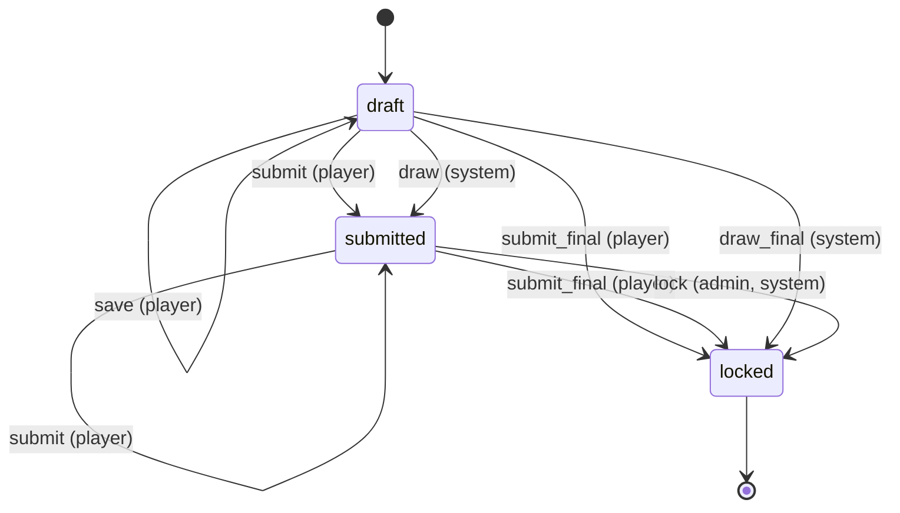
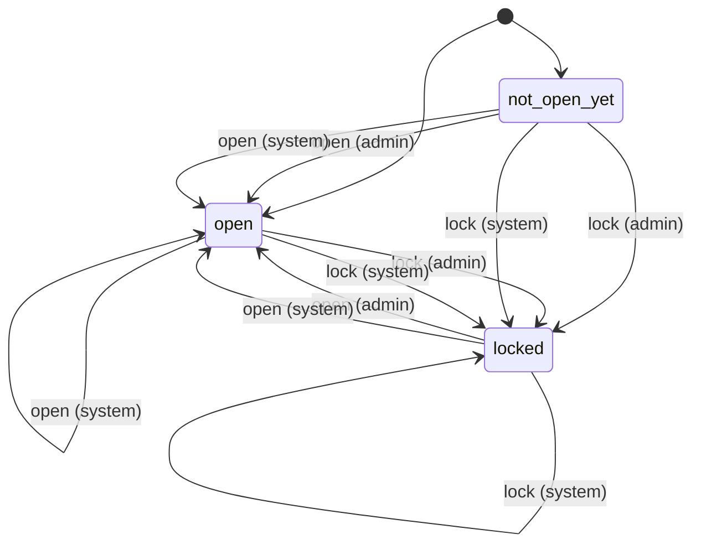
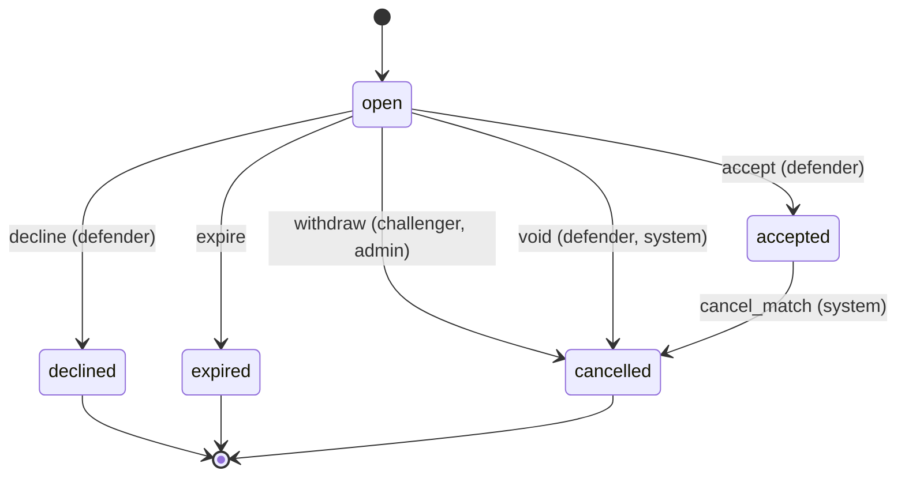
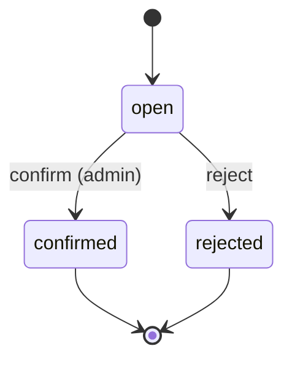
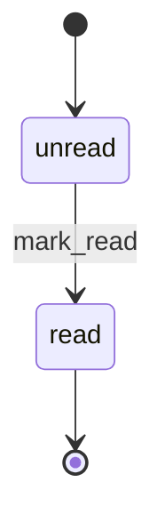
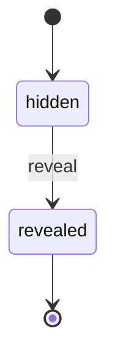
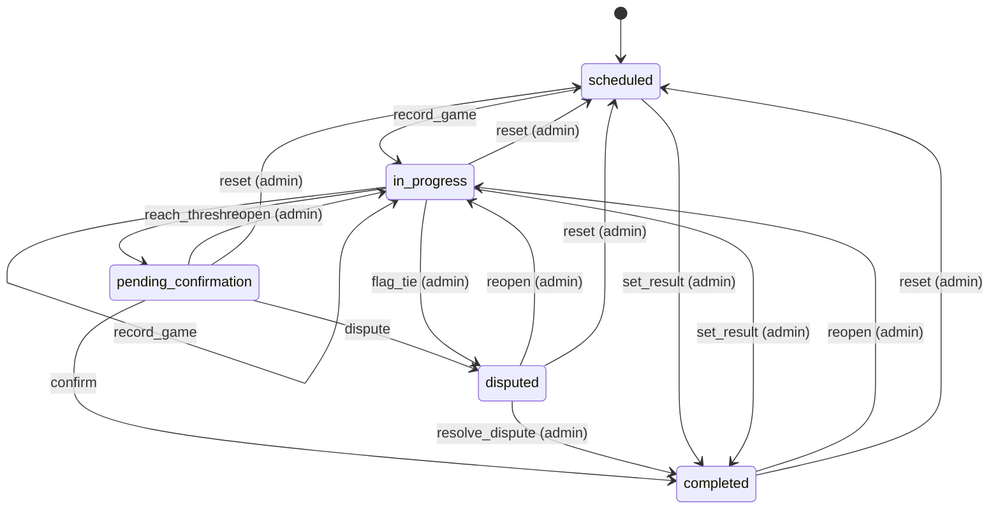
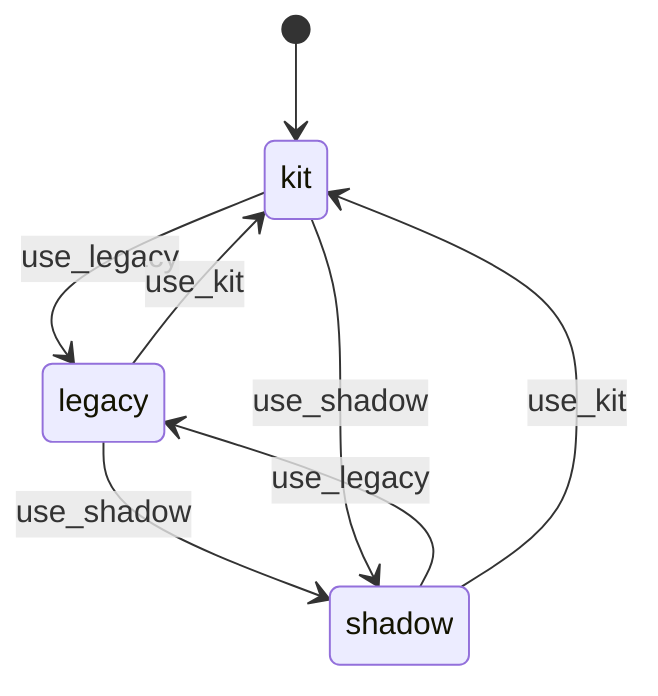

# State machines

<!-- Generated from src/lib/state-machine/registry.ts by `npm run docs:state-machines`. Do not edit by hand: change the machine's definition and regenerate. src/lib/state-machine/__tests__/docs.test.ts fails when this file is stale. -->

Each machine below is a column, timestamp or flag combination that moves through states, defined once, as data, with `defineMachine` (`src/lib/state-machine/machine.ts`). The rules for writers are in AGENTS.md ("Transitions go through the machine"); the decision is ADR 0004 (`docs/adr/0004-explicit-state-machines.md`).

- A writer calls `machine.assertTransition(from, to, actor)` before it writes, and guards the UPDATE with the source states (`.in(column, machine.sourcesOf(to))`, or `.eq(column, from)`), so a row that moved on in between is not overwritten.
- UI derives the available actions from `machine.transitionsFrom(state, actor)` instead of re-listing statuses.
- A refused move is an `IllegalTransitionError` (409, or 403 for the wrong actor) with a catalog code.

## Machines

- [Format action submission](#format-action-submission) — `format_action_submissions.status`
- [Format action window](#format-action-window) — `format_flags 'action:<id>' + the rule's window.opens_on`
- [Format challenge](#format-challenge) — `format_challenges.status`
- [Format check](#format-check) — `format_checks.status`
- [Format notification read](#format-notification-read) — `format_notifications.read_at`
- [Format relation reveal](#format-relation-reveal) — `format_relation_links.revealed_at`
- [Match](#match) — `matches.status (enum match_status)`
- [Season format engine](#season-format-engine) — `season_formats.engine`

## Format action submission

- **Id:** `format_action_submission`
- **State lives in:** format_action_submissions.status
- **Module doc:** `docs/format-kit.md`
- **States:** `draft`, `submitted`, `locked`
- **Actors:** `player`, `admin`, `system`

A player's pick for one player action. A draft is saved, a submission grants the pick's items, and a lock makes it final. Every writer in SQL refuses a locked row (action_locked); format_action_save writes only a draft and refuses a submitted pick under the action's lock (action_already_submitted, answered as format_action_already_submitted), so a save never demotes a submission.

| Event | From | To | Actors | Writers | Note |
| --- | --- | --- | --- | --- | --- |
| `save` | `draft` | `draft` | player | `src/lib/format-engine/runtime/actions-server.ts` `supabase/migrations/20261109090000_format_action_save_draft_only.sql#format_action_save` | Save draft. The first save inserts the row. |
| `submit` | `draft`, `submitted` | `submitted` | player | `src/lib/format-engine/runtime/actions-server.ts` `supabase/migrations/20261105090000_format_runtime.sql#format_action_submit` | Submit, or submit again: the new picks replace the old ones and their items; submitted_at records the last submission. |
| `submit_final` | `draft`, `submitted` | `locked` | player | `src/lib/format-engine/runtime/actions-server.ts` `supabase/migrations/20261105090000_format_runtime.sql#format_action_submit` | Submit on an action whose lock is on_submit: the pick is final at once. |
| `draw` | `draft` | `submitted` | system | `src/lib/format-engine/runtime/cron.ts` `supabase/migrations/20261105090000_format_runtime.sql#format_action_submit` | The cron's deadline pick (seeded_random_pick) for a player who has not submitted: p_only_if_unsubmitted refuses anything but a draft or no row (action_already_submitted). |
| `draw_final` | `draft` | `locked` | system | `src/lib/format-engine/runtime/cron.ts` `supabase/migrations/20261105090000_format_runtime.sql#format_action_submit` | The deadline pick on an action whose lock is on_submit. |
| `lock` | `submitted` | `locked` | admin, system | `src/lib/format-engine/runtime/adjust.ts` `src/lib/format-engine/runtime/effects.ts` `supabase/migrations/20261105090000_format_runtime.sql#format__apply_ops` | The window locks (lock_action op): every submitted pick becomes final. A draft stays a draft: it is not a submission. |

## Format action window

- **Id:** `format_action_window`
- **State lives in:** format_flags 'action:<id>' + the rule's window.opens_on
- **Module doc:** `docs/format-kit.md`
- **States:** `not_open_yet`, `open`, `locked`
- **Actors:** `admin`, `system`

When players may pick for a player action. The format's events and time marks open and lock it (format__apply_ops writes the flag unconditionally, so the system may repeat a move); an admin opens or locks it with an action adjustment, which refuses a move to the state the window is already in (action_state_unchanged). Opening a locked window does not unlock the picks the lock made final.

| Event | From | To | Actors | Writers | Note |
| --- | --- | --- | --- | --- | --- |
| `open` | `not_open_yet`, `locked` | `open` | admin | `src/lib/format-engine/runtime/adjust.ts` `supabase/migrations/20261105090000_format_runtime.sql#format__apply_ops` | Action adjustment with state open. Reopening a locked window leaves locked picks locked. |
| `open` | `not_open_yet`, `open`, `locked` | `open` | system | `src/lib/format-engine/runtime/effects.ts` `supabase/migrations/20261105090000_format_runtime.sql#format__apply_ops` | An event or time mark the rule's window.opens_on matches (open_action op). A late open after a lock reopens the window; the cron replays due marks in order (calendar.ts) so a later mark's lock wins. |
| `lock` | `not_open_yet`, `open` | `locked` | admin | `src/lib/format-engine/runtime/adjust.ts` `supabase/migrations/20261105090000_format_runtime.sql#format__apply_ops` | Action adjustment with state locked: locks every submitted pick too and fires action_locked. |
| `lock` | `not_open_yet`, `open`, `locked` | `locked` | system | `src/lib/format-engine/runtime/effects.ts` `src/lib/format-engine/runtime/cron.ts` `supabase/migrations/20261105090000_format_runtime.sql#format__apply_ops` | An event or time mark the rule's window.closes_on matches, or the cron's auto_lock policy (lock_action op): locks every submitted pick too. |

## Format challenge

- **Id:** `format_challenge`
- **State lives in:** format_challenges.status
- **Module doc:** `docs/format-kit.md`
- **States:** `open`, `accepted`, `declined`, `expired`, `cancelled`
- **Actors:** `challenger`, `defender`, `admin`, `system`

A ladder challenge from challenger to defender. Only an open challenge moves, except that deleting a round cancels the accepted challenges whose match it deletes. 'cancelled' covers a withdrawal, a player who left the phase and a deleted match; the cooldown counts every status but cancelled. The notify trigger writes a notification for every status change.

| Event | From | To | Actors | Writers | Note |
| --- | --- | --- | --- | --- | --- |
| `accept` | `open` | `accepted` | defender | `src/lib/supabase/queries/format-challenges.ts` `supabase/migrations/20261106090000_format_challenges.sql#format_challenge_respond` | The defender accepts while the engine is kit and the phase is not completed: a scheduled match is created in the open round. |
| `decline` | `open` | `declined` | defender | `src/lib/supabase/queries/format-challenges.ts` `supabase/migrations/20261106090000_format_challenges.sql#format_challenge_respond` |  |
| `withdraw` | `open` | `cancelled` | challenger, admin | `src/lib/supabase/queries/format-challenges.ts` `supabase/migrations/20261108090000_format_notifications.sql#format_challenge_cancel` | The challenger withdraws, or an admin for them. |
| `void` | `open` | `cancelled` | defender, system | `supabase/migrations/20261106090000_format_challenges.sql#format_challenge_respond` `supabase/migrations/20261106090000_format_challenges.sql#format_challenge_create` | A player left the phase: found by an accept (stored, then challenge_player_not_enrolled) or swept by the next create in the phase. |
| `expire` | `open` | `expired` | challenger, defender, admin, system | `src/lib/format-engine/challenge-server.ts` `supabase/migrations/20261106090000_format_challenges.sql#format_challenges_expire` `supabase/migrations/20261106090000_format_challenges.sql#format_challenge_create` `supabase/migrations/20261106090000_format_challenges.sql#format_challenge_respond` `supabase/migrations/20261108090000_format_notifications.sql#format_challenge_cancel` | The accept window ran out: the cron sweep, a create in the phase, or a late answer or withdrawal (stored, then challenge_expired). |
| `cancel_match` | `accepted` | `cancelled` | system | `supabase/migrations/20261109090000_format_action_save_draft_only.sql#round_delete` | Deleting a round with only scheduled matches cancels the accepted challenges whose match it deletes (the UPDATE is guarded by status = 'accepted'). |

## Format check

- **Id:** `format_check`
- **State lives in:** format_checks.status
- **Module doc:** `docs/format-kit.md`
- **States:** `open`, `confirmed`, `rejected`
- **Actors:** `admin`, `system`

A check the format opens for an admin (standings tie, missed deadline, team audit, pairing rule, unresolved outcome). An admin confirms or rejects it once; a match reset or reopen rejects the match's own open checks. A resolved check never reopens, and its dedupe key stays taken.

| Event | From | To | Actors | Writers | Note |
| --- | --- | --- | --- | --- | --- |
| `confirm` | `open` | `confirmed` | admin | `src/lib/format-engine/runtime/checks-server.ts` `supabase/migrations/20261105090000_format_runtime.sql#format_check_resolve` |  |
| `reject` | `open` | `rejected` | admin, system | `src/lib/format-engine/runtime/checks-server.ts` `src/lib/format-engine/runtime/hooks.ts` `supabase/migrations/20261105090000_format_runtime.sql#format_check_resolve` | An admin's verdict, or the system closing a match's checks when the match is reset or reopened (note match_reset). |

## Format notification read

- **Id:** `format_notification_read`
- **State lives in:** format_notifications.read_at
- **Module doc:** `docs/format-kit.md`
- **States:** `unread`, `read`
- **Actors:** `player`

A player's format notification, unread until the player marks it read. Nothing marks it unread again.

| Event | From | To | Actors | Writers | Note |
| --- | --- | --- | --- | --- | --- |
| `mark_read` | `unread` | `read` | player | `src/app/api/notifications/read/route.ts` `src/lib/supabase/queries/format-notifications.ts` | The player marks some or all of their own notifications read. |

## Format relation reveal

- **Id:** `format_relation_reveal`
- **State lives in:** format_relation_links.revealed_at
- **Module doc:** `docs/format-kit.md`
- **States:** `hidden`, `revealed`
- **Actors:** `admin`, `system`

Whether the links of a relation (a secret-santa draw) are visible to the players. A reveal on a relation without links changes no row, so a draw after the reveal event stays hidden; the planners only reveal links that exist.

| Event | From | To | Actors | Writers | Note |
| --- | --- | --- | --- | --- | --- |
| `reveal` | `hidden` | `revealed` | admin, system | `src/lib/format-engine/runtime/adjust.ts` `src/lib/format-engine/runtime/effects.ts` `supabase/migrations/20261105090000_format_runtime.sql#format__apply_ops` | A relation adjustment with reveal, or the event the relation's reveal_on matches. |

## Match

- **Id:** `match`
- **State lives in:** matches.status (enum match_status)
- **Module doc:** `docs/match.md`
- **States:** `scheduled`, `in_progress`, `pending_confirmation`, `completed`, `disputed`
- **Actors:** `player`, `admin`

A pairing from scheduling to a confirmed result (spec Section 8). Every status write clears finalized_at; a completion stamps confirmed_at and date_played and clears auto_confirm_at.

| Event | From | To | Actors | Writers | Note |
| --- | --- | --- | --- | --- | --- |
| `record_game` | `scheduled`, `in_progress` | `in_progress` | player, admin | `src/lib/pkmn/game-pipeline.ts` | A game is submitted and the series has no winner yet. |
| `reach_threshold` | `in_progress` | `pending_confirmation` | player, admin | `src/lib/pkmn/game-pipeline.ts` | A game gives one player the wins the best-of needs; auto_confirm_at starts the 24 h clock. |
| `confirm` | `pending_confirmation` | `completed` | player, admin | `src/app/api/confirm-match/[mid]/route.ts` `src/app/api/cron/auto-confirm/route.ts` | The opponent (not the submitter) or an admin confirms, or the auto-confirm cron does after 24 h. |
| `dispute` | `pending_confirmation` | `disputed` | player, admin | `src/app/api/confirm-match/[mid]/route.ts` | A participant flags the result. |
| `resolve_dispute` | `disputed` | `completed` | admin | `src/app/api/confirm-match/[mid]/route.ts` `src/app/api/admin/matches/[id]/result/route.ts` |  |
| `set_result` | `scheduled`, `in_progress` | `completed` | admin | `src/app/api/admin/matches/[id]/result/route.ts` `src/lib/match/bulk-actions.ts` `src/lib/format-engine/runtime/cron.ts` | An admin settles a no-show, a drop or a result agreed outside the app; no confirmation step. |
| `flag_tie` | `in_progress` | `disputed` | admin | `src/lib/pkmn/game-pipeline.ts` | The game pipeline, on the admins' behalf, when a replay is an engine tie. |
| `reopen` | `pending_confirmation`, `completed`, `disputed` | `in_progress` | admin | `src/lib/match/reopen.ts` | Withdraws the result and keeps the games. |
| `reset` | `in_progress`, `pending_confirmation`, `completed`, `disputed` | `scheduled` | admin | `src/lib/pkmn/game-pipeline.ts` | resetMatch / resetRound: deletes the games and rolls their aggregates back. |

## Season format engine

- **Id:** `season_format_engine`
- **State lives in:** season_formats.engine
- **Module doc:** `docs/format-kit.md`
- **States:** `legacy`, `shadow`, `kit`
- **Actors:** `admin`

The engine of a league's attached format. A first attach inserts the row with the column default kit; a replace keeps the engine; a detach deletes the row, so a detach and a new attach start again at kit. SQL knows only kit or not kit: shadow and legacy are the same to the database. Switching to kit makes the cron replay the league's finished matches; switching away stops new reactions and leaves open challenges open.

| Event | From | To | Actors | Writers | Note |
| --- | --- | --- | --- | --- | --- |
| `use_legacy` | `shadow`, `kit` | `legacy` | admin | `src/app/api/seasons/[id]/format/engine/route.ts` `src/lib/supabase/queries/season-formats.ts` |  |
| `use_shadow` | `legacy`, `kit` | `shadow` | admin | `src/app/api/seasons/[id]/format/engine/route.ts` `src/lib/supabase/queries/season-formats.ts` | Legacy tables stay in charge; the kit is computed alongside for the admin diff. |
| `use_kit` | `legacy`, `shadow` | `kit` | admin | `src/app/api/seasons/[id]/format/engine/route.ts` `src/lib/supabase/queries/season-formats.ts` | The docs advise going through shadow first; legacy to kit directly stays allowed. |
