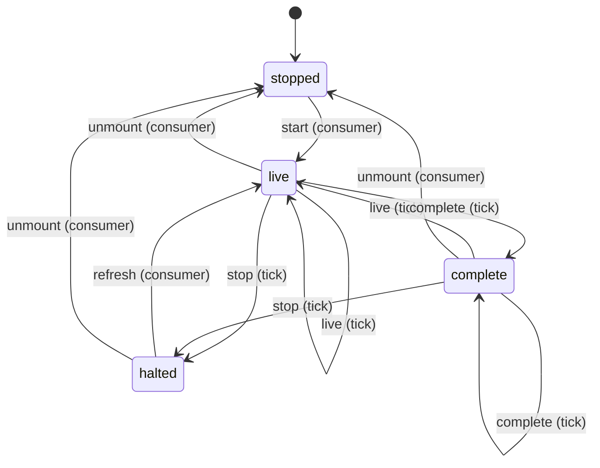
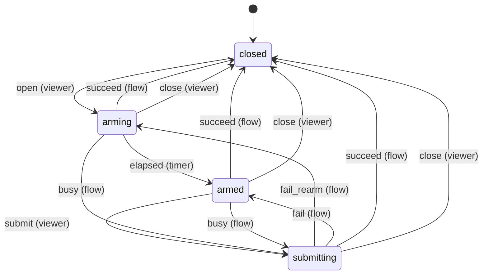
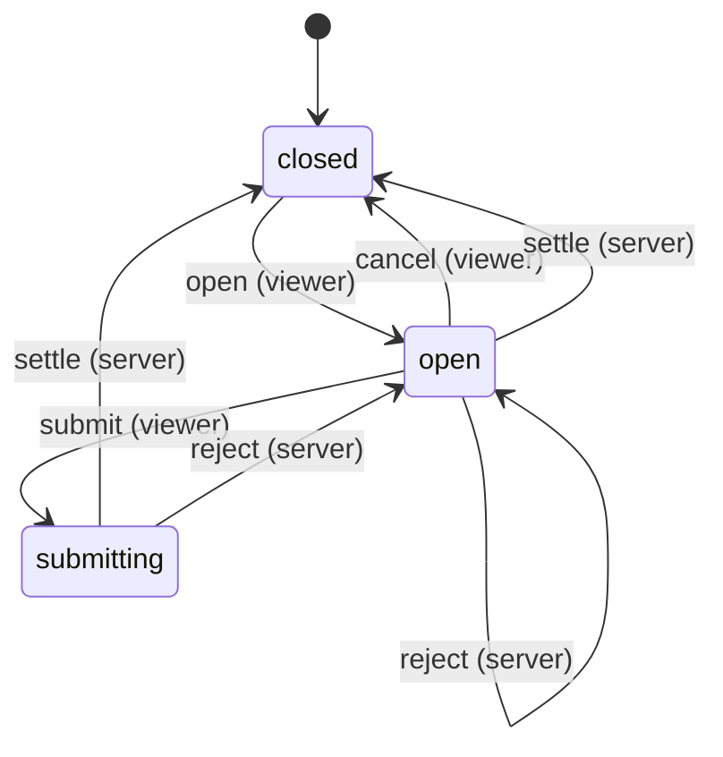
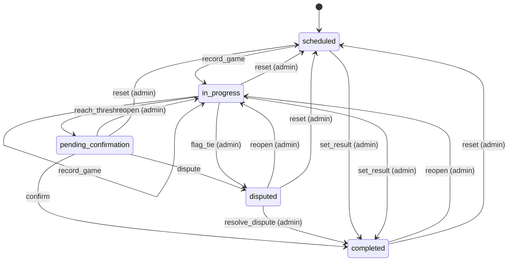
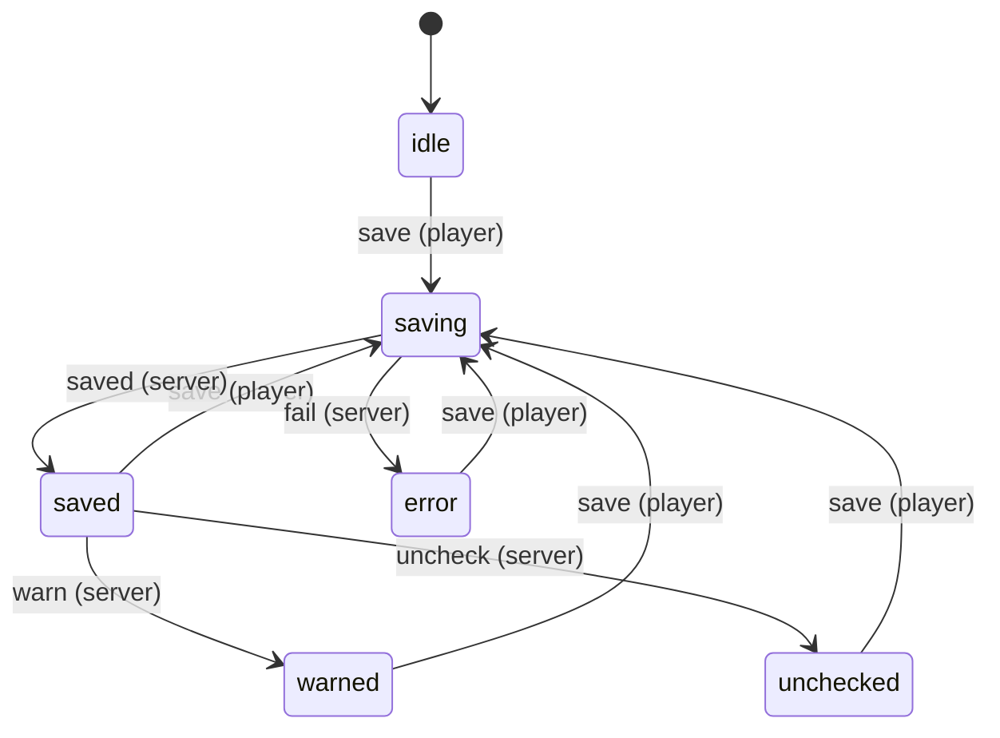

# State machines

<!-- Generated from src/lib/state-machine/registry.ts by `npm run docs:state-machines`. Do not edit by hand: change the machine's definition and regenerate. src/lib/state-machine/__tests__/docs.test.ts fails when this file is stale. -->

Each machine below is a column, timestamp or flag combination that moves through states, defined once, as data, with `defineMachine` (`src/lib/state-machine/machine.ts`). The rules for writers are in AGENTS.md ("Transitions go through the machine"); the decision is ADR 0004 (`docs/adr/0004-explicit-state-machines.md`).

- A writer calls `machine.assertTransition(from, to, actor)` before it writes, and guards the UPDATE with the source states (`.in(column, machine.sourcesOf(to))`, or `.eq(column, from)`), so a row that moved on in between is not overwritten.
- UI derives the available actions from `machine.transitionsFrom(state, actor)` instead of re-listing statuses.
- A refused move is an `IllegalTransitionError` (409, or 403 for the wrong actor) with a catalog code.

## Machines

- [Visible poller](#visible-poller) — `client: createVisiblePoller closure (src/lib/draft/use-visible-poll.ts)`
- [Draft room armed confirm](#draft-room-armed-confirm) — `client: armedConfirmReducer phase in ArmedConfirmDialog`
- [Draft room pick dialog](#draft-room-pick-dialog) — `client: pickFlowReducer state (open, submitting) in DraftToolClient`
- [Match](#match) — `matches.status (enum match_status)`
- [Push device (this browser)](#push-device-this-browser) — `client: NotifyState in usePushAlerts (browser permission + PushManager subscription)`
- [Teambuilder save](#teambuilder-save) — `client: EditorState.saveStatus in TeamsEditor`

## Visible poller

- **Id:** `client.visible_poller`
- **State lives in:** client: createVisiblePoller closure (src/lib/draft/use-visible-poll.ts)
- **Module doc:** `docs/draft-room.md`
- **States:** `stopped`, `live`, `complete`, `halted`
- **Actors:** `consumer`, `tick`

One poller per live draft screen (and the notification bell, the OBS draft overlay, the hidden-tab turn watch). A tick reports live, complete or stop; the poller schedules the next read from that. Ticks chain with setTimeout and never overlap.



| Event | From | To | Actors | Writers | Note |
| --- | --- | --- | --- | --- | --- |
| `start` | `stopped` | `live` | consumer | `src/lib/draft/use-visible-poll.ts` | Reads at once, also in a hidden tab. |
| `live` | `live`, `complete` | `live` | tick | `src/lib/draft/use-visible-poll.ts`<br>`src/components/draft-tool/hooks/use-draft-snapshot.ts`<br>`src/components/draft/draft-board-sync.ts`<br>`src/components/draft-tool/hooks/use-turn-watch.ts`<br>`src/components/draft-admin/pool-admin.tsx`<br>`src/components/notifications/NotificationBell.tsx`<br>`src/components/broadcast/overlays/DraftViewer.tsx` | Next read after liveIntervalMs. |
| `complete` | `live`, `complete` | `complete` | tick | `src/lib/draft/use-visible-poll.ts`<br>`src/components/draft-tool/hooks/use-draft-snapshot.ts`<br>`src/components/draft/draft-board-sync.ts`<br>`src/components/draft-tool/hooks/use-turn-watch.ts`<br>`src/components/draft-admin/pool-admin.tsx`<br>`src/components/notifications/NotificationBell.tsx`<br>`src/components/broadcast/overlays/DraftViewer.tsx` | Next read after completeIntervalMs (>= 60 s), or none when it is null. |
| `stop` | `live`, `complete` | `halted` | tick | `src/lib/draft/use-visible-poll.ts`<br>`src/components/draft-tool/hooks/use-draft-snapshot.ts`<br>`src/components/draft/draft-board-sync.ts`<br>`src/components/draft-tool/hooks/use-turn-watch.ts`<br>`src/components/draft-admin/pool-admin.tsx`<br>`src/components/notifications/NotificationBell.tsx`<br>`src/components/broadcast/overlays/DraftViewer.tsx` | 401/403: asking again cannot help. |
| `refresh` | `halted` | `live` | consumer | `src/lib/draft/use-visible-poll.ts` | refresh() after a write reads now; the read decides the next state. |
| `unmount` | `live`, `complete`, `halted` | `stopped` | consumer | `src/lib/draft/use-visible-poll.ts` | Aborts the running tick. |

## Draft room armed confirm

- **Id:** `draft_room.armed_confirm`
- **State lives in:** client: armedConfirmReducer phase in ArmedConfirmDialog
- **Module doc:** `docs/draft-room.md`
- **States:** `closed`, `arming`, `armed`, `submitting`
- **Actors:** `viewer`, `timer`, `flow`

The confirm button of a pick or token dialog is enabled only in armed: it stays disabled for CONFIRM_ARM_MS after every open and after every re-arming failure, and while a submission is in flight. A timer for an older arm token is ignored.



| Event | From | To | Actors | Writers | Note |
| --- | --- | --- | --- | --- | --- |
| `open` | `closed` | `arming` | viewer | `src/lib/draft-ui/armed-confirm.ts`<br>`src/components/draft-tool/shared/ArmedConfirmDialog.tsx` |  |
| `elapsed` | `arming` | `armed` | timer | `src/lib/draft-ui/armed-confirm.ts`<br>`src/components/draft-tool/shared/ArmedConfirmDialog.tsx` | Only the timer of the current arm token. |
| `submit` | `armed` | `submitting` | viewer | `src/lib/draft-ui/armed-confirm.ts`<br>`src/components/draft-tool/shared/ArmedConfirmDialog.tsx` |  |
| `busy` | `arming`, `armed` | `submitting` | flow | `src/lib/draft-ui/armed-confirm.ts`<br>`src/components/draft-tool/shared/ArmedConfirmDialog.tsx` | The caller reports a submission in flight. |
| `fail_rearm` | `submitting` | `arming` | flow | `src/lib/draft-ui/armed-confirm.ts`<br>`src/components/draft-tool/shared/ArmedConfirmDialog.tsx` | Default after a failure: a new arm token. |
| `fail` | `submitting` | `armed` | flow | `src/lib/draft-ui/armed-confirm.ts`<br>`src/components/draft-tool/shared/ArmedConfirmDialog.tsx` | `failed` with `rearm: false`. |
| `succeed` | `arming`, `armed`, `submitting` | `closed` | flow | `src/lib/draft-ui/armed-confirm.ts`<br>`src/components/draft-tool/shared/ArmedConfirmDialog.tsx` |  |
| `close` | `arming`, `armed`, `submitting` | `closed` | viewer | `src/lib/draft-ui/armed-confirm.ts`<br>`src/components/draft-tool/shared/ArmedConfirmDialog.tsx` |  |

## Draft room pick dialog

- **Id:** `draft_room.pick_flow`
- **State lives in:** client: pickFlowReducer state (open, submitting) in DraftToolClient
- **Module doc:** `docs/draft-room.md`
- **States:** `closed`, `open`, `submitting`
- **Actors:** `viewer`, `server`

The confirm dialog of one pick. The request id minted on open is reused for every retry of that dialog (idempotent on the server); a cancel is refused while a pick is in flight. A server answer either closes the dialog (success, or an error that makes it moot: CLOSING_PICK_ERRORS) or reopens it with the error inline (network errors offer Retry).



| Event | From | To | Actors | Writers | Note |
| --- | --- | --- | --- | --- | --- |
| `open` | `closed` | `open` | viewer | `src/components/draft-tool/hooks/pick-flow.ts`<br>`src/components/draft-tool/DraftToolClient.tsx` | Mints the request id; an open dialog ignores a second open. |
| `submit` | `open` | `submitting` | viewer | `src/components/draft-tool/hooks/pick-flow.ts`<br>`src/components/draft-tool/DraftToolClient.tsx` | Clears the previous error. |
| `cancel` | `open` | `closed` | viewer | `src/components/draft-tool/hooks/pick-flow.ts`<br>`src/components/draft-tool/DraftToolClient.tsx` | Not while a pick is in flight. |
| `settle` | `open`, `submitting` | `closed` | server | `src/components/draft-tool/hooks/pick-flow.ts`<br>`src/components/draft-tool/DraftToolClient.tsx` | Success, or a closing error (toast + refresh). |
| `reject` | `open`, `submitting` | `open` | server | `src/components/draft-tool/hooks/pick-flow.ts`<br>`src/components/draft-tool/DraftToolClient.tsx` | A validation or network error stays inline; network errors set retryable. |

## Match

- **Id:** `match`
- **State lives in:** matches.status (enum match_status)
- **Module doc:** `docs/match.md`
- **States:** `scheduled`, `in_progress`, `pending_confirmation`, `completed`, `disputed`
- **Actors:** `player`, `admin`

A pairing from scheduling to a confirmed result (spec Section 8). Every status write clears finalized_at; a completion stamps confirmed_at and date_played and clears auto_confirm_at.



| Event | From | To | Actors | Writers | Note |
| --- | --- | --- | --- | --- | --- |
| `record_game` | `scheduled`, `in_progress` | `in_progress` | player, admin | `src/lib/pkmn/game-pipeline.ts` | A game is submitted and the series has no winner yet. |
| `reach_threshold` | `in_progress` | `pending_confirmation` | player, admin | `src/lib/pkmn/game-pipeline.ts` | A game gives one player the wins the best-of needs; auto_confirm_at starts the 24 h clock. |
| `confirm` | `pending_confirmation` | `completed` | player, admin | `src/app/api/confirm-match/[mid]/route.ts`<br>`src/app/api/cron/auto-confirm/route.ts` | The opponent (not the submitter) or an admin confirms, or the auto-confirm cron does after 24 h. |
| `dispute` | `pending_confirmation` | `disputed` | player, admin | `src/app/api/confirm-match/[mid]/route.ts` | A participant flags the result. |
| `resolve_dispute` | `disputed` | `completed` | admin | `src/app/api/confirm-match/[mid]/route.ts`<br>`src/app/api/admin/matches/[id]/result/route.ts` |  |
| `set_result` | `scheduled`, `in_progress` | `completed` | admin | `src/app/api/admin/matches/[id]/result/route.ts`<br>`src/lib/match/bulk-actions.ts`<br>`src/lib/format-engine/runtime/cron.ts` | An admin settles a no-show, a drop or a result agreed outside the app; no confirmation step. |
| `flag_tie` | `in_progress` | `disputed` | admin | `src/lib/pkmn/game-pipeline.ts` | The game pipeline, on the admins' behalf, when a replay is an engine tie. |
| `reopen` | `pending_confirmation`, `completed`, `disputed` | `in_progress` | admin | `src/lib/match/reopen.ts` | Withdraws the result and keeps the games. |
| `reset` | `in_progress`, `pending_confirmation`, `completed`, `disputed` | `scheduled` | admin | `src/lib/pkmn/game-pipeline.ts` | resetMatch / resetRound: deletes the games and rolls their aggregates back. |

## Push device (this browser)

- **Id:** `push.device`
- **State lives in:** client: NotifyState in usePushAlerts (browser permission + PushManager subscription)
- **Module doc:** `docs/push.md`
- **States:** `unsupported`, `install-required`, `denied`, `ask`, `off`, `on`, `busy`, `failed`
- **Actors:** `browser`, `viewer`, `switch`

Whether THIS browser gets push alerts. The browser read on mount (and on a language change) sets the state from the permission and the subscription; a click on the bell switches it through busy. A server that answers push_disabled hides the control for good.

```mermaid
stateDiagram-v2
  [*] --> unsupported
  unsupported --> unsupported: read_unsupported (browser)
  install-required --> unsupported: read_unsupported (browser)
  denied --> unsupported: read_unsupported (browser)
  ask --> unsupported: read_unsupported (browser)
  off --> unsupported: read_unsupported (browser)
  on --> unsupported: read_unsupported (browser)
  busy --> unsupported: read_unsupported (browser)
  failed --> unsupported: read_unsupported (browser)
  unsupported --> install-required: read_install-required (browser)
  install-required --> install-required: read_install-required (browser)
  denied --> install-required: read_install-required (browser)
  ask --> install-required: read_install-required (browser)
  off --> install-required: read_install-required (browser)
  on --> install-required: read_install-required (browser)
  busy --> install-required: read_install-required (browser)
  failed --> install-required: read_install-required (browser)
  unsupported --> denied: read_denied (browser)
  install-required --> denied: read_denied (browser)
  denied --> denied: read_denied (browser)
  ask --> denied: read_denied (browser)
  off --> denied: read_denied (browser)
  on --> denied: read_denied (browser)
  busy --> denied: read_denied (browser)
  failed --> denied: read_denied (browser)
  unsupported --> ask: read_ask (browser)
  install-required --> ask: read_ask (browser)
  denied --> ask: read_ask (browser)
  ask --> ask: read_ask (browser)
  off --> ask: read_ask (browser)
  on --> ask: read_ask (browser)
  busy --> ask: read_ask (browser)
  failed --> ask: read_ask (browser)
  unsupported --> off: read_off (browser)
  install-required --> off: read_off (browser)
  denied --> off: read_off (browser)
  ask --> off: read_off (browser)
  off --> off: read_off (browser)
  on --> off: read_off (browser)
  busy --> off: read_off (browser)
  failed --> off: read_off (browser)
  unsupported --> on: read_on (browser)
  install-required --> on: read_on (browser)
  denied --> on: read_on (browser)
  ask --> on: read_on (browser)
  off --> on: read_on (browser)
  on --> on: read_on (browser)
  busy --> on: read_on (browser)
  failed --> on: read_on (browser)
  ask --> busy: toggle (viewer)
  off --> busy: toggle (viewer)
  on --> busy: toggle (viewer)
  failed --> busy: toggle (viewer)
  busy --> on: enabled (switch)
  busy --> off: disabled (switch)
  busy --> ask: dismissed (switch)
  busy --> denied: refused (switch)
  busy --> failed: fail (switch)
  busy --> unsupported: push_disabled (switch)
```

| Event | From | To | Actors | Writers | Note |
| --- | --- | --- | --- | --- | --- |
| `read_unsupported` | `unsupported`, `install-required`, `denied`, `ask`, `off`, `on`, `busy`, `failed` | `unsupported` | browser | `src/components/draft-tool/hooks/use-turn-watch.ts`<br>`src/lib/push/client.ts` | readPushState after mount or a language change. |
| `read_install-required` | `unsupported`, `install-required`, `denied`, `ask`, `off`, `on`, `busy`, `failed` | `install-required` | browser | `src/components/draft-tool/hooks/use-turn-watch.ts`<br>`src/lib/push/client.ts` | readPushState after mount or a language change. |
| `read_denied` | `unsupported`, `install-required`, `denied`, `ask`, `off`, `on`, `busy`, `failed` | `denied` | browser | `src/components/draft-tool/hooks/use-turn-watch.ts`<br>`src/lib/push/client.ts` | readPushState after mount or a language change. |
| `read_ask` | `unsupported`, `install-required`, `denied`, `ask`, `off`, `on`, `busy`, `failed` | `ask` | browser | `src/components/draft-tool/hooks/use-turn-watch.ts`<br>`src/lib/push/client.ts` | readPushState after mount or a language change. |
| `read_off` | `unsupported`, `install-required`, `denied`, `ask`, `off`, `on`, `busy`, `failed` | `off` | browser | `src/components/draft-tool/hooks/use-turn-watch.ts`<br>`src/lib/push/client.ts` | readPushState after mount or a language change. |
| `read_on` | `unsupported`, `install-required`, `denied`, `ask`, `off`, `on`, `busy`, `failed` | `on` | browser | `src/components/draft-tool/hooks/use-turn-watch.ts`<br>`src/lib/push/client.ts` | readPushState after mount or a language change. |
| `toggle` | `ask`, `off`, `on`, `failed` | `busy` | viewer | `src/components/draft-tool/hooks/use-turn-watch.ts`<br>`src/components/draft-tool/feedback/NotifyToggle.tsx` | Only a click; install-required and denied open their hint instead. |
| `enabled` | `busy` | `on` | switch | `src/components/draft-tool/hooks/use-turn-watch.ts`<br>`src/lib/push/client.ts` |  |
| `disabled` | `busy` | `off` | switch | `src/components/draft-tool/hooks/use-turn-watch.ts`<br>`src/lib/push/client.ts` |  |
| `dismissed` | `busy` | `ask` | switch | `src/components/draft-tool/hooks/use-turn-watch.ts` | The permission prompt was closed without an answer. |
| `refused` | `busy` | `denied` | switch | `src/components/draft-tool/hooks/use-turn-watch.ts` |  |
| `fail` | `busy` | `failed` | switch | `src/components/draft-tool/hooks/use-turn-watch.ts` | Keeps the previous on/off; retryable. |
| `push_disabled` | `busy` | `unsupported` | switch | `src/components/draft-tool/hooks/use-turn-watch.ts` | The server has no push configuration, or the browser cannot subscribe. |

## Teambuilder save

- **Id:** `teambuilder.save`
- **State lives in:** client: EditorState.saveStatus in TeamsEditor
- **Module doc:** `docs/teambuilder-editor.md`
- **States:** `idle`, `saving`, `saved`, `warned`, `unchecked`, `error`
- **Actors:** `player`, `server`

One save of the team (POST /api/teams, PATCH /api/teams/[id], or POST /api/match-prep in plan mode). A save never overlaps another one. An edit made while a save is in flight keeps the team dirty after the save lands.



| Event | From | To | Actors | Writers | Note |
| --- | --- | --- | --- | --- | --- |
| `save` | `idle`, `saved`, `warned`, `unchecked`, `error` | `saving` | player | `src/components/teambuilder/v3/hooks/useTeamSave.ts`<br>`src/components/teambuilder/v3/editor/state.ts` | The Save button; disabled while saving. |
| `saved` | `saving` | `saved` | server | `src/components/teambuilder/v3/hooks/useTeamSave.ts`<br>`src/components/teambuilder/v3/editor/state.ts` | MARK_SAVED: clean unless the team was edited during the save. |
| `fail` | `saving` | `error` | server | `src/components/teambuilder/v3/hooks/useTeamSave.ts`<br>`src/components/teambuilder/v3/editor/state.ts` | One generic label; a 409 for a completed match also locks the editor. |
| `warn` | `saved` | `warned` | server | `src/components/teambuilder/v3/hooks/useTeamSave.ts`<br>`src/components/teambuilder/v3/editor/state.ts` | Saved; the league rules are not met (the verdict goes to the validation panel). |
| `uncheck` | `saved` | `unchecked` | server | `src/components/teambuilder/v3/hooks/useTeamSave.ts`<br>`src/components/teambuilder/v3/editor/state.ts` | Saved; the league rules could not be checked. |
